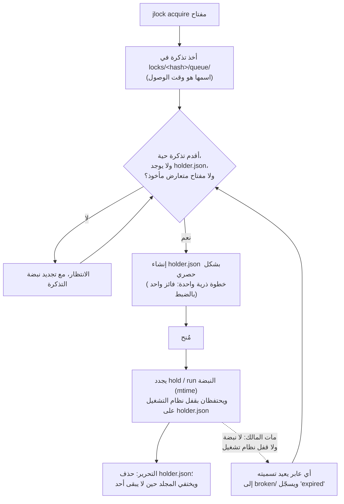

<!-- languages -->
[English](README.md) · [Português (Brasil)](README.pt-BR.md) · [Español](README.es.md) · [Français](README.fr.md) · [Deutsch](README.de.md) · [Italiano](README.it.md) · [简体中文](README.zh-CN.md) · [日本語](README.ja.md) · [Русский](README.ru.md) · [العربية](README.ar.md) · [हिन्दी](README.hi.md)

<div dir="rtl">

# jlock

**يتيح jlock للبرامج والسكربتات والأشخاص ووكلاء الذكاء الاصطناعي على الجهاز نفسه أن يتناوبوا على الملفات
والمجلدات وأي شيء آخر، بلا خادم.**

## لماذا وُجد jlock

بدأت فكرة jlock مع وكلاء البرمجة بالذكاء الاصطناعي. حين كان عدة وكلاء يعملون في المستودع نفسه في الوقت
نفسه، كان بعضهم يتعثر ببعض: يعدّل اثنان منهم الملف نفسه، أو يعيد أحدهم كتابة مجلد بينما يبنيه آخر. أدوات
التحرير التي يستخدمونها تفتح الملف وتكتبه وتغلقه في أجزاء من الثانية، فلا يلاحظ نظام التشغيل أي تعارض. لكن
*الملكية* التي يحتاجها الوكيل تدوم طوال المهمة: دقائق، عبر عشرات التعديلات وعمليات كثيرة قصيرة العمر. كان
ينقص شيء واحد: طريقة لقول "هذا الملف لي حتى أنتهي"، يراها كل وكيل آخر، وتنظّف نفسها بنفسها إن تعطّل الوكيل.

والحاجة نفسها تظهر في كل مكان آخر: عمليتا بناء تكتبان في مجلد `dist` نفسه، أو عمليتا نشر إلى الخادم
نفسه، أو خادما تطوير يريد كلاهما المنفذ 3000، أو سكربت ليلي يجب ألا يعمل مرتين. jlock أمر صغير واحد لكل
هذه الحالات.

## المشكلة بدقة

يبدو التناوب أمرًا بسيطًا. لكن تنفيذه بشكل صحيح على جهاز واحد، بلا خادم، يعني حل كل ما يلي:

- **طلبان في اللحظة نفسها.** قراءة "هل هو حر؟" ثم كتابة "إنه لي" خطوتان منفصلتان؛ وقد تقرأ عمليتان
  كلتاهما "حر". يحسم jlock الأمر بعملية ذرية واحدة من عمليات نظام الملفات.
- **موت المالك.** العملية التي تعطّلت لا تستطيع تحرير أي شيء. يستعيد jlock أقفالها بنفسه، ويسجّل أنه فعل
  ذلك.
- **ترتيب الوصول.** من طلب أولًا يجب أن يحصل أولًا، لا من صادف أن أعاد المحاولة في اللحظة المناسبة. يحتفظ
  jlock بطابور حقيقي.
- **الجمود (deadlock).** يملك A القفل على `x` وينتظر `y`؛ ويملك B القفل على `y` وينتظر `x`؛ فينتظر
  كلاهما إلى الأبد. يرى jlock هذه الحلقة ويرفض الطلب الذي كان سيغلقها.
- **معرفة من يملك ماذا.** حين يعلق شيء ما، تحتاج إلى أن ترى من يملكه، ومنذ متى، ومن ينتظره. يسرد jlock ذلك
  كله، ويتيح لك كسر قفل في حالات الطوارئ.

## لماذا لا نستخدم شيئًا موجودًا أصلًا

| الخيار | ما يقدّمه | ما ينقصه |
|---|---|---|
| أوضاع المشاركة في Windows (فتح ملف بشكل حصري) | يرفض نظام التشغيل أي فتح آخر للملف | لا يدوم إلا ما دام الملف مفتوحًا (أجزاء من الثانية في المحرر)؛ يحجب محررك أنت أيضًا؛ بلا طابور، وبلا معرفة "من" |
| الـ mutex المسمّى في Windows | قفل يموت مع عمليته | يحتاج إلى عملية تمسكه طوال الوقت؛ بلا ترتيب عادل؛ بلا قائمة |
| `flock(1)` + `lslocks` (Linux) | الاحتفاظ بقفل أثناء تشغيل أمر؛ وسرد الأقفال حسب PID | غير متاح على Windows؛ بلا ترتيب وصول؛ بلا هوية سوى PID؛ بلا كشف للجمود؛ لا يحتفظ بالقفل عبر أوامر منفصلة |
| `proper-lockfile` (npm) | قفل المجلدات، وكشف الأقفال القديمة عبر mtime | بلا طابور (محاولات عشوائية)؛ بلا CLI؛ بلا قائمة شاملة |

## التثبيت

على Linux و macOS:

<div dir="ltr">

```
curl -fsSL https://raw.githubusercontent.com/rodrigojager/jlock/main/install.sh | sh
```

</div>

على Windows (PowerShell):

<div dir="ltr">

```
irm https://raw.githubusercontent.com/rodrigojager/jlock/main/install.ps1 | iex
```

</div>

باستخدام Rust: `cargo install jlock`، أو `cargo binstall jlock` (ينزّل الملف التنفيذي الجاهز من الإصدار)، أو
من الشيفرة المصدرية: `cargo install --path .`. ثم تحقّق، في طرفية جديدة، من أن كل شيء في مكانه:

<div dir="ltr">

```
jlock doctor
```

</div>

## خمس دقائق

تأخذ أليس (`alice`) قفلًا على اسم. ثم يطلب بوب (`bob`) الاسم نفسه دون أن ينتظر، فيُخبَر بمن يملكه. بعد ذلك
تُرجع أليس القفل:

<!-- jlock-example -->
<div dir="ltr">

```text
$ jlock acquire name:demo --owner alice
مُنح name:demo
$ jlock acquire name:demo --owner bob --no-wait
مشغول name:demo لدى alice (الموضع 1)
تلميح: jlock status name:demo يعرض من يملكه والطابور؛ احذف --no-wait لتنتظر دورك
$ jlock release name:demo --owner alice
حُرّر name:demo
$ jlock status name:demo
حر name:demo
```

</div>

لو لم يستخدم بوب `--no-wait`، لانتظر دوره في الطابور ببساطة، ولحصل على القفل لحظة تحرّره أليس.
والأمر `jlock help acquire` يشرح كل خيار.

## الاستخدام من وكيل

يأخذ الوكيل (Claude Code أو OpenCode أو Codex أو أي وكيل آخر) ما هو على وشك تغييره، ويحتفظ به أثناء عمله،
ثم يُرجعه في النهاية:

1. الأمر `jlock acquire src/parser.rs src/lexer.rs --owner agent-7 --group task-42 --intent "T4 parser" --json`
   يأخذ الملفين معًا أو لا يأخذ أيًّا منهما، وينتظر دوره. الخيار `--owner` هو هوية الوكيل عبر الأوامر كلها؛
   والخيار `--group` يربط معًا كل ما تحتفظ به مهمة واحدة.
2. الأمر `jlock hold src/parser.rs src/lexer.rs --owner agent-7` يعمل في الخلفية ويُبقي القفل حيًا (ويُمنح
   فورًا، لأن المالك يملك الملفين أصلًا). وإن لم تستخدمه، فاستدعِ `jlock heartbeat` مرة واحدة على الأقل كل
   30 ثانية.
3. الأمر `jlock release --group task-42 --owner agent-7` في النهاية؛ أو اكتب السطر `release` في الدخل
   القياسي لـ `hold`.
4. إن خرج `hold` بالرمز 14 (`lost`)، فهذا يعني أن أحدًا كسر القفل أو أن صلاحيته انتهت: توقّف عن التعديل.

مع `--json`، يطبع كل أمر كائن JSON واحدًا، وهو نفسه في كل اللغات:

<!-- jlock-example -->
<div dir="ltr">

```text
$ jlock acquire name:port-3000 --owner agent-7 --json
{"key":"name:port-3000","keys":["name:port-3000"],"owner":"agent-7","result":"granted","waited_ms":0}
```

</div>

## الاستخدام من سكربت

يعمل `jlock run` مثل `flock(1)`: يأخذ المفاتيح، ويشغّل الأمر، ويُبقي القفل حيًا أثناء تشغيل الأمر، ويحرّره
في النهاية، ثم يخرج برمز خروج الأمر نفسه.

<div dir="ltr">

```
jlock run D:\proj\dist -- cargo build --release      # عملية بناء واحدة في كل مرة على هذا الجهاز
jlock run name:deploy-prod --timeout 2m -- ./deploy.sh
```

</div>

في المثال التالي، الأمر الذي يشغّله `run` هو jlock نفسه، فترى القفل محتجزًا أثناء التشغيل:

<!-- jlock-example -->
<div dir="ltr">

```text
$ jlock run name:nightly -- jlock list
المفتاح       المالك      المجموعة  الغرض  المدة  النبضة  الطابور
name:nightly  pid:188824  -         -      20ms   19ms    0

الأقفال: 1, في الانتظار: 0
$ jlock list
لا شيء مقفل
```

</div>

## الاستخدام كشخص

- الأمر `jlock list --watch` يعرض كل ما هو مقفل على الجهاز، ويعيد رسمه كل ثانية.
- الأمر `jlock status <key>` يعرض من يملك مفتاحًا واحدًا، والطابور، وما يحجبه.
- الأمر `jlock graph` يعرض من ينتظر من.
- الأمر `jlock unlock <key> --force --reason "..."` يكسر قفل شخص آخر في حالات الطوارئ؛ ويحفظ السجل من فعل
  ذلك ولماذا، ويتوقف `hold`/`run` لدى المالك.

<!-- jlock-example -->
<div dir="ltr">

```text
$ jlock acquire name:printer --owner alice --intent "printing the report"
مُنح name:printer
$ jlock unlock name:printer --force --reason "alice went home"
كُسر name:printer قسرًا (كان لدى alice)
$ jlock graph
لا منتظرين
```

</div>

## كيف يعمل

الحالة مجلد على القرص (`%LOCALAPPDATA%\jlock` على Windows، و `~/.local/state/jlock` على Linux، و
`~/Library/Application Support/jlock` على macOS). لا يلزم أن يبقى أي شيء قيد التشغيل، ولا يضيع شيء إن
تعطّلت أي عملية.

<div dir="ltr">



</div>

- **مجلد واحد لكل مفتاح**، اسمه هو SHA-1 للمفتاح بعد توحيد صيغته. الملف `holder.json` موجود ما دام المفتاح
  مأخوذًا فقط، ويقول من يملكه.
- **تذكرة لكل منتظِر** في `queue/`، اسمها هو وقت وصوله: وحدها أقدم تذكرة حية يمكنها أخذ القفل، لذا فالترتيب
  هو ترتيب الوصول.
- **النبضة**: يلمس المالكون والمنتظرون ملفاتهم كل 5 ثوانٍ. الملف الذي لم يُلمس منذ 30 ثانية يخص عملية ميتة،
  ويحذفه أول من يراه. ويحتفظ `hold` و `run` أيضًا بقفل من نظام التشغيل على `holder.json`، تُسقطه النواة
  (kernel) لحظة موت العملية، فلا يُعَدّ المالك البطيء الحي ميتًا أبدًا.
- **الجمود**: الملفات نفسها تصف من ينتظر من؛ والطلب الذي كان سيغلق حلقة يُرفض، مع عرض السلسلة.
- **لا مخلفات**: حين لا يكون شيء مقفلًا، يكون المجلد `locks` فارغًا.

## الضمانات والحدود

| ما يضمنه jlock | ما لا يفعله jlock (ولماذا لا بأس بذلك) |
|---|---|
| مالك واحد لكل مفتاح في أي لحظة | منع البرامج التي لا تستخدم jlock: الأقفال استشارية، مثل `flock` |
| ترتيب وصول صارم بين المنتظرين الأحياء | التسليم الفوري: يلاحظ التالي خلال ربع ثانية |
| قفل المالك الميت يُستعاد خلال 30 ثانية، ويُسجَّل ذلك | التمييز بين الميت والمتجمد مع `acquire` وحده (المالك المتجمد يجد `lost` فيتوقف)؛ أما مع `hold`/`run` فقفل نظام التشغيل يميّز بينهما |
| كشف الجمود وحلّه بالطريقة نفسها في كل مرة | التنسيق بين أجهزة مختلفة |
| القائمة هي الحقيقة دائمًا: إنها المجلد نفسه | — |
| لا يلزم أن تبقى أي عملية قيد التشغيل | التنظيف دون أي استدعاء: المخلفات تنتظر الأمر التالي أو `jlock gc` |
| مجلد `locks` فارغ حين لا يكون شيء مقفلًا | — |

## المفاتيح

| المفتاح | المعنى | يتعارض مع |
|---|---|---|
| مسار: `D:\proj\src\a.ts`، `src/a.ts`، `~/notes`، `.` | ذلك الملف أو المجلد؛ المسارات النسبية تبدأ من المجلد الحالي؛ ولا يلزم أن يكون المسار موجودًا | المسار نفسه، وكل ما بداخله، وكل مجلد فوقه، و `*` |
| `name:<text>` | أي شيء ليس مسارًا: `name:port-3000`، `name:deploy-prod` | الاسم نفسه، و `*` |
| `*` | كل شيء | كل مفتاح |

على Windows و macOS لا يُفرَّق بين الأحرف الكبيرة والصغيرة (`D:\Proj\SRC` و `d:/proj/src` مفتاح واحد).
والمفاتيح المتعددة في أمر واحد تُؤخذ كلها أو لا يُؤخذ أي منها، بترتيب ثابت، فلا تسبب جمودًا فيما بينها أبدًا.

## رموز الخروج

| الرمز | المعنى |
|---|---|
| 0 | مُنح / تم |
| 2 | استخدام خاطئ |
| 10 | مشغول (مع `--no-wait`) |
| 11 | انتهت المهلة (مع `--timeout`) |
| 12 | جمود: الطلب كان سيغلق حلقة |
| 13 | لست المالك |
| 14 | فُقد القفل (`hold`/`run`) |
| 20 | خطأ في نظام الملفات؛ والرسالة تحمل خطأ نظام التشغيل |
| 130 | مُقاطَع (CTRL+C) أثناء الانتظار |

بعد منح القفل، يخرج `jlock run` برمز خروج الأمر نفسه.

## الإعدادات

| المتغير | الافتراضي | الاستخدام |
|---|---|---|
| `JLOCK_HOME` | حسب النظام (انظر أعلاه) | مكان السجل |
| `JLOCK_LANG` | لغة النظام | لغة المخرجات النصية: `en`، `pt-BR`، `es`، `fr`، `de`، `it`، `zh-CN`، `ja`، `ru`، `ar`، `hi` (وأيضًا `--lang`) |
| `JLOCK_HINTS` | `1` | القيمة `0` توقف التلميحات |
| `JLOCK_HEARTBEAT_MS` | 5000 | كل كم يجدد المالكون والمنتظرون |
| `JLOCK_STALE_MS` | 30000 | غياب التجديد طوال هذه المدة = ميت |
| `JLOCK_POLL_MS` | 250 | كل كم ينظر المنتظِر |
| `JLOCK_SWEEP_MS` | 60000 | أقل مدة بين عمليتي تنظيف شامل |
| `JLOCK_LOG_MAX_BYTES` | 5242880 | الحجم الذي يُدوَّر عنده `log.jsonl` |

الأوامر والخيارات و `--json` وسجل الأحداث ورموز الخروج هي نفسها في كل اللغات.

## التحديث

<div dir="ltr">

```
jlock update --check   # هل يوجد إصدار أحدث؟
jlock update           # تثبيته
```

</div>

يُنزّل `update` الإصدار الخاص بنظامك، ويتحقق منه مقابل `SHA256SUMS` الخاص بالإصدار، ويستبدل الملف التنفيذي
الذي يعمل، ثم يشغّله مرة قبل أن يعلن النجاح. يستخدم `curl` الخاص بالنظام. وهو الأمر الوحيد الذي يستخدم
الشبكة، وفقط حين تشغّله أنت.

## المساهمة

انظر [`CONTRIBUTING.md`](CONTRIBUTING.md). النصوص التي يطبعها jlock متوفرة بإحدى عشرة لغة، و**مراجعات
الصياغة مرحَّب بها بأي لغة، بما فيها الإنجليزية**، دون الحاجة إلى معرفة Rust. المرجع الكامل للأوامر في
[`docs/USAGE.md`](docs/USAGE.md)؛ والتصميم في [`docs/PLAN.md`](docs/PLAN.md) (بالبرتغالية)، والقرارات التي
اتُّخذت أثناء البناء في [`docs/DEVIATIONS.md`](docs/DEVIATIONS.md)، وما سيأتي لاحقًا في
[`ROADMAP.md`](ROADMAP.md).

## المؤلف

Rodrigo Jäger — GitHub <https://github.com/rodrigojager> · LinkedIn <https://www.linkedin.com/in/rodrigojager>

## الترخيص

MIT، انظر [`LICENSE`](LICENSE).

<sub>هذه الترجمة بانتظار مراجعة متحدث أصلي باللغة؛ التصحيحات مرحَّب بها: انظر [CONTRIBUTING.md](CONTRIBUTING.md).</sub>

</div>
