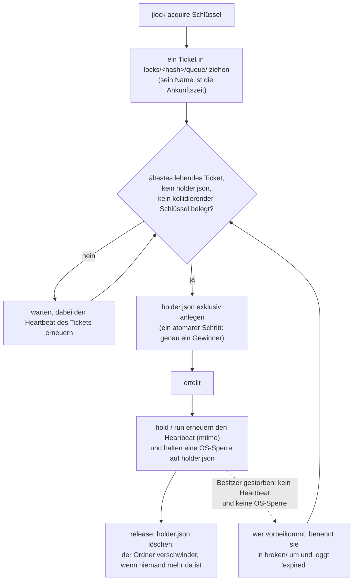

<!-- languages -->
[English](README.md) · [Português (Brasil)](README.pt-BR.md) · [Español](README.es.md) · [Français](README.fr.md) · [Deutsch](README.de.md) · [Italiano](README.it.md) · [简体中文](README.zh-CN.md) · [日本語](README.ja.md) · [Русский](README.ru.md) · [العربية](README.ar.md) · [हिन्दी](README.hi.md)

# jlock

**jlock lässt Programme, Skripte, Menschen und KI-Agenten auf einem Rechner abwechselnd an Dateien, Ordner
und alles andere heran, ganz ohne Server.**

## Warum es jlock gibt

jlock begann mit KI-Programmieragenten. Mehrere Agenten, die gleichzeitig im selben Repository arbeiteten,
kamen sich ständig in die Quere: Zwei bearbeiteten dieselbe Datei, oder einer schrieb einen Ordner neu,
während ein anderer ihn gerade baute. Die Werkzeuge, mit denen sie Dateien bearbeiten, öffnen eine Datei,
schreiben sie und schließen sie innerhalb von Millisekunden, deshalb bemerkt das Betriebssystem keinen
Konflikt. Der *Besitz*, den ein Agent braucht, dauert aber die ganze Aufgabe lang: Minuten, über Dutzende
Bearbeitungen und viele kurzlebige Prozesse hinweg. Es fehlte eine Möglichkeit zu sagen: „Diese Datei gehört
mir, bis ich fertig bin“, sichtbar für jeden anderen Agenten und so, dass sie von selbst aufgeräumt wird,
wenn der Agent abstürzt.

Dasselbe Bedürfnis taucht überall sonst auf: zwei Builds, die in denselben `dist`-Ordner schreiben, zwei
Deployments auf denselben Server, zwei Entwicklungsserver, die beide Port 3000 wollen, ein nächtliches
Skript, das nicht zweimal laufen darf. jlock ist ein kleiner Befehl für all das.

## Das Problem, genau betrachtet

Abwechseln klingt einfach. Es auf einem Rechner ohne Server richtig zu machen, heißt, all das zu lösen:

- **Zwei Anfragen im selben Augenblick.** „Ist es frei?“ lesen und dann „Es gehört mir“ schreiben sind zwei
  Schritte; zwei Prozesse können beide „frei“ lesen. jlock entscheidet mit einer einzigen atomaren Operation
  des Dateisystems.
- **Der Besitzer stirbt.** Ein abgestürzter Prozess kann nichts mehr freigeben. jlock gewinnt seine Sperren
  von selbst zurück und hält fest, dass es das getan hat.
- **Reihenfolge der Ankunft.** Wer zuerst gefragt hat, soll zuerst drankommen, nicht wer zufällig im
  richtigen Moment erneut versucht. jlock führt eine echte Warteschlange.
- **Deadlock.** A hält `x` und wartet auf `y`; B hält `y` und wartet auf `x`; beide warten für immer. jlock
  erkennt den Zyklus und lehnt die Anfrage ab, die ihn schließen würde.
- **Wissen, wer was hat.** Wenn etwas hängt, musst du sehen, wer es hält, seit wann und wer wartet. jlock
  listet all das auf und lässt dich im Notfall eine Sperre aufbrechen.

## Warum nicht etwas, das es schon gibt

| Option | Was sie bietet | Was fehlt |
|---|---|---|
| Windows-Freigabemodi (eine Datei exklusiv öffnen) | das Betriebssystem verweigert anderen das Öffnen | gilt nur, solange die Datei offen ist (bei einem Editor Millisekunden); blockiert auch deinen eigenen Editor; keine Warteschlange, kein „wer“ |
| Benannter Mutex unter Windows | eine Sperre, die mit ihrem Prozess stirbt | braucht einen Prozess, der sie die ganze Zeit hält; keine faire Reihenfolge; keine Liste |
| `flock(1)` + `lslocks` (Linux) | eine Sperre halten, während ein Befehl läuft; Liste nach PID | nicht unter Windows; keine Reihenfolge der Ankunft; keine Identität außer einer PID (sagt nicht, welcher Agent oder welche Aufgabe die Datei hält); keine Deadlock-Erkennung; kann nicht über getrennte Befehle hinweg halten |
| `proper-lockfile` (npm) | sperrt Ordner, erkennt tote Sperren an der mtime | keine Warteschlange (zufällige Wiederholungen); kein CLI; keine globale Liste |

**Warum die Identität zählt.** Eine PID sagt nur, welcher Prozess die Datei hält, und die Prozesse eines Agenten kommen und gehen ständig: Jede Änderung, jeder Shell-Befehl ist ein neuer Prozess. Wissen musst du aber, *wer* die Datei hält und *wofür*. jlock speichert das mit jeder Sperre: `--owner` nennt den Agenten oder die Sitzung (`claude:a8ec2aca`), `--group` die Aufgabe, an der er arbeitet (`aufgabe-42`), `--intent`, was er gerade tut („T4: Parser umbauen“), und `--meta` beliebige weitere Daten (`--meta task=T04`). So sieht, wer Agenten parallel koordiniert, welcher Agent und welche Aufgabe jede Datei halten (`jlock list`), gibt die Dateien einer Aufgabe auf einmal zurück (`jlock release --group aufgabe-42`) und verteilt Aufgaben, die nicht dieselben Dateien berühren. Skripte und Menschen profitieren auch davon, aber notwendig machen es die KI-Agenten, die nebeneinander arbeiten: Sie ändern Dateien in Millisekunden, halten sie minutenlang, und nichts sonst auf dem Rechner weiß, wer sie sind.

## Installation

Linux und macOS:

```
curl -fsSL https://raw.githubusercontent.com/rodrigojager/jlock/main/install.sh | sh
```

Windows (PowerShell):

```
irm https://raw.githubusercontent.com/rodrigojager/jlock/main/install.ps1 | iex
```

Mit Rust: `cargo install jlock`, `cargo binstall jlock` (lädt die Binärdatei des Releases herunter) oder aus
dem Quellcode: `cargo install --path .`. Prüfe danach in einem neuen Terminal, ob alles bereit ist:

```
jlock doctor
```

**Bring deinem KI-Agenten bei, jlock zu benutzen.** Der Ordner [`skills/`](skills/README.md) enthält eine
Skill für Claude Code, OpenCode und Codex. Sie sagt dem Agenten, wann er eine Sperre nehmen soll, welche
Befehle und Optionen er verwenden soll und was zu tun ist, wenn eine Datei belegt ist. Ein Befehl installiert
sie für deinen Agenten; starte danach eine neue Sitzung des Agenten.

Linux und macOS:

```
# Claude Code
mkdir -p ~/.claude/skills/jlock && curl -fsSL https://raw.githubusercontent.com/rodrigojager/jlock/main/skills/claude-code/jlock/SKILL.md -o ~/.claude/skills/jlock/SKILL.md
# OpenCode
mkdir -p ~/.config/opencode/skills/jlock && curl -fsSL https://raw.githubusercontent.com/rodrigojager/jlock/main/skills/opencode/jlock/SKILL.md -o ~/.config/opencode/skills/jlock/SKILL.md
# Codex
mkdir -p ~/.agents/skills/jlock && curl -fsSL https://raw.githubusercontent.com/rodrigojager/jlock/main/skills/codex/jlock/SKILL.md -o ~/.agents/skills/jlock/SKILL.md
```

Windows (PowerShell):

```
# Claude Code
New-Item -ItemType Directory -Force "$HOME\.claude\skills\jlock" | Out-Null; irm https://raw.githubusercontent.com/rodrigojager/jlock/main/skills/claude-code/jlock/SKILL.md -OutFile "$HOME\.claude\skills\jlock\SKILL.md"
# OpenCode
New-Item -ItemType Directory -Force "$HOME\.config\opencode\skills\jlock" | Out-Null; irm https://raw.githubusercontent.com/rodrigojager/jlock/main/skills/opencode/jlock/SKILL.md -OutFile "$HOME\.config\opencode\skills\jlock\SKILL.md"
# Codex
New-Item -ItemType Directory -Force "$HOME\.agents\skills\jlock" | Out-Null; irm https://raw.githubusercontent.com/rodrigojager/jlock/main/skills/codex/jlock/SKILL.md -OutFile "$HOME\.agents\skills\jlock\SKILL.md"
```

Weitere Details, etwa wie du eine Skill nur für ein Projekt installierst, findest du in [`skills/README.md`](skills/README.md).

## Fünf Minuten

Alice nimmt eine Sperre auf einen Namen. Bob fragt nach demselben Namen, ohne zu warten, und erfährt, wer
ihn hat. Dann gibt Alice ihn zurück:

<!-- jlock-example -->
```text
$ jlock acquire name:demo --owner alice
erteilt name:demo
$ jlock acquire name:demo --owner bob --no-wait
belegt name:demo, gehalten von alice (Position 1)
Tipp: jlock status name:demo zeigt, wer ihn hält, und die Warteschlange; lass --no-wait weg, um zu warten, bis du dran bist
$ jlock release name:demo --owner alice
freigegeben name:demo
$ jlock status name:demo
frei name:demo
```

Ohne `--no-wait` würde Bob sich einfach in der Warteschlange einreihen und die Sperre in dem Moment
erhalten, in dem Alice sie freigibt. `jlock help acquire` erklärt jede Option.

## Aus einem Agenten heraus

Ein Agent (Claude Code, OpenCode, Codex oder jeder andere) nimmt, was er gleich ändern wird, behält es,
während er arbeitet, und gibt es am Ende zurück. Dafür braucht es zwei Aufrufe:

1. **Nehmen:** `jlock hold src/parser.rs src/lexer.rs --owner agent-7 --group task-42 --intent "T4 parser" --detach`
   nimmt beide Dateien oder keine, wartet, bis es an der Reihe ist, falls jemand anderes sie hat, antwortet
   `granted` und kehrt zurück. Ein kleiner jlock-Prozess bleibt im Hintergrund und hält die Sperre am Leben,
   sodass der Agent dafür keine Aufrufe und keine Tokens verbraucht. `--owner` ist die Identität des Agenten
   über alle Befehle hinweg; `--group` fasst alles zusammen, was eine Aufgabe hält.
2. **Zurückgeben:** `jlock release --group task-42 --owner agent-7`, wenn die Aufgabe erledigt ist. Der
   Hintergrundprozess bemerkt es und endet.

Optionen, die du kennen solltest:

- `--no-wait`: nicht in der Warteschlange warten. Ist eine Datei belegt, kommt die Antwort sofort (`busy`,
  Exit-Code 10), samt dem, der sie hat, sodass der Agent sich andere Arbeit suchen kann, statt stillzustehen.
- `--timeout 2m`: höchstens so lange warten, dann aufgeben (Exit-Code 11).
- `--release-on-eof`: für ein Programm, das offen bleibt und `hold` im Vordergrund ausführt (ohne `--detach`)
  und dabei seine Standardeingabe hält: stirbt das Programm, schließt sich die Pipe und die Sperre wird sofort
  freigegeben. Kurze Aufrufe nutzen `--detach`; ein Programm, das offen bleibt, `--release-on-eof`.
- `--ttl 2h`: eine Sicherheitsgrenze. Die Sperre verschwindet nach dieser Zeit von selbst, auch wenn der
  Agent sie nie freigibt.

Warum nicht einfach `jlock acquire`? Eine mit `acquire` genommene Sperre überdauert den Befehl ebenfalls, muss
aber mindestens alle 30 Sekunden erneuert werden (`jlock heartbeat`), sonst gilt sie als tot und läuft ab. Ein
Agent verbringt Minuten zwischen zwei Befehlen, deshalb ist `hold --detach` das Werkzeug für ihn; `acquire` ist
für Programme, die selbst erneuern. Bricht jemand die Sperre auf (`jlock unlock --force`), endet der
Hintergrundprozess, und `jlock heartbeat <file> --owner agent-7` antwortet `lost` (Exit-Code 13): Nach einer
langen Pause lohnt sich diese Prüfung.

Der ganze Ablauf, an einem Namen:

<!-- jlock-example -->
```text
$ jlock hold name:port-3000 --owner agent-7 --group task-42 --ttl 2h --detach
erteilt name:port-3000
$ jlock release --group task-42 --owner agent-7
freigegeben name:port-3000
```

Mit `--json` gibt jeder Befehl ein einziges JSON-Objekt aus, in jeder Sprache gleich:

<!-- jlock-example -->
```text
$ jlock acquire name:port-3000 --owner agent-7 --json
{"key":"name:port-3000","keys":["name:port-3000"],"owner":"agent-7","result":"granted","waited_ms":0}
```

## Aus einem Skript heraus

`jlock run` funktioniert wie `flock(1)`: Es nimmt die Schlüssel, führt den Befehl aus, hält die Sperre am
Leben, solange der Befehl läuft, gibt sie am Ende frei und endet mit dem Exit-Code des Befehls selbst.

```
jlock run D:\proj\dist -- cargo build --release      # nur ein Build gleichzeitig auf diesem Rechner
jlock run name:deploy-prod --timeout 2m -- ./deploy.sh
```

Hier ist der Befehl jlock selbst, so siehst du die Sperre, die gehalten wird, solange er läuft:

<!-- jlock-example -->
```text
$ jlock run name:nightly -- jlock list
SCHLÜSSEL     BESITZER    GRUPPE  ABSICHT  DAUER  HEARTBEAT  WARTEND
name:nightly  pid:182568  -       -        26ms   25ms       0

1 Sperre, 0 warten
$ jlock list
nichts gesperrt
```

## Als Mensch

- `jlock list --watch` zeigt alles, was auf dem Rechner gesperrt ist, jede Sekunde neu gezeichnet.
- `jlock status <key>` zeigt, wer einen Schlüssel hält, die Warteschlange und was ihn blockiert.
- `jlock graph` zeigt, wer auf wen wartet.
- `jlock unlock <key> --force --reason "..."` bricht im Notfall die Sperre eines anderen auf; das Log hält
  fest, wer es getan hat und warum, und `hold`/`run` des Besitzers hört auf.

<!-- jlock-example -->
```text
$ jlock acquire name:printer --owner alice --intent "printing the report"
erteilt name:printer
$ jlock unlock name:printer --force --reason "alice went home"
erzwungen name:printer (gehörte alice)
$ jlock graph
niemand wartet
```

## Wie es funktioniert

Der Zustand ist ein Ordner auf der Festplatte (`%LOCALAPPDATA%\jlock` unter Windows, `~/.local/state/jlock`
unter Linux, `~/Library/Application Support/jlock` unter macOS). Nichts muss dauerhaft laufen, und nichts
geht verloren, wenn irgendein Prozess abstürzt.



- **Ein Ordner pro Schlüssel**, benannt nach dem SHA-1 des normalisierten Schlüssels. `holder.json` existiert
  genau so lange, wie der Schlüssel belegt ist, und sagt, wer ihn hat.
- **Ein Ticket pro Wartendem** in `queue/`, benannt nach seiner Ankunftszeit: Nur das älteste lebende Ticket
  darf die Sperre nehmen, also ist die Reihenfolge die Reihenfolge der Ankunft.
- **Heartbeat** (Lebenszeichen): Besitzer und Wartende berühren ihre Datei alle 5 s. Eine Datei, die 30 s
  lang nicht berührt wurde, gehört einem toten Prozess und wird von dem entfernt, der sie bemerkt. `hold`
  und `run` halten außerdem eine Betriebssystemsperre auf `holder.json`, die der Kernel in dem Augenblick
  aufhebt, in dem der Prozess stirbt; so wird ein langsamer, aber lebender Besitzer nie für tot gehalten.
- **Deadlocks**: Die Dateien selbst beschreiben, wer auf wen wartet; eine Anfrage, die einen Zyklus
  schließen würde, wird abgelehnt, samt der Kette.
- **Keine Überreste**: Ist nichts gesperrt, ist der Ordner `locks` leer.

## Garantien und Grenzen

| jlock garantiert | jlock garantiert nicht (und warum das in Ordnung ist) |
|---|---|
| ein Besitzer pro Schlüssel zu jedem Zeitpunkt | Programme aufzuhalten, die jlock nicht nutzen: Die Sperren sind beratend, wie bei `flock` |
| strikte Reihenfolge der Ankunft unter lebenden Wartenden | sofortige Übergabe: Der Nächste bemerkt es innerhalb einer Viertelsekunde |
| die Sperre eines toten Besitzers wird innerhalb von 30 s zurückgewonnen und protokolliert | bei einem einfachen `acquire` tot von eingefroren zu unterscheiden (ein eingefrorener Besitzer findet `lost` vor und hört auf); mit `hold`/`run` unterscheidet die OS-Sperre die beiden |
| Deadlocks werden erkannt und jedes Mal gleich aufgelöst | Koordination zwischen verschiedenen Rechnern |
| die Liste ist immer die Wahrheit: Sie ist der Ordner selbst | — |
| kein Prozess muss dauerhaft laufen | Aufräumen ganz ohne Aufruf: Überreste warten auf den nächsten Befehl oder auf `jlock gc` |
| ein leerer Ordner `locks`, wenn nichts gesperrt ist | — |

## Schlüssel

| Schlüssel | Bedeutung | Kollidiert mit |
|---|---|---|
| ein Pfad: `D:\proj\src\a.ts`, `src/a.ts`, `~/notes`, `.` | diese Datei oder dieser Ordner; relative Pfade gehen vom aktuellen Ordner aus; der Pfad muss nicht existieren | demselben Pfad, allem darin, jedem Ordner darüber und `*` |
| `name:<text>` | alles, was kein Pfad ist: `name:port-3000`, `name:deploy-prod` | demselben Namen und `*` |
| `*` | alles | jedem Schlüssel |

Unter Windows und macOS wird Groß- und Kleinschreibung ignoriert (`D:\Proj\SRC` und `d:/proj/src` sind
derselbe Schlüssel). Mehrere Schlüssel in einem Befehl werden alle oder keiner genommen, in einer festen
Reihenfolge, sodass sie sich nie gegenseitig blockieren.

## Exit-Codes

| Code | Bedeutung |
|---|---|
| 0 | erteilt / ok |
| 2 | falscher Aufruf |
| 10 | belegt (mit `--no-wait`) |
| 11 | Zeitüberschreitung (mit `--timeout`) |
| 12 | Deadlock: Die Anfrage würde einen Zyklus schließen |
| 13 | nicht der Besitzer |
| 14 | Sperre verloren (`hold`/`run`) |
| 20 | Dateisystemfehler; die Meldung enthält den Fehler des Betriebssystems |
| 130 | beim Warten unterbrochen (CTRL+C) |

`jlock run` endet mit dem Code des Befehls selbst, sobald die Sperre erteilt wurde.

## Konfiguration

| Variable | Standard | Zweck |
|---|---|---|
| `JLOCK_HOME` | je nach System (siehe oben) | wo die Registry liegt |
| `JLOCK_LANG` | die Sprache des Systems | Sprache der Textausgabe: `en`, `pt-BR`, `es`, `fr`, `de`, `it`, `zh-CN`, `ja`, `ru`, `ar`, `hi` (auch `--lang`) |
| `JLOCK_HINTS` | `1` | `0` schaltet die Tipps ab |
| `JLOCK_HEARTBEAT_MS` | 5000 | wie oft Besitzer und Wartende erneuern |
| `JLOCK_STALE_MS` | 30000 | so lange keine Erneuerung = tot |
| `JLOCK_POLL_MS` | 250 | wie oft ein Wartender nachsieht |
| `JLOCK_SWEEP_MS` | 60000 | Mindestabstand zwischen globalen Bereinigungen |
| `JLOCK_LOG_MAX_BYTES` | 5242880 | Größe, ab der `log.jsonl` rotiert wird |

Befehle, Optionen, `--json`, das Log und die Exit-Codes sind in jeder Sprache gleich.

## Aktualisieren

```
jlock update --check   # gibt es eine neuere Version?
jlock update           # installieren
```

`update` lädt das Release für dein System herunter, prüft es gegen die `SHA256SUMS` des Releases, ersetzt
das laufende Programm und startet es einmal, bevor es Erfolg meldet. Es nutzt das `curl` des Systems. Es ist
der einzige Befehl, der das Netzwerk nutzt, und nur, wenn du ihn ausführst.

## Mitwirken

Siehe [`CONTRIBUTING.md`](CONTRIBUTING.md). Der Text, den jlock ausgibt, existiert in elf Sprachen, und
**Korrekturvorschläge zur Formulierung sind in jeder Sprache willkommen, auch auf Englisch**, ganz ohne
Rust-Kenntnisse. Die vollständige Befehlsreferenz ist [`docs/USAGE.md`](docs/USAGE.md); der Entwurf steht in
[`docs/PLAN.md`](docs/PLAN.md) (auf Portugiesisch), die beim Bauen getroffenen Entscheidungen in
[`docs/DEVIATIONS.md`](docs/DEVIATIONS.md) und was als Nächstes kommt in [`ROADMAP.md`](ROADMAP.md).

## Autor

Rodrigo Jäger — GitHub <https://github.com/rodrigojager> · LinkedIn <https://www.linkedin.com/in/rodrigojager>

## Lizenz

MIT, siehe [`LICENSE`](LICENSE).
