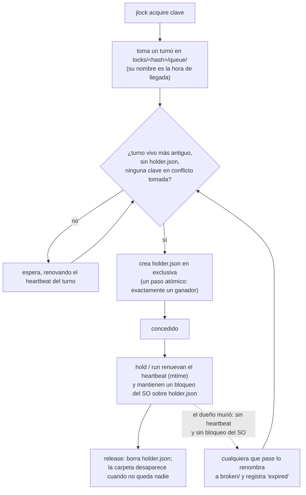

<!-- languages -->
[English](README.md) · [Português (Brasil)](README.pt-BR.md) · [Español](README.es.md) · [Français](README.fr.md) · [Deutsch](README.de.md) · [Italiano](README.it.md) · [简体中文](README.zh-CN.md) · [日本語](README.ja.md) · [Русский](README.ru.md) · [العربية](README.ar.md) · [हिन्दी](README.hi.md)

# jlock

**jlock hace que los programas, scripts, personas y agentes de IA de una misma máquina se turnen con
archivos, carpetas y cualquier otra cosa, sin servidor.**

## Por qué existe jlock

jlock nació con los agentes de IA que programan. Varios agentes trabajando a la vez en el mismo repositorio
se pisaban unos a otros: dos editaban el mismo archivo, o uno reescribía una carpeta mientras otro la estaba
compilando. Las herramientas de edición que usan abren un archivo, lo escriben y lo cierran en milisegundos,
así que el sistema operativo nunca nota ningún conflicto. Pero la *propiedad* que necesita un agente dura
toda la tarea: minutos, a lo largo de decenas de ediciones y de muchos procesos de vida corta. Lo que faltaba
era una forma de decir "este archivo es mío hasta que termine", visible para todos los demás agentes, y que
se limpie sola si el agente se cae.

La misma necesidad aparece en todas partes: dos compilaciones escribiendo en la misma carpeta `dist`, dos
despliegues al mismo servidor, dos servidores de desarrollo que quieren el puerto 3000, un script nocturno
que no debe ejecutarse dos veces. jlock es un solo comando, pequeño, para todos esos casos.

## El problema, con precisión

Turnarse parece sencillo. Hacerlo bien en una sola máquina, sin servidor, obliga a resolver todo esto:

- **Dos peticiones en el mismo instante.** Leer "¿está libre?" y después escribir "es mío" son dos pasos;
  dos procesos pueden leer "libre" a la vez. jlock decide con una única operación atómica del sistema de
  archivos.
- **El dueño muere.** Un proceso que se cayó no puede liberar nada. jlock recupera sus bloqueos por sí
  solo, y deja constancia de que lo hizo.
- **Orden de llegada.** Quien pidió primero debe recibir primero, no quien tenga la suerte de reintentar en
  el momento justo. jlock mantiene una cola de verdad.
- **Deadlock.** A tiene `x` y espera `y`; B tiene `y` y espera `x`; los dos esperan para siempre. jlock ve
  el ciclo y rechaza la petición que lo cerraría.
- **Saber quién tiene qué.** Cuando algo se atasca, hay que ver quién lo tiene, desde cuándo y quién está
  esperando. jlock lo lista todo, y permite romper un bloqueo en una emergencia.

## Por qué no algo que ya existe

| Opción | Qué ofrece | Qué le falta |
|---|---|---|
| Modos de compartición de Windows (abrir un archivo en exclusiva) | el SO rechaza las demás aperturas | solo dura mientras el archivo está abierto (milisegundos para un editor); bloquea también a tu propio editor; sin cola, sin "quién" |
| Mutex con nombre de Windows | un bloqueo que muere con su proceso | necesita un proceso que lo mantenga todo el tiempo; sin orden justo; sin lista |
| `flock(1)` + `lslocks` (Linux) | mantener un bloqueo mientras corre un comando; listar por PID | no existe en Windows; sin orden de llegada; sin identidad más allá de un PID (no dice qué agente o tarea tiene el archivo); sin detección de deadlock; no puede mantenerse entre comandos separados |
| `proper-lockfile` (npm) | bloquear carpetas, detección de abandonados por mtime | sin cola (reintentos al azar); sin CLI; sin lista global |

**Por qué importa la identidad.** Un PID solo dice qué proceso tiene el archivo, y los procesos de un agente nacen y mueren todo el tiempo: cada edición, cada comando de shell es un proceso nuevo. Lo que hace falta saber es *quién* tiene el archivo y *para qué*. jlock lo guarda en cada bloqueo: `--owner` dice qué agente o sesión (`claude:a8ec2aca`), `--group` en qué tarea está trabajando (`tarea-42`), `--intent` qué está haciendo ("T4: refactorizar el parser") y `--meta` cualquier dato adicional (`--meta task=T04`). Así, quien coordina agentes en paralelo ve qué agente y qué tarea tienen cada archivo (`jlock list`), devuelve de una vez los archivos de una tarea (`jlock release --group tarea-42`) y reparte tareas que no tocan los mismos archivos. Los scripts y las personas también se benefician, pero son los agentes de IA trabajando lado a lado los que lo hacen necesario: editan en milisegundos, se quedan con los archivos durante minutos, y nada más en la máquina sabe quiénes son.

## Instalación

Linux y macOS:

```
curl -fsSL https://raw.githubusercontent.com/rodrigojager/jlock/main/install.sh | sh
```

Windows (PowerShell):

```
irm https://raw.githubusercontent.com/rodrigojager/jlock/main/install.ps1 | iex
```

Con Rust: `cargo install jlock`, `cargo binstall jlock` (descarga el binario del release), o desde el código
fuente: `cargo install --path .`. Después, en una terminal nueva, comprueba que todo está en su sitio:

```
jlock doctor
```

## Cinco minutos

Alice toma un bloqueo sobre un nombre. Bob pide el mismo sin esperar y se le dice quién lo tiene. Después
Alice lo devuelve:

<!-- jlock-example -->
```text
$ jlock acquire name:demo --owner alice
concedida name:demo
$ jlock acquire name:demo --owner bob --no-wait
ocupada name:demo, la tiene alice (posición 1)
consejo: jlock status name:demo muestra quién la tiene y la cola; quita --no-wait para esperar tu turno
$ jlock release name:demo --owner alice
liberada name:demo
$ jlock status name:demo
libre name:demo
```

Sin `--no-wait`, Bob simplemente esperaría en la cola y recibiría el bloqueo en el momento en que Alice lo
liberara. `jlock help acquire` explica cada opción.

## Uso desde un agente

Un agente (Claude Code, OpenCode, Codex o cualquier otro) toma lo que va a cambiar, lo conserva mientras
trabaja y lo devuelve al final:

1. `jlock acquire src/parser.rs src/lexer.rs --owner agent-7 --group task-42 --intent "T4 parser" --json`
   toma los dos archivos o ninguno, esperando su turno. `--owner` es la identidad del agente de un comando
   a otro; `--group` agrupa todo lo que tiene una misma tarea.
2. `jlock hold src/parser.rs src/lexer.rs --owner agent-7` en segundo plano mantiene vivo el bloqueo (se
   concede al instante, porque el dueño ya tiene los archivos). Sin él, llama a `jlock heartbeat` con más
   frecuencia que cada 30 segundos.
3. `jlock release --group task-42 --owner agent-7` al final; o escribe la línea `release` en la entrada
   estándar de `hold`.
4. Si `hold` sale con el código 14 (`lost`), alguien rompió el bloqueo o este caducó: deja de editar.

Con `--json`, cada comando imprime un objeto JSON, igual en todos los idiomas:

<!-- jlock-example -->
```text
$ jlock acquire name:port-3000 --owner agent-7 --json
{"key":"name:port-3000","keys":["name:port-3000"],"owner":"agent-7","result":"granted","waited_ms":1}
```

## Uso desde un script

`jlock run` funciona como `flock(1)`: toma las claves, ejecuta el comando, mantiene vivo el bloqueo mientras
el comando corre, lo libera al final y sale con el mismo código de salida del comando.

```
jlock run D:\proj\dist -- cargo build --release      # una compilación a la vez en esta máquina
jlock run name:deploy-prod --timeout 2m -- ./deploy.sh
```

Aquí el comando es el propio jlock, así que puedes ver el bloqueo tomado mientras se ejecuta:

<!-- jlock-example -->
```text
$ jlock run name:nightly -- jlock list
CLAVE         DUEÑO     GRUPO  INTENCIÓN  TIEMPO  HEARTBEAT  COLA
name:nightly  pid:9404  -      -          20ms    19ms       0

1 bloqueo, 0 esperando
$ jlock list
nada bloqueado
```

## Uso como persona

- `jlock list --watch` muestra todo lo que está bloqueado en la máquina, redibujado cada segundo.
- `jlock status <key>` muestra quién tiene una clave, la cola y qué la bloquea.
- `jlock graph` muestra quién espera a quién.
- `jlock unlock <key> --force --reason "..."` rompe el bloqueo de otro en una emergencia; el registro guarda
  quién lo hizo y por qué, y el `hold`/`run` del dueño se detiene.

<!-- jlock-example -->
```text
$ jlock acquire name:printer --owner alice --intent "printing the report"
concedida name:printer
$ jlock unlock name:printer --force --reason "alice went home"
forzada name:printer (era de alice)
$ jlock graph
nadie esperando
```

## Cómo funciona

El estado es una carpeta en el disco (`%LOCALAPPDATA%\jlock` en Windows, `~/.local/state/jlock` en Linux,
`~/Library/Application Support/jlock` en macOS). Nada tiene que quedarse ejecutándose, y nada se pierde si
algún proceso se cae.



- **Una carpeta por clave**, con el SHA-1 de la clave normalizada como nombre. `holder.json` existe
  exactamente mientras la clave está tomada, y dice quién la tiene.
- **Un turno por cada uno que espera** en `queue/`, con su hora de llegada como nombre: solo el turno vivo
  más antiguo puede tomar el bloqueo, así que el orden es el orden de llegada.
- **Heartbeat (señal de vida)**: dueños y quienes esperan tocan su archivo cada 5 s. Un archivo que no se
  toca en 30 s pertenece a un proceso muerto y lo elimina quien lo vea. `hold` y `run` mantienen además un
  bloqueo del sistema operativo sobre `holder.json`, que el kernel suelta en el instante en que el proceso
  muere, así que un dueño lento pero vivo nunca se da por muerto.
- **Deadlocks**: los propios archivos describen quién espera a quién; una petición que cerraría un ciclo se
  rechaza, mostrando la cadena.
- **Cero restos**: sin nada bloqueado, la carpeta `locks` queda vacía.

## Garantías y límites

| jlock garantiza | jlock no hace (y por qué no importa) |
|---|---|
| un solo dueño por clave en cada instante | detener programas que no usan jlock: los bloqueos son orientativos, como `flock` |
| orden estricto de llegada entre los que esperan y siguen vivos | traspaso instantáneo: el siguiente se entera en menos de un cuarto de segundo |
| el bloqueo de un dueño muerto se recupera en 30 s como máximo, y queda registrado | distinguir un dueño muerto de uno congelado con un `acquire` simple (un dueño congelado encuentra `lost` y se detiene); con `hold`/`run` el bloqueo del SO los distingue |
| deadlocks detectados y resueltos siempre de la misma manera | coordinación entre máquinas distintas |
| la lista siempre es la verdad: es la propia carpeta | — |
| ningún proceso tiene que quedarse ejecutándose | limpieza sin ninguna llamada: los restos esperan al siguiente comando o a `jlock gc` |
| una carpeta `locks` vacía cuando no hay nada bloqueado | — |

## Claves

| Clave | Significado | Entra en conflicto con |
|---|---|---|
| una ruta: `D:\proj\src\a.ts`, `src/a.ts`, `~/notes`, `.` | ese archivo o carpeta; las rutas relativas parten de la carpeta actual; la ruta no tiene que existir | la misma ruta, todo lo que contiene, cada carpeta por encima de ella, y `*` |
| `name:<text>` | cualquier cosa que no sea una ruta: `name:port-3000`, `name:deploy-prod` | el mismo nombre, y `*` |
| `*` | todo | todas las claves |

En Windows y macOS se ignoran las mayúsculas y minúsculas (`D:\Proj\SRC` y `d:/proj/src` son la misma
clave). Varias claves en un mismo comando se toman todas o ninguna, en un orden fijo, así que nunca se
bloquean entre sí.

## Códigos de salida

| Código | Significado |
|---|---|
| 0 | concedido / ok |
| 2 | uso incorrecto |
| 10 | ocupada (con `--no-wait`) |
| 11 | tiempo agotado (con `--timeout`) |
| 12 | deadlock: la petición cerraría un ciclo |
| 13 | no es el dueño |
| 14 | bloqueo perdido (`hold`/`run`) |
| 20 | error del sistema de archivos; el mensaje incluye el error del SO |
| 130 | interrumpido (CTRL+C) durante la espera |

`jlock run` sale con el código del propio comando una vez concedido el bloqueo.

## Configuración

| Variable | Por defecto | Uso |
|---|---|---|
| `JLOCK_HOME` | según el sistema (ver arriba) | dónde vive el registro |
| `JLOCK_LANG` | el idioma del sistema | idioma de la salida de texto: `en`, `pt-BR`, `es`, `fr`, `de`, `it`, `zh-CN`, `ja`, `ru`, `ar`, `hi` (también `--lang`) |
| `JLOCK_HINTS` | `1` | `0` desactiva los consejos |
| `JLOCK_HEARTBEAT_MS` | 5000 | cada cuánto renuevan dueños y quienes esperan |
| `JLOCK_STALE_MS` | 30000 | sin renovación durante este tiempo = muerto |
| `JLOCK_POLL_MS` | 250 | cada cuánto mira quien espera |
| `JLOCK_SWEEP_MS` | 60000 | tiempo mínimo entre barridos globales |
| `JLOCK_LOG_MAX_BYTES` | 5242880 | tamaño a partir del cual se rota `log.jsonl` |

Los comandos, las opciones, `--json`, el registro y los códigos de salida son iguales en todos los idiomas.

## Actualización

```
jlock update --check   # ¿hay una versión más nueva?
jlock update           # instalarla
```

`update` descarga el release para tu sistema, lo verifica contra el `SHA256SUMS` del release, sustituye el
ejecutable en uso y lo ejecuta una vez antes de dar el éxito por bueno. Usa el `curl` del sistema. Es el
único comando que usa la red, y solo cuando tú lo ejecutas.

## Contribuir

Consulta [`CONTRIBUTING.md`](CONTRIBUTING.md). El texto que imprime jlock existe en once idiomas, y **las
revisiones de la redacción son bienvenidas en cualquier idioma, inglés incluido**, sin necesidad de saber
Rust. La referencia completa de comandos está en [`docs/USAGE.md`](docs/USAGE.md); el diseño, en
[`docs/PLAN.md`](docs/PLAN.md) (en portugués); las decisiones tomadas durante la construcción, en
[`docs/DEVIATIONS.md`](docs/DEVIATIONS.md); y lo que viene después, en [`ROADMAP.md`](ROADMAP.md).

## Autor

Rodrigo Jäger — GitHub <https://github.com/rodrigojager> · LinkedIn <https://www.linkedin.com/in/rodrigojager>

## Licencia

MIT, consulta [`LICENSE`](LICENSE).
