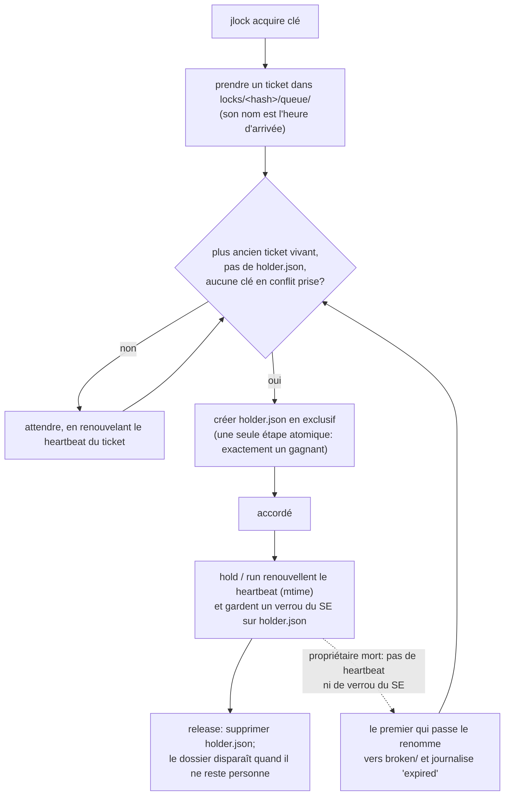

<!-- languages -->
[English](README.md) · [Português (Brasil)](README.pt-BR.md) · [Español](README.es.md) · [Français](README.fr.md) · [Deutsch](README.de.md) · [Italiano](README.it.md) · [简体中文](README.zh-CN.md) · [日本語](README.ja.md) · [Русский](README.ru.md) · [العربية](README.ar.md) · [हिन्दी](README.hi.md)

# jlock

**jlock permet aux programmes, scripts, personnes et agents d'IA d'une même machine de passer chacun leur tour
sur des fichiers, des dossiers et tout le reste, sans serveur.**

## Pourquoi jlock existe

jlock est né avec les agents d'IA qui écrivent du code. Plusieurs agents travaillant en même temps dans le
même dépôt se marchaient sans cesse sur les pieds: deux d'entre eux modifiaient le même fichier, ou l'un
réécrivait un dossier pendant qu'un autre le compilait. Les outils d'édition qu'ils utilisent ouvrent un
fichier, l'écrivent et le ferment en quelques millisecondes, si bien que rien dans le système d'exploitation
ne remarque le conflit. Mais la *propriété* dont un agent a besoin dure toute la tâche: des minutes, à
travers des dizaines de modifications et de nombreux processus éphémères. Il manquait un moyen de dire « ce
fichier est à moi jusqu'à ce que j'aie fini », visible par tous les autres agents, et qui se nettoie tout
seul si l'agent plante.

Le même besoin apparaît partout ailleurs: deux builds qui écrivent dans le même dossier `dist`, deux
déploiements vers le même serveur, deux serveurs de développement qui veulent le port 3000, un script de
nuit qui ne doit pas tourner deux fois. jlock est une seule petite commande pour tous ces cas.

## Le problème, précisément

Passer chacun son tour, cela paraît simple. Le faire correctement sur une machine, sans serveur, oblige à
résoudre tout ceci:

- **Deux demandes au même instant.** Lire « est-ce libre? » puis écrire « c'est à moi » font deux étapes;
  deux processus peuvent lire « libre » tous les deux. jlock tranche avec une seule opération atomique du
  système de fichiers.
- **Le propriétaire meurt.** Un processus qui a planté ne peut rien libérer. jlock récupère ses verrous
  tout seul, et note qu'il l'a fait.
- **L'ordre d'arrivée.** Celui qui a demandé en premier doit être servi en premier, et non celui qui
  réessaie par hasard au bon moment. jlock tient une vraie file d'attente.
- **L'interblocage.** A détient `x` et attend `y`; B détient `y` et attend `x`; les deux attendent pour
  toujours. jlock voit le cycle et refuse la demande qui le fermerait.
- **Savoir qui détient quoi.** Quand quelque chose est bloqué, il faut voir qui le détient, depuis quand,
  et qui attend. jlock affiche tout cela, et permet de casser un verrou en cas d'urgence.

## Pourquoi pas une solution qui existe déjà

| Option | Ce qu'elle apporte | Ce qui manque |
|---|---|---|
| Modes de partage de Windows (ouvrir un fichier en exclusif) | le SE refuse les autres ouvertures | ne dure que tant que le fichier est ouvert (quelques millisecondes pour un éditeur); bloque aussi votre propre éditeur; pas de file d'attente, pas de « qui » |
| Mutex nommé de Windows | un verrou qui meurt avec son processus | exige un processus qui le tienne en permanence; pas d'ordre équitable; pas de liste |
| `flock(1)` + `lslocks` (Linux) | garder un verrou pendant qu'une commande tourne; liste par PID | absent de Windows; pas d'ordre d'arrivée; aucune identité au-delà d'un PID (impossible de savoir quel agent ou quelle tâche tient le fichier); pas de détection d'interblocage; impossible de garder un verrou d'une commande à l'autre |
| `proper-lockfile` (npm) | verrouiller des dossiers, détection des verrous abandonnés par la mtime | pas de file d'attente (nouvelles tentatives au hasard); pas de CLI; pas de liste globale |

**Pourquoi l'identité compte.** Un PID dit seulement quel processus tient le fichier, et les processus d'un agent naissent et meurent sans cesse: chaque modification, chaque commande shell est un nouveau processus. Ce qu'il faut savoir, c'est *qui* tient le fichier et *pour quoi faire*. jlock l'enregistre avec chaque verrou: `--owner` nomme l'agent ou la session (`claude:a8ec2aca`), `--group` la tâche sur laquelle il travaille (`tache-42`), `--intent` ce qu'il fait ("T4: refactoriser le parseur") et `--meta` toute donnée supplémentaire (`--meta task=T04`). Ainsi, qui coordonne des agents en parallèle voit quel agent et quelle tâche tiennent chaque fichier (`jlock list`), rend d'un coup les fichiers d'une tâche (`jlock release --group tache-42`) et distribue des tâches qui ne touchent pas les mêmes fichiers. Les scripts et les personnes en profitent aussi, mais ce sont les agents d'IA qui travaillent côte à côte qui le rendent nécessaire: ils modifient en quelques millisecondes, gardent les fichiers pendant des minutes, et rien d'autre sur la machine ne sait qui ils sont.

## Installation

Linux et macOS:

```
curl -fsSL https://raw.githubusercontent.com/rodrigojager/jlock/main/install.sh | sh
```

Windows (PowerShell):

```
irm https://raw.githubusercontent.com/rodrigojager/jlock/main/install.ps1 | iex
```

Avec Rust: `cargo install jlock`, `cargo binstall jlock` (télécharge le binaire publié), ou depuis le code
source: `cargo install --path .`. Ensuite, dans un nouveau terminal, vérifiez que tout est en place:

```
jlock doctor
```

**Apprenez à votre agent IA à s'en servir.** Le dossier [`skills/`](skills/README.md) contient une skill pour
Claude Code, OpenCode et Codex. Elle indique à l'agent quand prendre un verrou, quelles commandes et options
utiliser, et que faire quand un fichier est pris. Une seule commande l'installe pour votre agent; ouvrez
ensuite une nouvelle session de l'agent.

Linux et macOS:

```
# Claude Code
mkdir -p ~/.claude/skills/jlock && curl -fsSL https://raw.githubusercontent.com/rodrigojager/jlock/main/skills/claude-code/jlock/SKILL.md -o ~/.claude/skills/jlock/SKILL.md
# OpenCode
mkdir -p ~/.config/opencode/skills/jlock && curl -fsSL https://raw.githubusercontent.com/rodrigojager/jlock/main/skills/opencode/jlock/SKILL.md -o ~/.config/opencode/skills/jlock/SKILL.md
# Codex
mkdir -p ~/.agents/skills/jlock && curl -fsSL https://raw.githubusercontent.com/rodrigojager/jlock/main/skills/codex/jlock/SKILL.md -o ~/.agents/skills/jlock/SKILL.md
```

Windows (PowerShell):

```
# Claude Code
New-Item -ItemType Directory -Force "$HOME\.claude\skills\jlock" | Out-Null; irm https://raw.githubusercontent.com/rodrigojager/jlock/main/skills/claude-code/jlock/SKILL.md -OutFile "$HOME\.claude\skills\jlock\SKILL.md"
# OpenCode
New-Item -ItemType Directory -Force "$HOME\.config\opencode\skills\jlock" | Out-Null; irm https://raw.githubusercontent.com/rodrigojager/jlock/main/skills/opencode/jlock/SKILL.md -OutFile "$HOME\.config\opencode\skills\jlock\SKILL.md"
# Codex
New-Item -ItemType Directory -Force "$HOME\.agents\skills\jlock" | Out-Null; irm https://raw.githubusercontent.com/rodrigojager/jlock/main/skills/codex/jlock/SKILL.md -OutFile "$HOME\.agents\skills\jlock\SKILL.md"
```

Pour installer une skill dans un seul projet, et pour d'autres détails, voir [`skills/README.md`](skills/README.md).

## Cinq minutes

Alice prend un verrou sur un nom. Bob demande le même sans attendre, et on lui dit qui l'a. Puis Alice le
rend:

<!-- jlock-example -->
```text
$ jlock acquire name:demo --owner alice
accordé name:demo
$ jlock acquire name:demo --owner bob --no-wait
occupé name:demo détenu par alice (position 1)
astuce: jlock status name:demo montre qui la détient et la file d'attente; retirez --no-wait pour attendre votre tour
$ jlock release name:demo --owner alice
libéré name:demo
$ jlock status name:demo
libre name:demo
```

Sans `--no-wait`, Bob attendrait simplement dans la file d'attente et obtiendrait le verrou dès qu'Alice le
libère. `jlock help acquire` explique chaque option.

## L'utiliser depuis un agent

Un agent (Claude Code, OpenCode, Codex ou n'importe quel autre) prend ce qu'il s'apprête à modifier, le
garde pendant qu'il travaille, et le rend à la fin. Il suffit de deux appels:

1. **Prendre:** `jlock hold src/parser.rs src/lexer.rs --owner agent-7 --group task-42 --intent "T4 parser" --detach`
   prend les deux fichiers ou aucun, en attendant son tour si quelqu'un d'autre les a, répond `accordé` et
   rend la main. Un petit processus jlock reste en arrière-plan et garde le verrou en vie, si bien que
   l'agent n'y dépense ni appels ni tokens. `--owner` est l'identité de l'agent d'une commande à l'autre;
   `--group` relie tout ce que détient une même tâche.
2. **Rendre:** `jlock release --group task-42 --owner agent-7` quand la tâche est finie. Le processus en
   arrière-plan s'en aperçoit et s'arrête.

Les options à connaître:

- `--no-wait`: ne pas attendre dans la file d'attente. Si un fichier est pris, la réponse arrive tout de
  suite (`occupé`, code de sortie 10) avec son détenteur, et l'agent peut passer à autre chose au lieu de
  rester planté.
- `--timeout 2m`: attendre au plus ce délai, puis abandonner (code de sortie 11).
- `--release-on-eof` : pour un programme qui reste ouvert et exécute `hold` au premier plan (sans `--detach`),
  en gardant son entrée standard : si le programme meurt, le tube se ferme et le verrou est relâché aussitôt.
  Les appels courts utilisent `--detach` ; un programme qui reste ouvert, `--release-on-eof`.
- `--ttl 2h`: une limite de sécurité. Le verrou disparaît de lui-même passé ce délai, même si l'agent ne
  le rend jamais.
  Pour un travail qui peut durer plus longtemps, `jlock renew --owner agent-7` repousse ce délai sans jamais
  lâcher le verrou.

Pourquoi pas simplement `jlock acquire`? Un verrou pris avec `acquire` survit lui aussi à la commande, mais
il doit être renouvelé (`jlock heartbeat`) au moins toutes les 30 secondes, sinon il est considéré comme
mort et expire. Un agent passe des minutes entre deux commandes, donc `hold --detach` est l'outil qu'il lui
faut; `acquire` est fait pour les programmes qui renouvellent d'eux-mêmes. Si quelqu'un casse le verrou
(`jlock unlock --force`), le processus en arrière-plan s'arrête et
`jlock heartbeat <fichier> --owner agent-7` répond `perdu` (code de sortie 13): à vérifier après une
longue pause.

Le cycle complet, sur un nom:

<!-- jlock-example -->
```text
$ jlock hold name:port-3000 --owner agent-7 --group task-42 --ttl 2h --detach
accordé name:port-3000
$ jlock release --group task-42 --owner agent-7
libéré name:port-3000
```

Avec `--json`, chaque commande affiche un seul objet JSON, identique dans toutes les langues:

<!-- jlock-example -->
```text
$ jlock acquire name:port-3000 --owner agent-7 --json
{"key":"name:port-3000","keys":["name:port-3000"],"owner":"agent-7","result":"granted","waited_ms":1}
```

## L'utiliser depuis un script

`jlock run` fonctionne comme `flock(1)`: il prend les clés, lance la commande, garde le verrou en vie
pendant qu'elle tourne, le libère à la fin, et sort avec le code de sortie de la commande elle-même.

```
jlock run D:\proj\dist -- cargo build --release      # un seul build à la fois sur cette machine
jlock run name:deploy-prod --timeout 2m -- ./deploy.sh
```

Ici, la commande est jlock lui-même, ce qui permet de voir le verrou tenu pendant qu'elle tourne:

<!-- jlock-example -->
```text
$ jlock run name:nightly -- jlock list
CLÉ           PROPRIÉTAIRE  GROUPE  INTENTION  DEPUIS  HEARTBEAT  FILE
name:nightly  pid:181076    -       -          34ms    33ms       0

1 verrou, 0 en attente
$ jlock list
rien de verrouillé
```

## L'utiliser en personne

- `jlock list --watch` montre tout ce qui est verrouillé sur la machine, redessiné chaque seconde.
- `jlock status <key>` montre qui détient une clé, la file d'attente, et ce qui la bloque.
- `jlock graph` montre qui attend qui.
- `jlock unlock <key> --force --reason "..."` casse le verrou de quelqu'un d'autre en cas d'urgence; le
  journal garde qui l'a fait et pourquoi, et le `hold`/`run` du propriétaire s'arrête.

<!-- jlock-example -->
```text
$ jlock acquire name:printer --owner alice --intent "printing the report"
accordé name:printer
$ jlock unlock name:printer --force --reason "alice went home"
forcé name:printer (était à alice)
$ jlock graph
personne en attente
```

## Comment ça marche

L'état est un dossier sur le disque (`%LOCALAPPDATA%\jlock` sous Windows, `~/.local/state/jlock` sous
Linux, `~/Library/Application Support/jlock` sous macOS). Rien n'a besoin de rester lancé, et rien n'est
perdu si un processus plante.



- **Un dossier par clé**, nommé d'après le SHA-1 de la clé normalisée. `holder.json` existe exactement
  tant que la clé est prise, et dit qui la détient.
- **Un ticket par demandeur en attente** dans `queue/`, nommé d'après son heure d'arrivée: seul le plus
  ancien ticket vivant peut prendre le verrou, donc l'ordre est l'ordre d'arrivée.
- **Heartbeat (signal de vie)**: les propriétaires et ceux qui attendent touchent leur fichier toutes les
  5 s. Un fichier qui n'a pas été touché depuis 30 s appartient à un processus mort et est supprimé par
  quiconque le remarque. `hold` et `run` gardent aussi un verrou du système d'exploitation sur
  `holder.json`, que le noyau relâche à l'instant où le processus meurt: un propriétaire lent mais vivant
  n'est donc jamais pris pour mort.
- **Interblocages**: les fichiers eux-mêmes décrivent qui attend qui; une demande qui fermerait un cycle
  est refusée, avec la chaîne.
- **Zéro reste**: quand rien n'est verrouillé, le dossier `locks` est vide.

## Garanties et limites

| jlock garantit | jlock ne fait pas (et pourquoi ce n'est pas grave) |
|---|---|
| un seul propriétaire par clé à tout instant | arrêter les programmes qui n'utilisent pas jlock: les verrous sont consultatifs, comme ceux de `flock` |
| un ordre d'arrivée strict entre les demandeurs vivants | le passage de relais instantané: le suivant s'en aperçoit en moins d'un quart de seconde |
| le verrou d'un propriétaire mort est récupéré en 30 s au plus, et journalisé | distinguer un mort d'un figé pour un simple `acquire` (un propriétaire figé trouve `lost` et s'arrête); avec `hold`/`run`, le verrou du SE fait la différence |
| des interblocages détectés et résolus de la même façon à chaque fois | la coordination entre plusieurs machines |
| la liste dit toujours la vérité: c'est le dossier lui-même | — |
| aucun processus n'a besoin de rester lancé | le nettoyage sans aucun appel: les restes attendent la prochaine commande ou `jlock gc` |
| un dossier `locks` vide quand rien n'est verrouillé | — |

## Clés

| Clé | Signification | En conflit avec |
|---|---|---|
| un chemin: `D:\proj\src\a.ts`, `src/a.ts`, `~/notes`, `.` | ce fichier ou ce dossier; les chemins relatifs partent du dossier courant; le chemin n'a pas besoin d'exister | le même chemin, tout ce qu'il contient, chaque dossier au-dessus de lui, et `*` |
| `name:<text>` | tout ce qui n'est pas un chemin: `name:port-3000`, `name:deploy-prod` | le même nom, et `*` |
| `*` | tout | toutes les clés |

Sous Windows et macOS, la casse des lettres est ignorée (`D:\Proj\SRC` et `d:/proj/src` sont la même clé).
Plusieurs clés dans une même commande sont prises toutes ou aucune, dans un ordre fixe, si bien qu'elles ne
se bloquent jamais entre elles.

## Codes de sortie

| Code | Signification |
|---|---|
| 0 | accordé / ok |
| 2 | mauvaise utilisation |
| 10 | occupé (avec `--no-wait`) |
| 11 | délai dépassé (avec `--timeout`) |
| 12 | interblocage: la demande fermerait un cycle |
| 13 | non propriétaire |
| 14 | verrou perdu (`hold`/`run`/`renew`) |
| 20 | erreur du système de fichiers; le message contient l'erreur du SE |
| 130 | interrompu (CTRL+C) pendant l'attente |

Une fois le verrou accordé, `jlock run` sort avec le code de la commande elle-même.

## Configuration

| Variable | Par défaut | Usage |
|---|---|---|
| `JLOCK_HOME` | selon le système (voir plus haut) | où se trouve le registre |
| `JLOCK_LANG` | la langue du système | langue de la sortie texte: `en`, `pt-BR`, `es`, `fr`, `de`, `it`, `zh-CN`, `ja`, `ru`, `ar`, `hi` (aussi `--lang`) |
| `JLOCK_HINTS` | `1` | `0` désactive les astuces |
| `JLOCK_HEARTBEAT_MS` | 5000 | à quelle fréquence propriétaires et demandeurs en attente se renouvellent |
| `JLOCK_STALE_MS` | 30000 | sans renouvellement pendant ce délai = mort |
| `JLOCK_POLL_MS` | 250 | à quelle fréquence un demandeur en attente regarde |
| `JLOCK_SWEEP_MS` | 60000 | temps minimal entre deux balayages globaux |
| `JLOCK_LOG_MAX_BYTES` | 5242880 | taille à partir de laquelle on fait tourner `log.jsonl` |

Les commandes, les options, `--json`, le journal et les codes de sortie sont les mêmes dans toutes les langues.

## Mise à jour

```
jlock update --check   # y a-t-il une version plus récente?
jlock update           # l'installer
```

`update` télécharge la version publiée pour votre système, la vérifie avec le `SHA256SUMS` de la version,
remplace l'exécutable en cours et le lance une fois avant d'annoncer le succès. Il utilise le `curl` du
système. C'est la seule commande qui utilise le réseau, et seulement quand vous la lancez.

## Contribuer

Voir [`CONTRIBUTING.md`](CONTRIBUTING.md). Les textes qu'affiche jlock existent en onze langues, et **les
relectures de la formulation sont bienvenues dans n'importe quelle langue, anglais compris**, sans connaître
Rust. La référence complète des commandes est [`docs/USAGE.md`](docs/USAGE.md); la conception est dans
[`docs/PLAN.md`](docs/PLAN.md) (en portugais), les décisions prises pendant la construction dans
[`docs/DEVIATIONS.md`](docs/DEVIATIONS.md), et la suite dans [`ROADMAP.md`](ROADMAP.md).

## Auteur

Rodrigo Jäger — GitHub <https://github.com/rodrigojager> · LinkedIn <https://www.linkedin.com/in/rodrigojager>

## Licence

MIT, voir [`LICENSE`](LICENSE).
