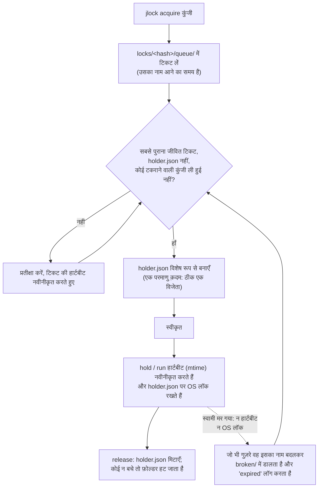

<!-- languages -->
[English](README.md) · [Português (Brasil)](README.pt-BR.md) · [Español](README.es.md) · [Français](README.fr.md) · [Deutsch](README.de.md) · [Italiano](README.it.md) · [简体中文](README.zh-CN.md) · [日本語](README.ja.md) · [Русский](README.ru.md) · [العربية](README.ar.md) · [हिन्दी](README.hi.md)

# jlock

**jlock एक ही मशीन पर चल रहे प्रोग्राम, स्क्रिप्ट, लोग और AI एजेंट को फ़ाइलों, फ़ोल्डरों और किसी भी अन्य चीज़ का
बारी-बारी से उपयोग करने देता है, बिना किसी सर्वर के।**

## jlock क्यों बना

jlock की शुरुआत AI कोडिंग एजेंटों से हुई। एक ही रिपॉज़िटरी में एक साथ काम कर रहे कई एजेंट बार-बार एक-दूसरे के
काम में दख़ल देते थे: दो एजेंट एक ही फ़ाइल बदल देते, या एक किसी फ़ोल्डर को दोबारा लिख देता जबकि दूसरा उसी को बिल्ड
कर रहा होता। जिन संपादन टूल का वे इस्तेमाल करते हैं वे फ़ाइल को कुछ मिलीसेकंड में खोलते, लिखते और बंद कर देते हैं,
इसलिए ऑपरेटिंग सिस्टम को कोई टकराव दिखता ही नहीं। लेकिन एजेंट को जिस *स्वामित्व* की ज़रूरत होती है वह पूरे कार्य तक
चलता है: कई मिनट, दर्जनों संपादनों और कई अल्पकालिक प्रक्रियाओं के पार। कमी थी एक ऐसे तरीक़े की जिससे कहा जा सके
"यह फ़ाइल मेरा काम पूरा होने तक मेरी है", जो हर दूसरे एजेंट को दिखे, और जो एजेंट के क्रैश होने पर अपने आप साफ़ हो
जाए।

यही ज़रूरत हर जगह दिखती है: एक ही `dist` फ़ोल्डर में लिखते दो बिल्ड, एक ही सर्वर पर दो डिप्लॉय, पोर्ट 3000 चाहने
वाले दो डेवलपमेंट सर्वर, रात में चलने वाली एक स्क्रिप्ट जो दो बार नहीं चलनी चाहिए। इन सबके लिए jlock एक छोटी-सी
कमांड है।

## समस्या, ठीक-ठीक

बारी-बारी से काम करना सुनने में आसान लगता है। लेकिन इसे एक मशीन पर, बिना सर्वर के, सही ढंग से करने के लिए यह सब
हल करना पड़ता है:

- **एक ही पल में दो अनुरोध।** "क्या यह मुक्त है?" पढ़ना और फिर "यह मेरा है" लिखना दो अलग क़दम हैं; दो प्रक्रियाएँ
  दोनों "मुक्त" पढ़ सकती हैं। jlock फ़ाइल सिस्टम के एक ही परमाणु (atomic) ऑपरेशन से फ़ैसला करता है।
- **स्वामी मर जाता है।** क्रैश हुई प्रक्रिया कुछ भी नहीं छोड़ सकती। jlock उसके लॉक अपने आप वापस ले लेता है, और
  लिख देता है कि उसने ऐसा किया।
- **आने का क्रम।** जिसने पहले माँगा उसे पहले मिलना चाहिए, न कि उसे जो संयोग से सही पल पर फिर कोशिश करे। jlock एक
  असली कतार रखता है।
- **डेडलॉक।** A के पास `x` है और वह `y` की प्रतीक्षा करता है; B के पास `y` है और वह `x` की प्रतीक्षा करता है; दोनों
  हमेशा प्रतीक्षा करते रहते हैं। jlock इस चक्र को देख लेता है और उस अनुरोध को अस्वीकार कर देता है जो चक्र को पूरा
  करता।
- **किसके पास क्या है, यह जानना।** जब कुछ अटक जाए, तो आपको देखना होता है कि वह किसके पास है, कब से है, और कौन
  प्रतीक्षा में है। jlock यह सब सूचीबद्ध करता है, और आपातकाल में आपको लॉक तोड़ने देता है।

## पहले से मौजूद किसी चीज़ का उपयोग क्यों नहीं

| विकल्प | क्या देता है | क्या कमी है |
|---|---|---|
| Windows share modes (फ़ाइल को विशेष रूप से खोलना) | OS दूसरों को फ़ाइल खोलने से मना कर देता है | केवल तब तक चलता है जब तक फ़ाइल खुली है (एडिटर के लिए मिलीसेकंड); आपके अपने एडिटर को भी रोकता है; कोई कतार नहीं, "कौन" का पता नहीं |
| Windows named mutex | एक लॉक जो अपनी प्रक्रिया के साथ मर जाता है | पूरे समय उसे थामे रखने वाली एक प्रक्रिया चाहिए; कोई निष्पक्ष क्रम नहीं; कोई सूची नहीं |
| `flock(1)` + `lslocks` (Linux) | कमांड चलने के दौरान लॉक रखना; PID के अनुसार सूची | Windows पर नहीं; आने का क्रम नहीं; PID से आगे कोई पहचान नहीं (यह नहीं बताता कि फ़ाइल किस एजेंट या किस कार्य के पास है); डेडलॉक की पहचान नहीं; अलग-अलग कमांडों के पार लॉक नहीं रख सकता |
| `proper-lockfile` (npm) | फ़ोल्डर लॉक करना, mtime से पुराने लॉक की पहचान | कोई कतार नहीं (यादृच्छिक पुनःप्रयास); कोई CLI नहीं; कोई वैश्विक सूची नहीं |

**पहचान क्यों मायने रखती है।** PID सिर्फ़ यह बताता है कि फ़ाइल किस प्रोसेस के पास है, और एजेंट के प्रोसेस लगातार बनते और ख़त्म होते रहते हैं: हर बदलाव, हर शेल कमांड एक नया प्रोसेस है। जानना यह ज़रूरी है कि फ़ाइल *किसके* पास है और *किस काम के लिए*। jlock हर लॉक के साथ यह दर्ज करता है: `--owner` एजेंट या सत्र का नाम बताता है (`claude:a8ec2aca`), `--group` वह कार्य जिस पर वह काम कर रहा है (`task-42`), `--intent` कि वह क्या कर रहा है ("T4: पार्सर का पुनर्गठन"), और `--meta` कोई भी अतिरिक्त जानकारी (`--meta task=T04`)। इससे समानांतर एजेंटों का समन्वय करने वाला देख सकता है कि हर फ़ाइल किस एजेंट और किस कार्य के पास है (`jlock list`), किसी कार्य की सारी फ़ाइलें एक साथ लौटा सकता है (`jlock release --group task-42`), और ऐसे कार्य बाँट सकता है जो एक ही फ़ाइलों को न छुएँ। स्क्रिप्ट और लोगों को भी इसका फ़ायदा है, लेकिन इसे ज़रूरी बनाते हैं साथ-साथ काम करने वाले AI एजेंट: वे मिलीसेकंड में बदलाव करते हैं, फ़ाइलों को मिनटों तक रखते हैं, और मशीन पर और कोई नहीं जानता कि वे कौन हैं।

## इंस्टॉल

Linux और macOS:

```
curl -fsSL https://raw.githubusercontent.com/rodrigojager/jlock/main/install.sh | sh
```

Windows (PowerShell):

```
irm https://raw.githubusercontent.com/rodrigojager/jlock/main/install.ps1 | iex
```

Rust के साथ: `cargo install jlock`, `cargo binstall jlock` (रिलीज़ की बाइनरी डाउनलोड करता है), या सोर्स कोड से:
`cargo install --path .`। फिर, एक नए टर्मिनल में, जाँचें कि सब कुछ ठीक जगह पर है:

```
jlock doctor
```

**अपने AI एजेंट को इसका उपयोग सिखाएँ।** [`skills/`](skills/README.md) फ़ोल्डर में Claude Code, OpenCode और
Codex के लिए एक स्किल है। यह एजेंट को बताती है कि लॉक कब लेना है, कौन-सी कमांड और विकल्प उपयोग करने हैं, और
कोई फ़ाइल ली हुई हो तो क्या करना है। एक कमांड इसे आपके एजेंट के लिए इंस्टॉल कर देती है; उसके बाद एजेंट का एक
नया सत्र शुरू करें।

Linux और macOS:

```
# Claude Code
mkdir -p ~/.claude/skills/jlock && curl -fsSL https://raw.githubusercontent.com/rodrigojager/jlock/main/skills/claude-code/jlock/SKILL.md -o ~/.claude/skills/jlock/SKILL.md
# OpenCode
mkdir -p ~/.config/opencode/skills/jlock && curl -fsSL https://raw.githubusercontent.com/rodrigojager/jlock/main/skills/opencode/jlock/SKILL.md -o ~/.config/opencode/skills/jlock/SKILL.md
# Codex
mkdir -p ~/.agents/skills/jlock && curl -fsSL https://raw.githubusercontent.com/rodrigojager/jlock/main/skills/codex/jlock/SKILL.md -o ~/.agents/skills/jlock/SKILL.md
```

Windows (PowerShell):

```
# Claude Code
New-Item -ItemType Directory -Force "$HOME\.claude\skills\jlock" | Out-Null; irm https://raw.githubusercontent.com/rodrigojager/jlock/main/skills/claude-code/jlock/SKILL.md -OutFile "$HOME\.claude\skills\jlock\SKILL.md"
# OpenCode
New-Item -ItemType Directory -Force "$HOME\.config\opencode\skills\jlock" | Out-Null; irm https://raw.githubusercontent.com/rodrigojager/jlock/main/skills/opencode/jlock/SKILL.md -OutFile "$HOME\.config\opencode\skills\jlock\SKILL.md"
# Codex
New-Item -ItemType Directory -Force "$HOME\.agents\skills\jlock" | Out-Null; irm https://raw.githubusercontent.com/rodrigojager/jlock/main/skills/codex/jlock/SKILL.md -OutFile "$HOME\.agents\skills\jlock\SKILL.md"
```

स्किल को केवल एक प्रोजेक्ट के लिए इंस्टॉल करने और अन्य विवरणों के लिए, [`skills/README.md`](skills/README.md) देखें।

## पाँच मिनट में

Alice एक नाम पर लॉक लेती है। Bob बिना प्रतीक्षा किए वही नाम माँगता है और उसे बताया जाता है कि वह किसके पास है।
फिर Alice उसे लौटा देती है:

<!-- jlock-example -->
```text
$ jlock acquire name:demo --owner alice
स्वीकृत name:demo
$ jlock acquire name:demo --owner bob --no-wait
व्यस्त name:demo, alice के पास (स्थान 1)
सुझाव: jlock status name:demo दिखाता है कि यह किसके पास है और कतार; अपनी बारी की प्रतीक्षा के लिए --no-wait हटा दें
$ jlock release name:demo --owner alice
छोड़ा name:demo
$ jlock status name:demo
मुक्त name:demo
```

`--no-wait` के बिना, Bob बस कतार में प्रतीक्षा करता और जिस पल Alice लॉक छोड़ती, उसी पल उसे लॉक मिल जाता।
`jlock help acquire` हर विकल्प को समझाता है।

## एजेंट से उपयोग

एक एजेंट (Claude Code, OpenCode, Codex या कोई और) जो कुछ बदलने वाला है उसे ले लेता है, काम करते समय उसे अपने पास
रखता है, और अंत में लौटा देता है। इसके लिए दो कॉल चाहिए:

1. **लेना:** `jlock hold src/parser.rs src/lexer.rs --owner agent-7 --group task-42 --intent "T4 parser" --detach`
   दोनों फ़ाइलें लेता है या कोई नहीं, अगर वे किसी और के पास हों तो अपनी बारी की प्रतीक्षा करते हुए, `granted`
   उत्तर देता है और लौट आता है। एक छोटी jlock प्रक्रिया पृष्ठभूमि में रहती है और लॉक को जीवित रखती है, इसलिए
   एजेंट उस पर कोई कॉल, और कोई टोकन, ख़र्च नहीं करता। `--owner` कमांडों के पार एजेंट की पहचान है; `--group`
   एक कार्य के पास की हर चीज़ को एक साथ बाँधता है।
2. **लौटाना:** कार्य पूरा होने पर `jlock release --group task-42 --owner agent-7`। पृष्ठभूमि की प्रक्रिया यह
   देख लेती है और समाप्त हो जाती है।

जानने लायक विकल्प:

- `--no-wait`: कतार में प्रतीक्षा न करें। अगर कोई फ़ाइल ली हुई है, तो उत्तर तुरंत आता है (`busy`, निकास कोड 10)
  इस जानकारी के साथ कि वह किसके पास है, ताकि एजेंट खड़े रहने के बजाय कोई और काम चुन सके।
- `--timeout 2m`: अधिकतम इतनी देर प्रतीक्षा करें, फिर हार मान लें (निकास कोड 11)।
- `--ttl 2h`: एक सुरक्षा सीमा। इतने समय बाद लॉक अपने-आप हट जाता है, भले ही एजेंट उसे कभी न छोड़े।

सीधा `jlock acquire` क्यों नहीं? `acquire` से लिया गया लॉक भी कमांड के बाद बना रहता है, लेकिन उसे कम से कम हर
30 सेकंड में नवीनीकृत (`jlock heartbeat`) करना पड़ता है, वरना उसे मृत मान लिया जाता है और वह समाप्त हो जाता है।
एक एजेंट दो कमांडों के बीच मिनट बिताता है, इसलिए उसके लिए `hold --detach` सही औज़ार है; `acquire` उन
प्रोग्रामों के लिए है जो ख़ुद नवीनीकरण करते हैं। अगर कोई लॉक तोड़ दे (`jlock unlock --force`), तो पृष्ठभूमि की
प्रक्रिया समाप्त हो जाती है और `jlock heartbeat <file> --owner agent-7` `lost` (निकास कोड 13) उत्तर देता है: लंबे
विराम के बाद यह जाँचना उचित है।

पूरा चक्र, एक नाम पर:

<!-- jlock-example -->
```text
$ jlock hold name:port-3000 --owner agent-7 --group task-42 --ttl 2h --detach
स्वीकृत name:port-3000
$ jlock release --group task-42 --owner agent-7
छोड़ा name:port-3000
```

`--json` के साथ, हर कमांड एक JSON ऑब्जेक्ट छापती है, जो हर भाषा में एक जैसा है:

<!-- jlock-example -->
```text
$ jlock acquire name:port-3000 --owner agent-7 --json
{"key":"name:port-3000","keys":["name:port-3000"],"owner":"agent-7","result":"granted","waited_ms":1}
```

## स्क्रिप्ट से उपयोग

`jlock run` `flock(1)` की तरह काम करता है: यह कुंजियाँ लेता है, कमांड चलाता है, कमांड चलने के दौरान लॉक को जीवित
रखता है, अंत में उसे छोड़ देता है, और कमांड के अपने निकास कोड से बाहर निकलता है।

```
jlock run D:\proj\dist -- cargo build --release      # इस मशीन पर एक समय में एक ही बिल्ड
jlock run name:deploy-prod --timeout 2m -- ./deploy.sh
```

यहाँ कमांड ख़ुद jlock है, ताकि आप देख सकें कि उसके चलते समय लॉक धारित है:

<!-- jlock-example -->
```text
$ jlock run name:nightly -- jlock list
कुंजी           स्वामी       समूह  उद्देश्य  कब से  हार्टबीट  कतार
name:nightly  pid:177188  -    -      24ms  24ms     0

1 लॉक, 0 प्रतीक्षा में
$ jlock list
कुछ भी लॉक नहीं
```

## एक व्यक्ति के रूप में उपयोग

- `jlock list --watch` मशीन पर लॉक की गई हर चीज़ दिखाता है, हर सेकंड फिर से बनाकर।
- `jlock status <key>` दिखाता है कि एक कुंजी किसके पास है, उसकी कतार, और उसे क्या रोक रहा है।
- `jlock graph` दिखाता है कि कौन किसकी प्रतीक्षा में है।
- `jlock unlock <key> --force --reason "..."` आपातकाल में किसी और का लॉक तोड़ता है; लॉग में रहता है कि किसने तोड़ा
  और क्यों, और स्वामी का `hold`/`run` रुक जाता है।

<!-- jlock-example -->
```text
$ jlock acquire name:printer --owner alice --intent "printing the report"
स्वीकृत name:printer
$ jlock unlock name:printer --force --reason "alice went home"
बलपूर्वक-तोड़ा name:printer (पहले alice का)
$ jlock graph
कोई प्रतीक्षक नहीं
```

## यह कैसे काम करता है

स्थिति डिस्क पर एक फ़ोल्डर है (Windows पर `%LOCALAPPDATA%\jlock`, Linux पर `~/.local/state/jlock`, macOS पर
`~/Library/Application Support/jlock`)। किसी चीज़ को लगातार चलते रहने की ज़रूरत नहीं है, और किसी भी प्रक्रिया के
क्रैश होने पर कुछ भी नहीं खोता।



- **हर कुंजी के लिए एक फ़ोल्डर**, जिसका नाम सामान्यीकृत कुंजी का SHA-1 होता है। `holder.json` ठीक उतनी देर मौजूद
  रहती है जितनी देर कुंजी ली हुई है, और बताती है कि वह किसके पास है।
- **हर प्रतीक्षक के लिए एक टिकट** `queue/` में, जिसका नाम उसके आने का समय होता है: केवल सबसे पुराना जीवित टिकट लॉक
  ले सकता है, इसलिए क्रम आने का क्रम ही है।
- **हार्टबीट**: स्वामी और प्रतीक्षक हर 5 s में अपनी फ़ाइल को छूते हैं। जो फ़ाइल 30 s तक न छुई गई हो वह एक मृत
  प्रक्रिया की है और जो भी उसे देखे वह उसे हटा देता है। `hold` और `run` `holder.json` पर ऑपरेटिंग सिस्टम का लॉक भी
  रखते हैं, जिसे प्रक्रिया के मरते ही कर्नेल छोड़ देता है, इसलिए धीमे लेकिन जीवित स्वामी को कभी मृत नहीं समझा
  जाता।
- **डेडलॉक**: फ़ाइलें ख़ुद बताती हैं कि कौन किसकी प्रतीक्षा में है; जो अनुरोध चक्र पूरा करता उसे शृंखला के साथ
  अस्वीकार कर दिया जाता है।
- **कोई अवशेष नहीं**: जब कुछ भी लॉक न हो, तो `locks` फ़ोल्डर खाली रहता है।

## गारंटियाँ और सीमाएँ

| jlock गारंटी देता है | jlock गारंटी नहीं देता (और यह ठीक क्यों है) |
|---|---|
| किसी भी पल हर कुंजी का एक ही स्वामी | jlock का उपयोग न करने वाले प्रोग्रामों को रोकना: लॉक सलाह भर हैं, `flock` की तरह |
| जीवित प्रतीक्षकों के बीच आने का सख़्त क्रम | तुरंत हस्तांतरण: अगले को एक सेकंड के चौथाई हिस्से में पता चल जाता है |
| मृत स्वामी का लॉक 30 s के भीतर वापस लिया जाता है, और लॉग किया जाता है | साधारण `acquire` के लिए मृत और जमे हुए में फ़र्क़ करना (जमा हुआ स्वामी `lost` पाता है और रुक जाता है); `hold`/`run` के साथ OS लॉक दोनों में फ़र्क़ कर देता है |
| डेडलॉक हर बार एक ही तरह से पहचाने और सुलझाए जाते हैं | अलग-अलग मशीनों के बीच समन्वय |
| सूची हमेशा सच होती है: वह ख़ुद फ़ोल्डर ही है | — |
| किसी प्रक्रिया को लगातार चलते रहने की ज़रूरत नहीं | बिना किसी कॉल के सफ़ाई: अवशेष अगली कमांड या `jlock gc` की प्रतीक्षा करते हैं |
| कुछ भी लॉक न होने पर `locks` फ़ोल्डर खाली | — |

## कुंजियाँ

| कुंजी | अर्थ | किससे टकराती है |
|---|---|---|
| एक पथ: `D:\proj\src\a.ts`, `src/a.ts`, `~/notes`, `.` | वह फ़ाइल या फ़ोल्डर; सापेक्ष पथ वर्तमान फ़ोल्डर से शुरू होते हैं; पथ का मौजूद होना ज़रूरी नहीं | वही पथ, उसके अंदर की हर चीज़, उसके ऊपर का हर फ़ोल्डर, और `*` |
| `name:<text>` | जो कुछ भी पथ नहीं है: `name:port-3000`, `name:deploy-prod` | वही नाम, और `*` |
| `*` | सब कुछ | हर कुंजी |

Windows और macOS पर अक्षरों का छोटा-बड़ा होना अनदेखा किया जाता है (`D:\Proj\SRC` और `d:/proj/src` एक ही कुंजी हैं)।
एक कमांड में दी गई कई कुंजियाँ सभी या कोई नहीं के रूप में, एक तय क्रम में ली जाती हैं, इसलिए वे कभी एक-दूसरे के
साथ डेडलॉक नहीं बनातीं।

## निकास कोड

| कोड | अर्थ |
|---|---|
| 0 | स्वीकृत / ठीक |
| 2 | गलत उपयोग |
| 10 | व्यस्त (`--no-wait` के साथ) |
| 11 | समयसीमा (`--timeout` के साथ) |
| 12 | डेडलॉक: अनुरोध एक चक्र पूरा कर देता |
| 13 | स्वामी नहीं |
| 14 | लॉक खो गया (`hold`/`run`) |
| 20 | फ़ाइल सिस्टम त्रुटि; संदेश में OS की त्रुटि होती है |
| 130 | प्रतीक्षा के दौरान बाधित (CTRL+C) |

लॉक स्वीकृत होने के बाद `jlock run` कमांड के अपने कोड से निकलता है।

## कॉन्फ़िगरेशन

| वेरिएबल | डिफ़ॉल्ट | उपयोग |
|---|---|---|
| `JLOCK_HOME` | सिस्टम के अनुसार (ऊपर देखें) | रजिस्ट्री कहाँ रहती है |
| `JLOCK_LANG` | सिस्टम की भाषा | टेक्स्ट आउटपुट की भाषा: `en`, `pt-BR`, `es`, `fr`, `de`, `it`, `zh-CN`, `ja`, `ru`, `ar`, `hi` (`--lang` भी) |
| `JLOCK_HINTS` | `1` | `0` सुझाव बंद कर देता है |
| `JLOCK_HEARTBEAT_MS` | 5000 | स्वामी और प्रतीक्षक कितनी बार नवीनीकरण करते हैं |
| `JLOCK_STALE_MS` | 30000 | इतनी देर तक नवीनीकरण न हो = मृत |
| `JLOCK_POLL_MS` | 250 | प्रतीक्षक कितनी बार देखता है |
| `JLOCK_SWEEP_MS` | 60000 | दो वैश्विक सफ़ाइयों के बीच न्यूनतम समय |
| `JLOCK_LOG_MAX_BYTES` | 5242880 | वह आकार जिस पर `log.jsonl` को घुमाया जाता है |

कमांड, विकल्प, `--json`, लॉग और निकास कोड हर भाषा में एक जैसे हैं।

## अपडेट करना

```
jlock update --check   # क्या कोई नया संस्करण है?
jlock update           # इसे इंस्टॉल करें
```

`update` आपके सिस्टम के लिए रिलीज़ डाउनलोड करता है, उसे रिलीज़ के `SHA256SUMS` से जाँचता है, चल रहे एक्ज़ीक्यूटेबल
की जगह उसे रखता है और सफलता घोषित करने से पहले उसे एक बार चलाता है। यह सिस्टम का `curl` इस्तेमाल करता है। यही
एकमात्र कमांड है जो नेटवर्क का उपयोग करती है, और केवल तब जब आप इसे चलाएँ।

## योगदान

[`CONTRIBUTING.md`](CONTRIBUTING.md) देखें। jlock जो टेक्स्ट छापता है वह ग्यारह भाषाओं में है, और **शब्दों की
समीक्षा का किसी भी भाषा में स्वागत है, अंग्रेज़ी में भी**, Rust जाने बिना। पूरा कमांड संदर्भ
[`docs/USAGE.md`](docs/USAGE.md) में है; डिज़ाइन [`docs/PLAN.md`](docs/PLAN.md) (पुर्तगाली) में, इसे बनाते समय लिए
गए निर्णय [`docs/DEVIATIONS.md`](docs/DEVIATIONS.md) में, और आगे क्या आने वाला है वह [`ROADMAP.md`](ROADMAP.md) में।

## लेखक

Rodrigo Jäger — GitHub <https://github.com/rodrigojager> · LinkedIn <https://www.linkedin.com/in/rodrigojager>

## लाइसेंस

MIT, देखें [`LICENSE`](LICENSE)।

<sub>यह अनुवाद किसी मूल वक्ता की समीक्षा की प्रतीक्षा में है; सुधारों का स्वागत है — देखें [`CONTRIBUTING.md`](CONTRIBUTING.md)।</sub>
