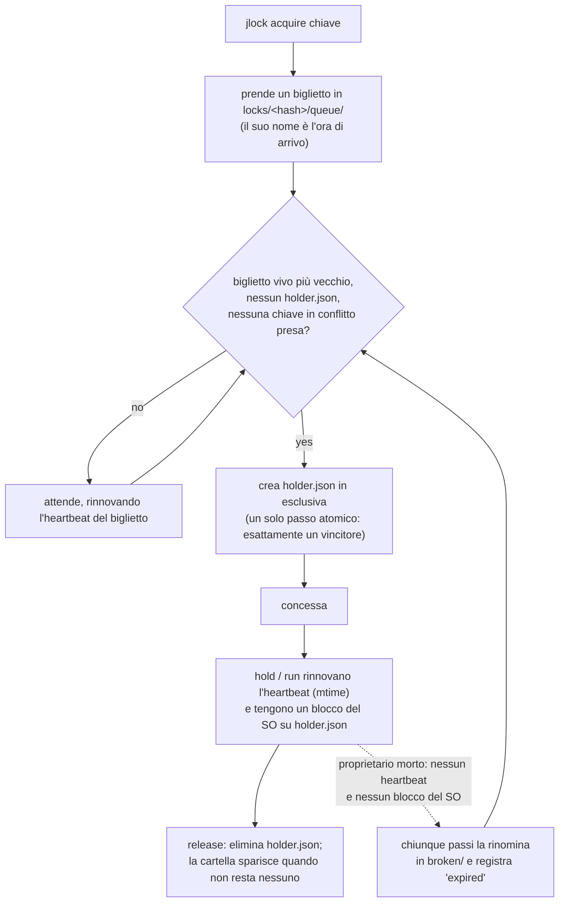

<!-- languages -->
[English](README.md) · [Português (Brasil)](README.pt-BR.md) · [Español](README.es.md) · [Français](README.fr.md) · [Deutsch](README.de.md) · [Italiano](README.it.md) · [简体中文](README.zh-CN.md) · [日本語](README.ja.md) · [Русский](README.ru.md) · [العربية](README.ar.md) · [हिन्दी](README.hi.md)

# jlock

**jlock fa sì che programmi, script, persone e agenti IA sulla stessa macchina si diano il turno con file,
cartelle e qualsiasi altra cosa, senza un server.**

## Perché esiste jlock

jlock è nato con gli agenti IA che scrivono codice. Più agenti al lavoro nello stesso repository nello
stesso momento finivano per pestarsi i piedi: due modificavano lo stesso file, oppure uno riscriveva una
cartella mentre un altro la stava compilando. Gli strumenti di modifica che usano aprono un file, lo
scrivono e lo chiudono in pochi millisecondi, quindi il sistema operativo non si accorge di nessun
conflitto. Ma la *proprietà* di cui un agente ha bisogno dura per tutta l'attività: minuti, attraverso
decine di modifiche e tanti processi di breve vita. Mancava un modo per dire "questo file è mio finché non
ho finito", visibile a ogni altro agente, che si ripulisca da solo se l'agente va in crash.

Lo stesso bisogno compare ovunque: due build che scrivono nella stessa cartella `dist`, due deploy sullo
stesso server, due server di sviluppo che vogliono la porta 3000, uno script notturno che non deve girare
due volte. jlock è un solo piccolo comando per tutti questi casi.

## Il problema, nel dettaglio

Darsi il turno sembra semplice. Farlo bene su una sola macchina, senza server, significa risolvere tutto
questo:

- **Due richieste nello stesso istante.** Leggere "è libero?" e poi scrivere "è mio" sono due passi; due
  processi possono leggere entrambi "libero". jlock decide con un'unica operazione atomica del file system.
- **Il proprietario muore.** Un processo andato in crash non può rilasciare nulla. jlock recupera da solo i
  suoi blocchi, e annota di averlo fatto.
- **Ordine di arrivo.** Chi ha chiesto per primo deve ottenerlo per primo, non chi per caso riprova nel
  momento giusto. jlock tiene una vera coda.
- **Deadlock.** A tiene `x` e attende `y`; B tiene `y` e attende `x`; entrambi attendono per sempre. jlock
  vede il ciclo e rifiuta la richiesta che lo chiuderebbe.
- **Sapere chi tiene cosa.** Quando qualcosa è bloccato, devi vedere chi lo tiene, da quando e chi sta
  attendendo. jlock elenca tutto, e ti permette di rompere un blocco in caso di emergenza.

## Perché non qualcosa che esiste già

| Opzione | Cosa offre | Cosa manca |
|---|---|---|
| Modalità di condivisione di Windows (aprire un file in esclusiva) | il SO rifiuta le altre aperture | dura solo finché il file è aperto (millisecondi per un editor); blocca anche il tuo editor; nessuna coda, nessun "chi" |
| Mutex con nome di Windows | un blocco che muore con il suo processo | richiede un processo che lo tenga per tutto il tempo; nessun ordine equo; nessun elenco |
| `flock(1)` + `lslocks` (Linux) | tiene un blocco mentre un comando è in esecuzione; elenco per PID | non esiste su Windows; nessun ordine di arrivo; nessuna identità oltre al PID (non dice quale agente o attività tiene il file); nessun rilevamento dei deadlock; non può tenere un blocco tra comandi separati |
| `proper-lockfile` (npm) | blocca cartelle, rileva i blocchi abbandonati tramite mtime | nessuna coda (tentativi casuali); nessuna CLI; nessun elenco globale |

**Perché l'identità conta.** Un PID dice solo quale processo tiene il file, e i processi di un agente nascono e muoiono di continuo: ogni modifica, ogni comando di shell è un processo nuovo. Quello che serve sapere è *chi* tiene il file e *per fare cosa*. jlock lo registra con ogni blocco: `--owner` indica l'agente o la sessione (`claude:a8ec2aca`), `--group` l'attività su cui sta lavorando (`attivita-42`), `--intent` cosa sta facendo ("T4: rifattorizzare il parser") e `--meta` qualsiasi dato in più (`--meta task=T04`). Così chi coordina agenti in parallelo vede quale agente e quale attività tengono ogni file (`jlock list`), restituisce in un colpo i file di un'attività (`jlock release --group attivita-42`) e distribuisce attività che non toccano gli stessi file. Anche script e persone ne traggono vantaggio, ma sono gli agenti IA che lavorano fianco a fianco a renderlo necessario: modificano in millisecondi, tengono i file per minuti, e nient'altro sulla macchina sa chi sono.

## Installazione

Linux e macOS:

```
curl -fsSL https://raw.githubusercontent.com/rodrigojager/jlock/main/install.sh | sh
```

Windows (PowerShell):

```
irm https://raw.githubusercontent.com/rodrigojager/jlock/main/install.ps1 | iex
```

Con Rust: `cargo install jlock`, `cargo binstall jlock` (scarica il binario della release), oppure dal
codice sorgente: `cargo install --path .`. Poi, in un nuovo terminale, controlla che sia tutto a posto:

```
jlock doctor
```

**Insegna al tuo agente di IA a usarlo.** La cartella [`skills/`](skills/README.md) contiene una skill per
Claude Code, OpenCode e Codex. Dice all'agente quando prendere un blocco, quali comandi e opzioni usare e
cosa fare quando un file è occupato. Un solo comando la installa per il tuo agente; poi apri una nuova
sessione dell'agente.

Linux e macOS:

```
# Claude Code
mkdir -p ~/.claude/skills/jlock && curl -fsSL https://raw.githubusercontent.com/rodrigojager/jlock/main/skills/claude-code/jlock/SKILL.md -o ~/.claude/skills/jlock/SKILL.md
# OpenCode
mkdir -p ~/.config/opencode/skills/jlock && curl -fsSL https://raw.githubusercontent.com/rodrigojager/jlock/main/skills/opencode/jlock/SKILL.md -o ~/.config/opencode/skills/jlock/SKILL.md
# Codex
mkdir -p ~/.agents/skills/jlock && curl -fsSL https://raw.githubusercontent.com/rodrigojager/jlock/main/skills/codex/jlock/SKILL.md -o ~/.agents/skills/jlock/SKILL.md
```

Windows (PowerShell):

```
# Claude Code
New-Item -ItemType Directory -Force "$HOME\.claude\skills\jlock" | Out-Null; irm https://raw.githubusercontent.com/rodrigojager/jlock/main/skills/claude-code/jlock/SKILL.md -OutFile "$HOME\.claude\skills\jlock\SKILL.md"
# OpenCode
New-Item -ItemType Directory -Force "$HOME\.config\opencode\skills\jlock" | Out-Null; irm https://raw.githubusercontent.com/rodrigojager/jlock/main/skills/opencode/jlock/SKILL.md -OutFile "$HOME\.config\opencode\skills\jlock\SKILL.md"
# Codex
New-Item -ItemType Directory -Force "$HOME\.agents\skills\jlock" | Out-Null; irm https://raw.githubusercontent.com/rodrigojager/jlock/main/skills/codex/jlock/SKILL.md -OutFile "$HOME\.agents\skills\jlock\SKILL.md"
```

Per installare la skill in un solo progetto, e per altri dettagli, vedi [`skills/README.md`](skills/README.md).

## Cinque minuti

Alice prende un blocco su un nome. Bob chiede lo stesso senza attendere e gli viene detto chi ce l'ha. Poi
Alice lo restituisce:

<!-- jlock-example -->
```text
$ jlock acquire name:demo --owner alice
concessa name:demo
$ jlock acquire name:demo --owner bob --no-wait
occupata name:demo, tenuta da alice (posizione 1)
suggerimento: jlock status name:demo mostra chi la tiene e la coda; togli --no-wait per attendere il tuo turno
$ jlock release name:demo --owner alice
rilasciata name:demo
$ jlock status name:demo
libera name:demo
```

Senza `--no-wait`, Bob si metterebbe semplicemente in coda e otterrebbe il blocco nel momento in cui Alice
lo rilascia. `jlock help acquire` spiega ogni opzione.

## Usarlo da un agente

Un agente (Claude Code, OpenCode, Codex o qualsiasi altro) prende ciò che sta per modificare, lo tiene
mentre lavora e lo restituisce alla fine. Bastano due chiamate:

1. **Prendere:** `jlock hold src/parser.rs src/lexer.rs --owner agent-7 --group task-42 --intent "T4 parser" --detach`
   prende entrambi i file o nessuno dei due, attendendo il suo turno se qualcun altro li ha, risponde
   `granted` e torna. Un piccolo processo jlock resta in background e mantiene vivo il blocco, così l'agente
   non spende chiamate, né token, per questo. `--owner` è l'identità dell'agente da un comando all'altro;
   `--group` lega insieme tutto ciò che un'attività tiene.
2. **Restituire:** `jlock release --group task-42 --owner agent-7` quando l'attività è finita. Il processo
   in background se ne accorge e termina.

Opzioni da conoscere:

- `--no-wait`: non mettersi in coda. Se un file è occupato, la risposta arriva subito (`busy`, codice di
  uscita 10) con chi lo tiene, così l'agente può scegliere un altro lavoro invece di restare fermo.
- `--timeout 2m`: attendere al massimo questo tempo, poi rinunciare (codice di uscita 11).
- `--release-on-eof`: per un programma che resta aperto ed esegue `hold` in primo piano (senza `--detach`),
  tenendo il suo standard input: se il programma muore, la pipe si chiude e il blocco è rilasciato subito. Le
  chiamate brevi usano `--detach`; un programma che resta aperto usa `--release-on-eof`.
- `--ttl 2h`: un limite di sicurezza. Il blocco se ne va da solo dopo questo tempo, anche se l'agente non
  lo rilascia mai.
  Per un lavoro che può durare di più, `jlock renew --owner agent-7` sposta in avanti questo limite senza mai
  lasciare il blocco.

Perché non semplicemente `jlock acquire`? Anche un blocco preso con `acquire` sopravvive al comando, ma va
rinnovato (`jlock heartbeat`) almeno ogni 30 secondi, altrimenti viene considerato morto e scade. Un agente
passa minuti tra due comandi, quindi `hold --detach` è lo strumento giusto per lui; `acquire` è per i
programmi che si rinnovano da soli. Se qualcuno rompe il blocco (`jlock unlock --force`), il processo in
background termina e `jlock heartbeat <file> --owner agent-7` risponde `lost` (codice di uscita 13): vale la
pena controllarlo dopo una lunga pausa.

L'intero ciclo, su un nome:

<!-- jlock-example -->
```text
$ jlock hold name:port-3000 --owner agent-7 --group task-42 --ttl 2h --detach
concessa name:port-3000
$ jlock release --group task-42 --owner agent-7
rilasciata name:port-3000
```

Con `--json`, ogni comando stampa un oggetto JSON, uguale in ogni lingua:

<!-- jlock-example -->
```text
$ jlock acquire name:port-3000 --owner agent-7 --json
{"key":"name:port-3000","keys":["name:port-3000"],"owner":"agent-7","result":"granted","waited_ms":1}
```

## Usarlo da uno script

`jlock run` funziona come `flock(1)`: prende le chiavi, esegue il comando, mantiene vivo il blocco mentre
il comando è in esecuzione, lo rilascia alla fine ed esce con il codice di uscita del comando stesso.

```
jlock run D:\proj\dist -- cargo build --release      # una build alla volta su questa macchina
jlock run name:deploy-prod --timeout 2m -- ./deploy.sh
```

Qui il comando è jlock stesso, così puoi vedere il blocco tenuto mentre è in esecuzione:

<!-- jlock-example -->
```text
$ jlock run name:nightly -- jlock list
CHIAVE        PROPRIETARIO  GRUPPO  SCOPO  DURATA  HEARTBEAT  CODA
name:nightly  pid:179856    -       -      21ms    21ms       0

1 blocco, 0 in attesa
$ jlock list
niente bloccato
```

## Usarlo come persona

- `jlock list --watch` mostra tutto ciò che è bloccato sulla macchina, ridisegnato ogni secondo.
- `jlock status <key>` mostra chi tiene una chiave, la coda e cosa la blocca.
- `jlock graph` mostra chi attende chi.
- `jlock unlock <key> --force --reason "..."` rompe il blocco di qualcun altro in caso di emergenza; il log
  conserva chi l'ha fatto e perché, e l'`hold`/`run` del proprietario si ferma.

<!-- jlock-example -->
```text
$ jlock acquire name:printer --owner alice --intent "printing the report"
concessa name:printer
$ jlock unlock name:printer --force --reason "alice went home"
forzata name:printer (era di alice)
$ jlock graph
nessuno in attesa
```

## Come funziona

Lo stato è una cartella sul disco (`%LOCALAPPDATA%\jlock` su Windows, `~/.local/state/jlock` su Linux,
`~/Library/Application Support/jlock` su macOS). Nulla deve restare in esecuzione, e nulla va perso se un
processo va in crash.



- **Una cartella per chiave**, chiamata con lo SHA-1 della chiave normalizzata. `holder.json` esiste
  esattamente finché la chiave è presa, e dice chi ce l'ha.
- **Un biglietto per ogni attesa** in `queue/`, chiamato con l'ora di arrivo: solo il biglietto vivo più
  vecchio può prendere il blocco, quindi l'ordine è l'ordine di arrivo.
- **Heartbeat** (segnale di vita): proprietari e chi attende toccano il proprio file ogni 5 s. Un file non
  toccato da 30 s appartiene a un processo morto e viene rimosso da chiunque lo veda. `hold` e `run`
  tengono anche un blocco del sistema operativo su `holder.json`, che il kernel rilascia nell'istante in
  cui il processo muore, così un proprietario lento ma vivo non viene mai preso per morto.
- **Deadlock**: i file stessi descrivono chi attende chi; una richiesta che chiuderebbe un ciclo viene
  rifiutata, mostrando la catena.
- **Zero residui**: quando nulla è bloccato, la cartella `locks` è vuota.

## Garanzie e limiti

| jlock garantisce | jlock non garantisce (e perché va bene così) |
|---|---|
| un solo proprietario per chiave in ogni istante | fermare i programmi che non usano jlock: i blocchi sono consultivi, come `flock` |
| ordine di arrivo rigoroso tra chi attende ed è vivo | il passaggio istantaneo: il prossimo se ne accorge entro un quarto di secondo |
| il blocco di un proprietario morto viene recuperato entro 30 s, e registrato nel log | distinguere un morto da un congelato con un semplice `acquire` (un proprietario congelato trova `lost` e si ferma); con `hold`/`run` il blocco del SO li distingue |
| deadlock rilevati e risolti sempre allo stesso modo | il coordinamento tra macchine diverse |
| l'elenco è sempre la verità: è la cartella stessa | — |
| nessun processo deve restare in esecuzione | la pulizia senza alcuna chiamata: i residui attendono il prossimo comando o `jlock gc` |
| una cartella `locks` vuota quando nulla è bloccato | — |

## Chiavi

| Chiave | Significato | In conflitto con |
|---|---|---|
| un percorso: `D:\proj\src\a.ts`, `src/a.ts`, `~/notes`, `.` | quel file o quella cartella; i percorsi relativi partono dalla cartella corrente; il percorso non deve per forza esistere | lo stesso percorso, tutto ciò che contiene, ogni cartella sopra di esso, e `*` |
| `name:<text>` | qualsiasi cosa che non sia un percorso: `name:port-3000`, `name:deploy-prod` | lo stesso nome, e `*` |
| `*` | tutto | ogni chiave |

Su Windows e macOS maiuscole e minuscole non contano (`D:\Proj\SRC` e `d:/proj/src` sono la stessa
chiave). Più chiavi in un solo comando vengono prese tutte o nessuna, in un ordine fisso, così non vanno
mai in deadlock tra loro.

## Codici di uscita

| Codice | Significato |
|---|---|
| 0 | concessa / ok |
| 2 | uso errato |
| 10 | occupata (con `--no-wait`) |
| 11 | tempo esaurito (con `--timeout`) |
| 12 | deadlock: la richiesta chiuderebbe un ciclo |
| 13 | non proprietario |
| 14 | blocco perso (`hold`/`run`/`renew`) |
| 20 | errore del file system; il messaggio riporta l'errore del SO |
| 130 | interrotto (CTRL+C) durante l'attesa |

`jlock run` esce con il codice del comando stesso, una volta concesso il blocco.

## Configurazione

| Variabile | Predefinito | Uso |
|---|---|---|
| `JLOCK_HOME` | dipende dal sistema (vedi sopra) | dove si trova il registro |
| `JLOCK_LANG` | la lingua del sistema | lingua dell'output testuale: `en`, `pt-BR`, `es`, `fr`, `de`, `it`, `zh-CN`, `ja`, `ru`, `ar`, `hi` (anche `--lang`) |
| `JLOCK_HINTS` | `1` | `0` disattiva i suggerimenti |
| `JLOCK_HEARTBEAT_MS` | 5000 | ogni quanto proprietari e chi attende si rinnovano |
| `JLOCK_STALE_MS` | 30000 | nessun rinnovo per questo tempo = morto |
| `JLOCK_POLL_MS` | 250 | ogni quanto chi attende controlla |
| `JLOCK_SWEEP_MS` | 60000 | tempo minimo tra due pulizie globali |
| `JLOCK_LOG_MAX_BYTES` | 5242880 | dimensione oltre la quale `log.jsonl` viene ruotato |

Comandi, opzioni, `--json`, il log e i codici di uscita sono uguali in ogni lingua.

## Aggiornamento

```
jlock update --check   # c'è una versione più recente?
jlock update           # installala
```

`update` scarica la release per il tuo sistema, la verifica con il `SHA256SUMS` della release, sostituisce
l'eseguibile in esecuzione e lo esegue una volta prima di dichiarare il successo. Usa il `curl` del
sistema. È l'unico comando che usa la rete, e solo quando lo esegui.

## Contribuire

Vedi [`CONTRIBUTING.md`](CONTRIBUTING.md). Il testo che jlock stampa esiste in undici lingue, e **le
revisioni della formulazione sono benvenute in qualsiasi lingua, inglese compreso**, senza bisogno di
conoscere Rust. Il riferimento completo dei comandi è in [`docs/USAGE.md`](docs/USAGE.md); il progetto è in
[`docs/PLAN.md`](docs/PLAN.md) (in portoghese), le decisioni prese durante lo sviluppo in
[`docs/DEVIATIONS.md`](docs/DEVIATIONS.md), e ciò che verrà dopo in [`ROADMAP.md`](ROADMAP.md).

## Autore

Rodrigo Jäger — GitHub <https://github.com/rodrigojager> · LinkedIn <https://www.linkedin.com/in/rodrigojager>

## Licenza

MIT, vedi [`LICENSE`](LICENSE).
