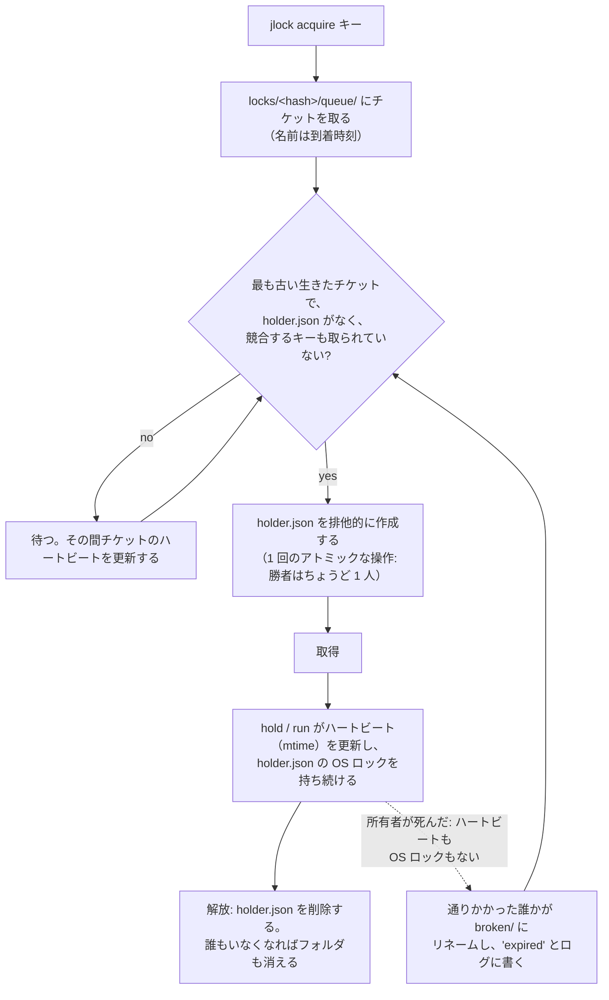

<!-- languages -->
[English](README.md) · [Português (Brasil)](README.pt-BR.md) · [Español](README.es.md) · [Français](README.fr.md) · [Deutsch](README.de.md) · [Italiano](README.it.md) · [简体中文](README.zh-CN.md) · [日本語](README.ja.md) · [Русский](README.ru.md) · [العربية](README.ar.md) · [हिन्दी](README.hi.md)

# jlock

**jlock は、同じマシン上のプログラム、スクリプト、人、AI エージェントが、ファイルやフォルダをはじめ何でも、サーバーなしで順番に使えるようにする。**

## jlock が生まれた理由

jlock は AI コーディングエージェントから始まった。同じリポジトリで複数のエージェントが同時に作業すると、互いの邪魔をし合っていた。2 つのエージェントが同じファイルを編集したり、一方がフォルダを書き換えている最中に、もう一方がそのフォルダをビルドしていたりした。エージェントが使う編集ツールは、ファイルを開き、書き込み、閉じるまでを数ミリ秒で終えるので、OS は競合に何も気づかない。しかし、エージェントに必要な「所有」はタスク全体にわたって続く。数十回の編集と、多数の短命なプロセスにまたがる、数分間である。足りなかったのは、「このファイルは自分の作業が終わるまで自分のものだ」と宣言でき、それが他のすべてのエージェントから見え、エージェントがクラッシュしても自然に片付く仕組みだった。

同じ必要は、ほかのあらゆる場面にも現れる。同じ `dist` フォルダに書き込む 2 つのビルド、同じサーバーへの 2 つのデプロイ、どちらもポート 3000 を使いたい 2 つの開発サーバー、二重に走ってはいけない夜間スクリプト。jlock は、そのすべてに使える 1 つの小さなコマンドである。

## 問題を正確に言うと

順番に使うのは簡単そうに聞こえる。だが、1 台のマシンでサーバーなしに正しく行うには、次のすべてを解決しなければならない。

- **同じ瞬間に来た 2 つの要求。** 「空いている?」と読んでから「自分のものだ」と書くのは 2 段階なので、2 つのプロセスが両方とも「空いている」と読んでしまうことがある。jlock は、ファイルシステムの 1 回のアトミックな操作で決着をつける。
- **所有者が死ぬ。** クラッシュしたプロセスは何も解放できない。jlock はそのロックを自分で回収し、回収したことを記録する。
- **到着順。** 先に求めた者が先に得るべきであって、たまたまよいタイミングで再試行した者が得るべきではない。jlock は本物のキューを持つ。
- **デッドロック。** A が `x` を保持して `y` を待ち、B が `y` を保持して `x` を待つと、両者は永遠に待ち続ける。jlock はこの循環を見つけ、循環を閉じることになる要求を拒否する。
- **誰が何を持っているかを知る。** 何かが詰まったときは、誰が保持しているのか、いつからか、誰が待っているのかを見る必要がある。jlock はそれをすべて一覧にし、緊急時にはロックを破棄することもできる。

## なぜ既存のものを使わないのか

| 選択肢 | 得られるもの | 足りないもの |
|---|---|---|
| Windows の共有モード（ファイルを排他的に開く） | OS が他からのオープンを拒否する | ファイルが開いている間しか続かない（エディタなら数ミリ秒）。自分のエディタもブロックされる。キューも「誰が」もない |
| Windows の名前付きミューテックス | プロセスと一緒に消えるロック | 保持し続けるプロセスが常に必要。公平な順序がない。一覧がない |
| `flock(1)` + `lslocks`（Linux） | コマンドの実行中ロックを保持する。PID で一覧できる | Windows にない。到着順がない。PID 以外の識別がない（どのエージェント・どのタスクがファイルを持っているか分からない）。デッドロック検出がない。別々のコマンドをまたいで保持できない |
| `proper-lockfile`（npm） | フォルダをロックし、mtime で古いロックを検出する | キューがない（ランダムな再試行）。CLI がない。全体の一覧がない |

**なぜ識別が重要か。** PID が示すのはどのプロセスがファイルを持っているかだけで、エージェントのプロセスは絶えず生まれては消える。編集のたび、シェルコマンドのたびに新しいプロセスになる。知る必要があるのは、*誰が*、*何のために*ファイルを持っているかだ。jlock はロックごとにそれを記録する。`--owner` はエージェントやセッション（`claude:a8ec2aca`）、`--group` は取り組んでいるタスク（`task-42`）、`--intent` は何をしているか（"T4: パーサーのリファクタリング"）、`--meta` は追加のデータ（`--meta task=T04`）を表す。これにより、エージェントを並行して動かす側は、どのファイルをどのエージェント・どのタスクが持っているかを確認でき（`jlock list`）、タスクのファイルをまとめて返し（`jlock release --group task-42`）、同じファイルに触れないタスクを割り振れる。スクリプトや人にも役立つが、これを本当に必要にしているのは並んで作業する AI エージェントだ。ミリ秒で編集し、ファイルを何分も持ち続け、しかもマシン上の他の何も彼らが誰なのかを知らない。

## インストール

Linux と macOS:

```
curl -fsSL https://raw.githubusercontent.com/rodrigojager/jlock/main/install.sh | sh
```

Windows（PowerShell）:

```
irm https://raw.githubusercontent.com/rodrigojager/jlock/main/install.ps1 | iex
```

Rust があれば、`cargo install jlock`、`cargo binstall jlock`（リリースのバイナリをダウンロードする）、またはソースコードから `cargo install --path .` でもよい。その後、新しいターミナルで、すべてが揃っているか確認する。

```
jlock doctor
```

**AI エージェントに jlock の使い方を教える。** [`skills/`](skills/README.md) フォルダには、Claude Code、OpenCode、Codex 向けのスキルがある。スキルはエージェントに、いつロックを取得するか、どのコマンドとオプションを使うか、ファイルが使用中のときにどうするかを教える。1 つのコマンドでエージェントにスキルがインストールされる。その後、エージェントの新しいセッションを始める。

Linux と macOS:

```
# Claude Code
mkdir -p ~/.claude/skills/jlock && curl -fsSL https://raw.githubusercontent.com/rodrigojager/jlock/main/skills/claude-code/jlock/SKILL.md -o ~/.claude/skills/jlock/SKILL.md
# OpenCode
mkdir -p ~/.config/opencode/skills/jlock && curl -fsSL https://raw.githubusercontent.com/rodrigojager/jlock/main/skills/opencode/jlock/SKILL.md -o ~/.config/opencode/skills/jlock/SKILL.md
# Codex
mkdir -p ~/.agents/skills/jlock && curl -fsSL https://raw.githubusercontent.com/rodrigojager/jlock/main/skills/codex/jlock/SKILL.md -o ~/.agents/skills/jlock/SKILL.md
```

Windows（PowerShell）:

```
# Claude Code
New-Item -ItemType Directory -Force "$HOME\.claude\skills\jlock" | Out-Null; irm https://raw.githubusercontent.com/rodrigojager/jlock/main/skills/claude-code/jlock/SKILL.md -OutFile "$HOME\.claude\skills\jlock\SKILL.md"
# OpenCode
New-Item -ItemType Directory -Force "$HOME\.config\opencode\skills\jlock" | Out-Null; irm https://raw.githubusercontent.com/rodrigojager/jlock/main/skills/opencode/jlock/SKILL.md -OutFile "$HOME\.config\opencode\skills\jlock\SKILL.md"
# Codex
New-Item -ItemType Directory -Force "$HOME\.agents\skills\jlock" | Out-Null; irm https://raw.githubusercontent.com/rodrigojager/jlock/main/skills/codex/jlock/SKILL.md -OutFile "$HOME\.agents\skills\jlock\SKILL.md"
```

1 つのプロジェクトだけにスキルをインストールする方法などの詳細は、[`skills/README.md`](skills/README.md) を参照。

## 5 分で試す

アリスがある名前のロックを取得する。ボブは待たずに同じものを求め、誰が持っているかを知らされる。その後、アリスがロックを返す。

<!-- jlock-example -->
```text
$ jlock acquire name:demo --owner alice
取得 name:demo
$ jlock acquire name:demo --owner bob --no-wait
使用中 name:demo、保持者 alice（順番 1）
ヒント: jlock status name:demo で保持者とキューがわかる。順番を待つなら --no-wait を外す
$ jlock release name:demo --owner alice
解放 name:demo
$ jlock status name:demo
空き name:demo
```

`--no-wait` がなければ、ボブはそのまま列に並んで待ち、アリスが解放した瞬間にロックを得る。
すべてのオプションは `jlock help acquire` で説明されている。

## エージェントから使う

エージェント（Claude Code、OpenCode、Codex、その他何でも）は、これから変更するものを取得し、作業中はそれを保持し、最後に返す。必要な呼び出しは 2 回だけである。

1. **取得:** `jlock hold src/parser.rs src/lexer.rs --owner agent-7 --group task-42 --intent "T4 parser" --detach`
   は、両方のファイルを取得するか、どちらも取得しないかのどちらかで、他の誰かが持っていれば順番を待ち、`granted` と答えて戻る。小さな jlock プロセスがバックグラウンドに残ってロックを生かし続けるので、エージェントはそのために呼び出しもトークンも使わない。`--owner` はコマンドをまたいで使うエージェントの識別子で、`--group` は 1 つのタスクが保持するものすべてをまとめる。
2. **返却:** タスクが終わったら `jlock release --group task-42 --owner agent-7` を実行する。バックグラウンドのプロセスはそれに気づいて終了する。

知っておくと便利なオプション:

- `--no-wait`: 列に並んで待たない。ファイルが使用中なら、誰が持っているかを添えてすぐに答えが返る（`busy`、終了コード 10）。エージェントは立ち止まらずに別の作業を選べる。
- `--timeout 2m`: 最大この時間だけ待ち、その後諦める（終了コード 11）。
- `--release-on-eof`: 開いたまま前面で `hold` を実行し（`--detach` なし）、標準入力を握り続けるプログラム向け。
  プログラムが死ぬとパイプが閉じ、ロックはすぐに解放される。短い呼び出しは `--detach`、開いたままのホストは
  `--release-on-eof`。
- `--ttl 2h`: 安全のための上限。エージェントが一度も解放しなくても、この時間が経つとロックはひとりでに消える。

なぜ普通の `jlock acquire` ではないのか。`acquire` で取得したロックもコマンドの終了後に残るが、少なくとも 30 秒ごとに更新（`jlock heartbeat`）しなければ死んだものとみなされ、失効する。エージェントは 2 つのコマンドの間に何分もかけるので、エージェントに合うのは `hold --detach` である。`acquire` は自分で更新するプログラム向けである。誰かがロックを破棄した（`jlock unlock --force`）場合、バックグラウンドのプロセスは終了し、`jlock heartbeat <file> --owner agent-7` は `lost`（終了コード 13）と答える。長く間を空けた後には確かめる価値がある。

名前を使った一連の流れ:

<!-- jlock-example -->
```text
$ jlock hold name:port-3000 --owner agent-7 --group task-42 --ttl 2h --detach
取得 name:port-3000
$ jlock release --group task-42 --owner agent-7
解放 name:port-3000
```

`--json` を付けると、どのコマンドも JSON オブジェクトを 1 つ出力する。その内容はどの言語でも同じである。

<!-- jlock-example -->
```text
$ jlock acquire name:port-3000 --owner agent-7 --json
{"key":"name:port-3000","keys":["name:port-3000"],"owner":"agent-7","result":"granted","waited_ms":1}
```

## スクリプトから使う

`jlock run` は `flock(1)` と同じように動く。キーを取得し、コマンドを実行し、コマンドの実行中はロックを生かし続け、最後に解放し、コマンド自身の終了コードで終了する。

```
jlock run D:\proj\dist -- cargo build --release      # このマシンでビルドは一度に 1 つ
jlock run name:deploy-prod --timeout 2m -- ./deploy.sh
```

次の例では実行するコマンドが jlock 自身なので、実行中にロックが保持されている様子が見える。

<!-- jlock-example -->
```text
$ jlock run name:nightly -- jlock list
キー          所有者      グループ  用途  保持  ハートビート  キュー
name:nightly  pid:189108  -         -     24ms  22ms          0

ロック 1 件, 待機 0 件
$ jlock list
ロックされているものはない
```

## 人が使う

- `jlock list --watch` は、マシン上でロックされているものをすべて表示し、毎秒描き直す。
- `jlock status <key>` は、1 つのキーの保持者、キュー、そのキーをブロックしているものを表示する。
- `jlock graph` は、誰が誰を待っているかを表示する。
- `jlock unlock <key> --force --reason "..."` は、緊急時に他人のロックを破棄する。誰がなぜ行ったかはログに残り、所有者の `hold`/`run` は停止する。

<!-- jlock-example -->
```text
$ jlock acquire name:printer --owner alice --intent "printing the report"
取得 name:printer
$ jlock unlock name:printer --force --reason "alice went home"
強制解除 name:printer（所有者は alice だった）
$ jlock graph
待機者はいない
```

## 仕組み

状態はディスク上のフォルダである（Windows では `%LOCALAPPDATA%\jlock`、Linux では `~/.local/state/jlock`、macOS では `~/Library/Application Support/jlock`）。動かし続けなければならないものは何もなく、どのプロセスがクラッシュしても何も失われない。



- **キーごとに 1 つのフォルダ。** 名前は、正規化したキーの SHA-1 である。`holder.json` はキーが取られている間だけ存在し、誰が持っているかを示す。
- **待機者ごとに 1 枚のチケット。** `queue/` に置かれ、名前は到着時刻である。ロックを取れるのは最も古い生きたチケットだけなので、順序は到着順になる。
- **ハートビート。** 所有者と待機者は 5 s ごとに自分のファイルに触れる（更新時刻を新しくする）。30 s 触れられていないファイルは死んだプロセスのものとみなされ、それを見つけた者が削除する。`hold` と `run` は、さらに `holder.json` に OS のロックを持ち続ける。プロセスが死んだ瞬間にカーネルがこのロックを外すので、遅いだけで生きている所有者が死んだと誤解されることはない。
- **デッドロック。** 誰が誰を待っているかは、ファイルそのものが表している。循環を閉じることになる要求は、その連鎖を添えて拒否される。
- **残骸ゼロ。** 何もロックされていなければ、`locks` フォルダは空である。

## 保証と限界

| jlock が保証すること | jlock がしないこと（そしてそれで構わない理由） |
|---|---|
| どの瞬間も、キーごとに所有者は 1 人だけ | jlock を使わないプログラムを止めること: ロックは `flock` と同じく勧告的（advisory）である |
| 生きている待機者の間では、厳密に到着順 | 即時の引き渡し: 次の者は 0.25 秒以内に気づく |
| 死んだ所有者のロックは 30 s 以内に回収され、ログに記録される | 単純な `acquire` で、死んだ所有者と固まった所有者を見分けること（固まった所有者は `lost` に気づいて止まる）。`hold`/`run` なら OS ロックで見分けられる |
| デッドロックを検出し、毎回同じ方法で解決する | 別々のマシンの間の調整 |
| 一覧は常に真実である: フォルダそのものだから | — |
| 動かし続けなければならないプロセスはない | 何も呼ばずに行われる掃除: 残骸は次のコマンドか `jlock gc` を待つ |
| 何もロックされていなければ `locks` フォルダは空 | — |

## キー

| キー | 意味 | 競合する相手 |
|---|---|---|
| パス: `D:\proj\src\a.ts`、`src/a.ts`、`~/notes`、`.` | そのファイルまたはフォルダ。相対パスはカレントフォルダを起点とする。パスは存在しなくてもよい | 同じパス、その中のすべて、その上にあるすべてのフォルダ、そして `*` |
| `name:<text>` | パスでないもの何でも: `name:port-3000`、`name:deploy-prod` | 同じ名前、そして `*` |
| `*` | すべて | すべてのキー |

Windows と macOS では大文字と小文字を区別しない（`D:\Proj\SRC` と `d:/proj/src` は同じキーである）。
1 つのコマンドで指定した複数のキーは、決まった順序で、全部かゼロかで取得されるので、互いにデッドロックすることはない。

## 終了コード

| コード | 意味 |
|---|---|
| 0 | 取得 / 成功 |
| 2 | 使い方の誤り |
| 10 | 使用中（`--no-wait` 指定時） |
| 11 | タイムアウト（`--timeout` 指定時） |
| 12 | デッドロック: 要求が循環を閉じることになる |
| 13 | 所有者でない |
| 14 | ロック喪失（`hold`/`run`） |
| 20 | ファイルシステムのエラー。メッセージに OS のエラーが含まれる |
| 130 | 待機中に中断された（CTRL+C） |

ロックが取得された後、`jlock run` はコマンド自身の終了コードで終了する。

## 設定

| 変数 | 既定値 | 役割 |
|---|---|---|
| `JLOCK_HOME` | システムごと（上記参照） | レジストリの置き場所 |
| `JLOCK_LANG` | システムの言語 | テキスト出力の言語: `en`、`pt-BR`、`es`、`fr`、`de`、`it`、`zh-CN`、`ja`、`ru`、`ar`、`hi`（`--lang` でも指定できる） |
| `JLOCK_HINTS` | `1` | `0` でヒントを出さない |
| `JLOCK_HEARTBEAT_MS` | 5000 | 所有者と待機者が更新する間隔 |
| `JLOCK_STALE_MS` | 30000 | この時間更新がなければ死亡とみなす |
| `JLOCK_POLL_MS` | 250 | 待機者が確認する間隔 |
| `JLOCK_SWEEP_MS` | 60000 | グローバルなスイープの最小間隔 |
| `JLOCK_LOG_MAX_BYTES` | 5242880 | `log.jsonl` をローテーションするサイズ |

コマンド、オプション、`--json`、ログ、終了コードは、どの言語でも同じである。

## 更新

```
jlock update --check   # 新しいバージョンはある?
jlock update           # インストールする
```

`update` は、使っているシステム用のリリースをダウンロードし、リリースの `SHA256SUMS` と照合し、実行中の実行ファイルを置き換え、成功と判断する前に一度実行してみる。システムの `curl` を使う。ネットワークを使うコマンドはこれだけで、それも実行したときだけである。

## 貢献

[`CONTRIBUTING.md`](CONTRIBUTING.md) を参照。jlock が出力するテキストは 11 の言語で用意されており、**英語を含むどの言語についても、文言のレビューを歓迎する**。Rust を知っている必要はない。コマンドの完全なリファレンスは [`docs/USAGE.md`](docs/USAGE.md) にある。設計は [`docs/PLAN.md`](docs/PLAN.md)（ポルトガル語）に、作る過程で下した判断は [`docs/DEVIATIONS.md`](docs/DEVIATIONS.md) に、今後の予定は [`ROADMAP.md`](ROADMAP.md) にある。

## 作者

Rodrigo Jäger — GitHub <https://github.com/rodrigojager> · LinkedIn <https://www.linkedin.com/in/rodrigojager>

## ライセンス

MIT。[`LICENSE`](LICENSE) を参照。

<sub>この翻訳はネイティブスピーカーによるレビューを待っている。修正は歓迎する（[`CONTRIBUTING.md`](CONTRIBUTING.md) を参照）。</sub>
