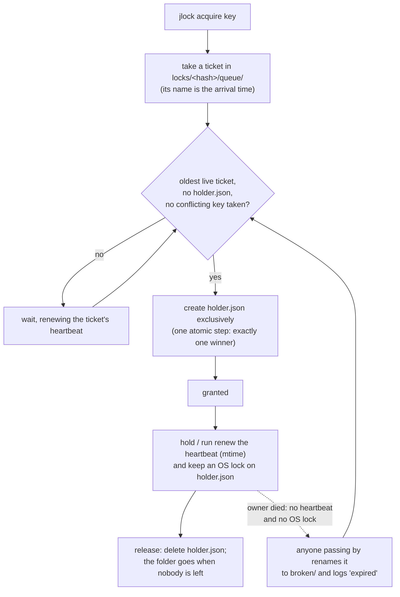

<!-- languages -->
[English](README.md) · [Português (Brasil)](README.pt-BR.md) · [Español](README.es.md) · [Français](README.fr.md) · [Deutsch](README.de.md) · [Italiano](README.it.md) · [简体中文](README.zh-CN.md) · [日本語](README.ja.md) · [Русский](README.ru.md) · [العربية](README.ar.md) · [हिन्दी](README.hi.md)

# jlock

**jlock lets the programs, scripts, people and AI agents on one machine take turns with files, folders and
anything else, without a server.**

## Why jlock exists

jlock started with AI coding agents. Several agents working in the same repository at once kept stepping
on each other: two of them would edit the same file, or one would rewrite a folder while another was
building it. The editing tools they use open a file, write it and close it in milliseconds, so nothing in
the operating system notices a conflict. But the *ownership* an agent needs lasts the whole task: minutes,
across dozens of edits and many short-lived processes. What was missing was a way to say "this file is
mine until I am done", visible to every other agent, that cleans itself up if the agent crashes.

The same need shows up everywhere else: two builds writing the same `dist` folder, two deploys to the same
server, two dev servers wanting port 3000, a nightly script that must not run twice. jlock is one small
command for all of them.

## The problem, precisely

Taking turns sounds simple. Doing it right on one machine, with no server, means solving all of this:

- **Two requests at the same instant.** Reading "is it free?" and then writing "it is mine" are two steps;
  two processes can both read "free". jlock decides with a single atomic operation of the file system.
- **The owner dies.** A crashed process cannot release anything. jlock recovers its locks by itself, and
  writes down that it did.
- **Order of arrival.** Whoever asked first should get it first, not whoever happens to retry at the right
  moment. jlock keeps a real queue.
- **Deadlock.** A holds `x` and waits for `y`; B holds `y` and waits for `x`; both wait forever. jlock sees
  the cycle and refuses the request that would close it.
- **Knowing who has what.** When something is stuck, you need to see who holds it, since when, and who is
  waiting. jlock lists it all, and lets you break a lock in an emergency.

## Why not something that already exists

| Option | What it gives | What is missing |
|---|---|---|
| Windows share modes (open a file exclusively) | the OS refuses other opens | lasts only while the file is open (milliseconds for an editor); blocks your own editor too; no queue, no "who" |
| Windows named mutex | a lock that dies with its process | needs a process holding it the whole time; no fair order; no list |
| `flock(1)` + `lslocks` (Linux) | hold a lock while a command runs; list by PID | not on Windows; no arrival order; no identity beyond a PID (it cannot tell which agent or task holds the file); no deadlock detection; cannot hold across separate commands |
| `proper-lockfile` (npm) | lock folders, stale detection by mtime | no queue (random retries); no CLI; no global list |

**Why the identity matters.** A PID says only which process holds a file, and an agent's processes come and go all the time: every edit, every shell command is a new one. What you need to know is *who* holds the file and *for what*. jlock records that with every lock: `--owner` names the agent or session (`claude:a8ec2aca`), `--group` the task it is working on (`task-42`), `--intent` what it is doing ("T4: refactor the parser"), and `--meta` any extra data (`--meta task=T04`). With that, whoever runs agents in parallel can see which agent and which task holds each file (`jlock list`), give all of a task's files back at once (`jlock release --group task-42`), and hand out tasks that do not touch the same files. Scripts and people benefit too, but it is AI agents working side by side that make this necessary: they edit in milliseconds, keep files for minutes, and nothing else on the machine knows who they are.

## Install

Linux and macOS:

```
curl -fsSL https://raw.githubusercontent.com/rodrigojager/jlock/main/install.sh | sh
```

Windows (PowerShell):

```
irm https://raw.githubusercontent.com/rodrigojager/jlock/main/install.ps1 | iex
```

With Rust: `cargo install jlock`, `cargo binstall jlock` (downloads the release binary), or from the source
code: `cargo install --path .`. Then, in a new terminal, check that everything is in place:

```
jlock doctor
```

## Five minutes

Alice takes a lock on a name. Bob asks for the same one without waiting and is told who has it. Then Alice
gives it back:

<!-- jlock-example -->
```text
$ jlock acquire name:demo --owner alice
granted name:demo
$ jlock acquire name:demo --owner bob --no-wait
busy name:demo held by alice (position 1)
tip: jlock status name:demo shows who holds it and the queue; drop --no-wait to wait your turn
$ jlock release name:demo --owner alice
released name:demo
$ jlock status name:demo
free name:demo
```

Without `--no-wait`, Bob would simply wait in line and get the lock the moment Alice releases it.
`jlock help acquire` explains every option.

## Using it from an agent

An agent (Claude Code, OpenCode, Codex or any other) takes what it is about to change, keeps it while it
works, and gives it back at the end:

1. `jlock acquire src/parser.rs src/lexer.rs --owner agent-7 --group task-42 --intent "T4 parser" --json`
   takes both files or neither, waiting its turn. `--owner` is the agent's identity across commands;
   `--group` ties together everything one task holds.
2. `jlock hold src/parser.rs src/lexer.rs --owner agent-7` in the background keeps the lock alive (it is
   granted at once, since the owner already holds the files). Without it, call `jlock heartbeat` more often
   than every 30 seconds.
3. `jlock release --group task-42 --owner agent-7` at the end; or write the line `release` to `hold`'s
   standard input.
4. If `hold` exits with code 14 (`lost`), someone broke or expired the lock: stop editing.

With `--json`, every command prints one JSON object, the same in every language:

<!-- jlock-example -->
```text
$ jlock acquire name:port-3000 --owner agent-7 --json
{"key":"name:port-3000","keys":["name:port-3000"],"owner":"agent-7","result":"granted","waited_ms":1}
```

## Using it from a script

`jlock run` works like `flock(1)`: it takes the keys, runs the command, keeps the lock alive while the
command runs, releases it at the end, and exits with the command's own exit code.

```
jlock run D:\proj\dist -- cargo build --release      # one build at a time on this machine
jlock run name:deploy-prod --timeout 2m -- ./deploy.sh
```

Here the command is jlock itself, so you can see the lock held while it runs:

<!-- jlock-example -->
```text
$ jlock run name:nightly -- jlock list
KEY           OWNER       GROUP  INTENT  HELD  HEARTBEAT  QUEUE
name:nightly  pid:175424  -      -       26ms  25ms       0

1 lock, 0 waiting
$ jlock list
nothing locked
```

## Using it as a person

- `jlock list --watch` shows everything locked on the machine, redrawn every second.
- `jlock status <key>` shows who holds one key, the queue, and what blocks it.
- `jlock graph` shows who waits for whom.
- `jlock unlock <key> --force --reason "..."` breaks someone else's lock in an emergency; the log keeps who
  did it and why, and the owner's `hold`/`run` stops.

<!-- jlock-example -->
```text
$ jlock acquire name:printer --owner alice --intent "printing the report"
granted name:printer
$ jlock unlock name:printer --force --reason "alice went home"
forced name:printer (was alice)
$ jlock graph
no waiters
```

## How it works

The state is a folder on disk (`%LOCALAPPDATA%\jlock` on Windows, `~/.local/state/jlock` on Linux,
`~/Library/Application Support/jlock` on macOS). Nothing has to stay running, and nothing is lost if any
process crashes.



- **One folder per key**, named by the SHA-1 of the normalized key. `holder.json` exists exactly while the
  key is taken, and says who has it.
- **A ticket per waiter** in `queue/`, named by its arrival time: only the oldest live ticket may take the
  lock, so the order is the order of arrival.
- **Heartbeat**: owners and waiters touch their file every 5 s. A file not touched for 30 s belongs to a
  dead process and is removed by whoever sees it. `hold` and `run` also keep an operating-system lock on
  `holder.json`, which the kernel drops the instant the process dies, so a slow but living owner is never
  taken for dead.
- **Deadlocks**: the files themselves describe who waits for whom; a request that would close a cycle is
  refused, with the chain.
- **Zero leftovers**: with nothing locked, the `locks` folder is empty.

## Guarantees and limits

| jlock guarantees | jlock does not (and why that is fine) |
|---|---|
| one owner per key at any instant | stopping programs that do not use jlock: the locks are advisory, like `flock` |
| strict order of arrival among living waiters | instant hand-over: the next one notices within a quarter of a second |
| a dead owner's lock is recovered within 30 s, and logged | telling dead from frozen for a plain `acquire` (a frozen owner finds `lost` and stops); with `hold`/`run` the OS lock tells them apart |
| deadlocks detected and resolved the same way every time | coordination between different machines |
| the list is always the truth: it is the folder itself | — |
| no process has to stay running | cleanup without any call: leftovers wait for the next command or `jlock gc` |
| an empty `locks` folder when nothing is locked | — |

## Keys

| Key | Meaning | Conflicts with |
|---|---|---|
| a path: `D:\proj\src\a.ts`, `src/a.ts`, `~/notes`, `.` | that file or folder; relative paths start from the current folder; the path does not have to exist | the same path, everything inside it, every folder above it, and `*` |
| `name:<text>` | anything that is not a path: `name:port-3000`, `name:deploy-prod` | the same name, and `*` |
| `*` | everything | every key |

On Windows and macOS the case of letters is ignored (`D:\Proj\SRC` and `d:/proj/src` are the same key).
Several keys in one command are taken all or none, in a fixed order, so they never deadlock each other.

## Exit codes

| Code | Meaning |
|---|---|
| 0 | granted / ok |
| 2 | wrong usage |
| 10 | busy (with `--no-wait`) |
| 11 | timeout (with `--timeout`) |
| 12 | deadlock: the request would close a cycle |
| 13 | not the owner |
| 14 | lock lost (`hold`/`run`) |
| 20 | file system error; the message carries the OS error |
| 130 | interrupted (CTRL+C) while waiting |

`jlock run` exits with the command's own code once the lock is granted.

## Configuration

| Variable | Default | Use |
|---|---|---|
| `JLOCK_HOME` | per system (see above) | where the registry lives |
| `JLOCK_LANG` | the system's language | language of the text output: `en`, `pt-BR`, `es`, `fr`, `de`, `it`, `zh-CN`, `ja`, `ru`, `ar`, `hi` (also `--lang`) |
| `JLOCK_HINTS` | `1` | `0` turns off the tips |
| `JLOCK_HEARTBEAT_MS` | 5000 | how often owners and waiters renew |
| `JLOCK_STALE_MS` | 30000 | no renewal for this long = dead |
| `JLOCK_POLL_MS` | 250 | how often a waiter looks |
| `JLOCK_SWEEP_MS` | 60000 | minimum time between global cleanups |
| `JLOCK_LOG_MAX_BYTES` | 5242880 | size at which `log.jsonl` is rotated |

Commands, options, `--json`, the log and the exit codes are the same in every language.

## Updating

```
jlock update --check   # is there a newer version?
jlock update           # install it
```

`update` downloads the release for your system, checks it against the release's `SHA256SUMS`, replaces the
running executable and runs it once before declaring success. It uses the system's `curl`. It is the only
command that uses the network, and only when you run it.

## Contributing

See [`CONTRIBUTING.md`](CONTRIBUTING.md). The text jlock prints exists in eleven languages, and **reviews of
the wording are welcome in any language, English included**, without knowing Rust. The full command
reference is [`docs/USAGE.md`](docs/USAGE.md); the design is in [`docs/PLAN.md`](docs/PLAN.md) (Portuguese),
the decisions taken while building it in [`docs/DEVIATIONS.md`](docs/DEVIATIONS.md), and what comes next in
[`ROADMAP.md`](ROADMAP.md).

## Author

Rodrigo Jäger — GitHub <https://github.com/rodrigojager> · LinkedIn <https://www.linkedin.com/in/rodrigojager>

## License

MIT, see [`LICENSE`](LICENSE).
