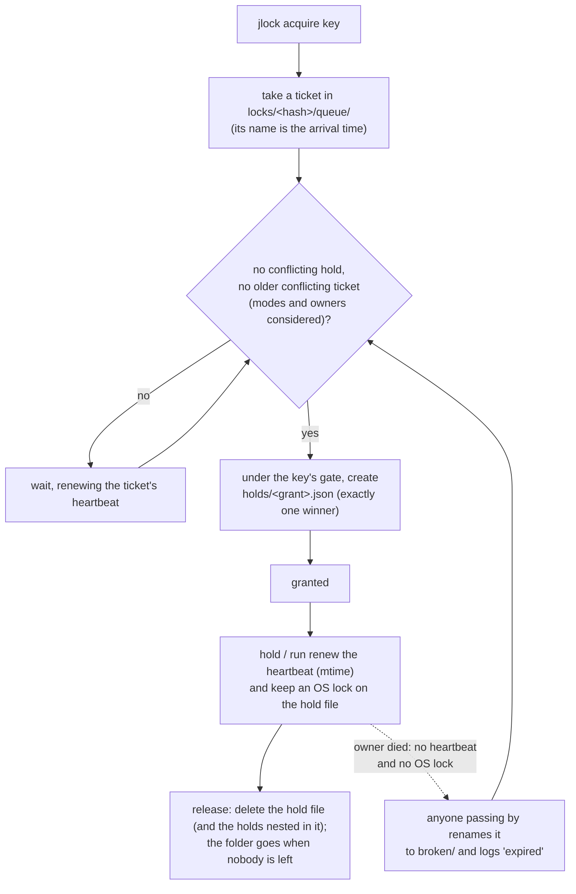

<!-- languages -->
[English](README.md) · [Português (Brasil)](README.pt-BR.md) · [Español](README.es.md) · [Français](README.fr.md) · [Deutsch](README.de.md) · [Italiano](README.it.md) · [简体中文](README.zh-CN.md) · [日本語](README.ja.md) · [Русский](README.ru.md) · [العربية](README.ar.md) · [हिन्दी](README.hi.md)

# jlock

**jlock lets the programs, scripts, people and AI agents on one machine take turns with files, folders and
anything else, without a server.**

## Why jlock exists

jlock started with AI coding agents. Several agents working in the same repository at once kept stepping
on each other: two of them would edit the same file, or one would rewrite a folder while another was
building it. The editing tools they use open a file, write it and close it in milliseconds, so nothing in
the operating system notices a conflict. But the *ownership* an agent needs lasts the whole task: minutes,
across dozens of edits and many short-lived processes. What was missing was a way to say "this file is
mine until I am done", visible to every other agent, that cleans itself up if the agent crashes.

The same need shows up everywhere else: two builds writing the same `dist` folder, two deploys to the same
server, two dev servers wanting port 3000, a nightly script that must not run twice. jlock is one small
command for all of them.

## The problem, precisely

Taking turns sounds simple. Doing it right on one machine, with no server, means solving all of this:

- **Two requests at the same instant.** Reading "is it free?" and then writing "it is mine" are two steps;
  two processes can both read "free". jlock decides with a single atomic operation of the file system.
- **The owner dies.** A crashed process cannot release anything. jlock recovers its locks by itself, and
  writes down that it did.
- **Order of arrival.** Whoever asked first should get it first, not whoever happens to retry at the right
  moment. jlock keeps a real queue.
- **Deadlock.** A holds `x` and waits for `y`; B holds `y` and waits for `x`; both wait forever. jlock sees
  the cycle and refuses the request that would close it.
- **Knowing who has what.** When something is stuck, you need to see who holds it, since when, and who is
  waiting. jlock lists it all, and lets you break a lock in an emergency.
- **Readers and writers.** Many may read a thing at once while nobody writes it. jlock has shared and
  exclusive locks, and a writer waiting its turn is never starved by a stream of readers.
- **A task and the commands it starts.** A task that holds its files must be able to run a command that
  takes them again, without waiting for itself. In jlock owners are paths (`run-1/T04/exec-2`), and a
  task's own family never blocks it.

## Why not something that already exists

| Option | What it gives | What is missing |
|---|---|---|
| Windows share modes (open a file exclusively) | the OS refuses other opens | lasts only while the file is open (milliseconds for an editor); blocks your own editor too; no queue, no "who" |
| Windows named mutex | a lock that dies with its process | needs a process holding it the whole time; no fair order; no list |
| `flock(1)` + `lslocks` (Linux) | hold a lock while a command runs; list by PID | not on Windows; no arrival order; no identity beyond a PID (it cannot tell which agent or task holds the file); no deadlock detection; cannot hold across separate commands |
| `proper-lockfile` (npm) | lock folders, stale detection by mtime | no queue (random retries); no CLI; no global list |

**Why the identity matters.** A PID says only which process holds a file, and an agent's processes come and go all the time: every edit, every shell command is a new one. What you need to know is *who* holds the file and *for what*. jlock records that with every lock: `--owner` names the agent or session (`claude:a8ec2aca`), `--group` the task it is working on (`task-42`), `--intent` what it is doing ("T4: refactor the parser"), and `--meta` any extra data (`--meta task=T04`). With that, whoever runs agents in parallel can see which agent and which task holds each file (`jlock list`), give all of a task's files back at once (`jlock release --group task-42`), and hand out tasks that do not touch the same files. Scripts and people benefit too, but it is AI agents working side by side that make this necessary: they edit in milliseconds, keep files for minutes, and nothing else on the machine knows who they are.

## Install

Linux and macOS:

```
curl -fsSL https://raw.githubusercontent.com/rodrigojager/jlock/main/install.sh | sh
```

Windows (PowerShell):

```
irm https://raw.githubusercontent.com/rodrigojager/jlock/main/install.ps1 | iex
```

With Rust: `cargo install jlock`, `cargo binstall jlock` (downloads the release binary), or from the source
code: `cargo install --path .`. Then, in a new terminal, check that everything is in place:

```
jlock doctor
```

**Teach your AI agent to use it.** The [`skills/`](skills/README.md) folder has a skill for Claude Code,
OpenCode and Codex. It tells the agent when to take a lock, which commands and options to use, and what to
do when a file is taken. One command installs it for your agent; start a new session of the agent
afterwards.

Linux and macOS:

```
# Claude Code
mkdir -p ~/.claude/skills/jlock && curl -fsSL https://raw.githubusercontent.com/rodrigojager/jlock/main/skills/claude-code/jlock/SKILL.md -o ~/.claude/skills/jlock/SKILL.md
# OpenCode
mkdir -p ~/.config/opencode/skills/jlock && curl -fsSL https://raw.githubusercontent.com/rodrigojager/jlock/main/skills/opencode/jlock/SKILL.md -o ~/.config/opencode/skills/jlock/SKILL.md
# Codex
mkdir -p ~/.agents/skills/jlock && curl -fsSL https://raw.githubusercontent.com/rodrigojager/jlock/main/skills/codex/jlock/SKILL.md -o ~/.agents/skills/jlock/SKILL.md
```

Windows (PowerShell):

```
# Claude Code
New-Item -ItemType Directory -Force "$HOME\.claude\skills\jlock" | Out-Null; irm https://raw.githubusercontent.com/rodrigojager/jlock/main/skills/claude-code/jlock/SKILL.md -OutFile "$HOME\.claude\skills\jlock\SKILL.md"
# OpenCode
New-Item -ItemType Directory -Force "$HOME\.config\opencode\skills\jlock" | Out-Null; irm https://raw.githubusercontent.com/rodrigojager/jlock/main/skills/opencode/jlock/SKILL.md -OutFile "$HOME\.config\opencode\skills\jlock\SKILL.md"
# Codex
New-Item -ItemType Directory -Force "$HOME\.agents\skills\jlock" | Out-Null; irm https://raw.githubusercontent.com/rodrigojager/jlock/main/skills/codex/jlock/SKILL.md -OutFile "$HOME\.agents\skills\jlock\SKILL.md"
```

To install a skill for one project only, and other details, see [`skills/README.md`](skills/README.md).

## Five minutes

Alice takes a lock on a name. Bob asks for the same one without waiting and is told who has it. Then Alice
gives it back:

<!-- jlock-example -->
```text
$ jlock acquire name:demo --owner alice
granted name:demo
$ jlock acquire name:demo --owner bob --no-wait
busy name:demo held by alice (position 1)
tip: jlock status name:demo shows who holds it and the queue; drop --no-wait to wait your turn
$ jlock release name:demo --owner alice
released name:demo
$ jlock status name:demo
free name:demo
```

Without `--no-wait`, Bob would simply wait in line and get the lock the moment Alice releases it.
`jlock help acquire` explains every option.

## Using it from an agent

An agent (Claude Code, OpenCode, Codex or any other) takes what it is about to change, keeps it while it
works, and gives it back at the end. That takes two calls:

1. **Take:** `jlock hold src/parser.rs src/lexer.rs --owner agent-7 --group task-42 --intent "T4 parser" --detach`
   takes both files or neither, waiting its turn if someone else has them, answers `granted` and returns.
   A small jlock process stays in the background and keeps the lock alive, so the agent spends no calls,
   and no tokens, on that. `--owner` is the agent's identity across commands; `--group` ties together
   everything one task holds.
2. **Give back:** `jlock release --group task-42 --owner agent-7` when the task is done. The background
   process notices and ends.

Options worth knowing:

- `--no-wait`: do not wait in line. If a file is taken, the answer comes at once (`busy`, exit code 10)
  with who has it, so the agent can pick other work instead of standing still.
- `--timeout 2m`: wait at most this long, then give up (exit code 11).
- `--release-on-eof`: for a program that stays open and runs `hold` in the foreground (without `--detach`),
  keeping its standard input: if the program dies, the pipe closes and the lock is released at once. Short
  calls use `--detach`; a host that stays open uses `--release-on-eof`.
- `--ttl 2h`: a safety limit. The lock goes away by itself after this long, even if the agent never
  releases it.
  For work that may take longer, `jlock renew --owner agent-7` pushes it back without ever letting the
  lock go.
- `--mode shared`: for reading only. Shared locks on a key coexist; an exclusive one (the default) waits
  for them. A single key can say it too: `src/a.ts@shared`.
- Owners are paths: a command the agent starts for task 42 can take the task's files again as
  `--owner agent-7/task-42/build` and is granted at once, nested in the task's lock.

Why not plain `jlock acquire`? A lock taken with `acquire` also outlives the command, but it has to be
renewed (`jlock heartbeat`) at least every 30 seconds, or it is taken for dead and expires. An agent spends
minutes between two commands, so `hold --detach` is the tool for it; `acquire` is for programs that renew
by themselves. If someone breaks the lock (`jlock unlock --force`), the background process ends and
`jlock heartbeat <file> --owner agent-7` answers `lost` (exit code 13): worth checking after a long pause.

The whole cycle, on a name:

<!-- jlock-example -->
```text
$ jlock hold name:port-3000 --owner agent-7 --group task-42 --ttl 2h --detach
granted name:port-3000
$ jlock release --group task-42 --owner agent-7
released name:port-3000
```

With `--json`, every command prints one JSON object, the same in every language:

<!-- jlock-example -->
```text
$ jlock acquire name:port-3000 --owner agent-7 --json
{"key":"name:port-3000","keys":["name:port-3000"],"locks":[{"grant":"1794179300217744-06814","key":"name:port-3000","mode":"exclusive","nested":false,"parent":null}],"mode":"exclusive","owner":"agent-7","result":"granted","waited_ms":5}
```

## Using it from a script

`jlock run` works like `flock(1)`: it takes the keys, runs the command, keeps the lock alive while the
command runs, releases it at the end, and exits with the command's own exit code.

```
jlock run D:\proj\dist -- cargo build --release      # one build at a time on this machine
jlock run name:deploy-prod --timeout 2m -- ./deploy.sh
```

Here the command is jlock itself, so you can see the lock held while it runs:

<!-- jlock-example -->
```text
$ jlock run name:nightly -- jlock list
KEY           MODE       OWNER      GROUP  INTENT  HELD  HEARTBEAT  QUEUE
name:nightly  exclusive  pid:22640  -      -       11ms  11ms       0

1 lock, 0 waiting
$ jlock list
nothing locked
```

## Using it as a person

- `jlock list --watch` shows everything locked on the machine, redrawn every second.
- `jlock status <key>` shows who holds one key, the queue, and what blocks it.
- `jlock graph` shows who waits for whom.
- `jlock unlock <key> --force --reason "..."` breaks someone else's lock in an emergency; the log keeps who
  did it and why, and the owner's `hold`/`run` stops.

<!-- jlock-example -->
```text
$ jlock acquire name:printer --owner alice --intent "printing the report"
granted name:printer
$ jlock unlock name:printer --force --reason "alice went home"
forced name:printer (was alice)
$ jlock graph
no waiters
```

## Sharing, families and resources

Three things go beyond "one owner at a time":

- **Shared locks.** `--mode shared` (or `@shared` after a key) for readers: shared locks of a key coexist,
  an exclusive one waits until they are gone, and a reader that arrives after a waiting writer queues
  behind it. A shared lock on a folder and an exclusive one on a file inside it still conflict.
- **Families of owners.** An owner is a path: `task-7/exec-1` is a child of `task-7`. An owner, its
  ancestors and its descendants never block each other. A key that an ancestor holds (the key itself, a
  folder above it, or `*`) is granted to the child at once, as a *nested* lock that skips the queue and
  ends when the ancestor's lock ends. Siblings and strangers wait as usual.
- **Resources.** `resource:<name>` names something that is not a file: `resource:desktop` (the real mouse,
  keyboard and windows), `resource:clipboard`, `resource:port:8080`, `resource:machine`, and more
  (`jlock resources` lists them; add your own in `resources.json` in the registry folder). A misspelled
  resource is refused with a suggestion instead of silently becoming another lock. To ask for a quiet
  machine (a benchmark, a timing test), take `resource:machine` exclusive; jobs that load the machine
  take it shared. `*` still exists, but it stops every lock of every project: keep it for emergencies.

<!-- jlock-example -->
```text
$ jlock acquire name:db --mode shared --owner reader-1
granted name:db (shared)
$ jlock acquire name:db --mode shared --owner reader-2
granted name:db (shared)
$ jlock acquire name:db --owner writer --no-wait
busy name:db held by reader-1 (shared) and 1 other (position 1)
tip: jlock status name:db shows who holds it and the queue; drop --no-wait to wait your turn
$ jlock acquire name:build --owner task-7
granted name:build
$ jlock acquire name:build --owner task-7/exec-1
granted name:build (nested in task-7)
$ jlock acquire resource:desktp --owner agent-7
jlock: unknown resource 'desktp'; did you mean resource:desktop? (jlock resources lists them)
```

## How it works

The state is a folder on disk (`%LOCALAPPDATA%\jlock` on Windows, `~/.local/state/jlock` on Linux,
`~/Library/Application Support/jlock` on macOS). Nothing has to stay running, and nothing is lost if any
process crashes.



- **One folder per key**, named by the SHA-1 of the normalized key. Each lock on it is one file in
  `holds/` saying who has it, in which mode, and which lock it is nested in. Two requests for the same key
  are decided one after the other under the key's `gate` file, created and deleted in an instant.
- **A ticket per waiter** in `queue/`, named by its arrival time: a waiter goes only when no older
  conflicting ticket is ahead of it, so the order is the order of arrival.
- **Heartbeat**: owners and waiters touch their file every 5 s. A file not touched for 30 s belongs to a
  dead process and is removed by whoever sees it. `hold` and `run` also keep an operating-system lock on
  their hold files, which the kernel drops the instant the process dies, so a slow but living owner is
  never taken for dead.
- **Deadlocks**: the files themselves describe who waits for whom; a request that would close a cycle is
  refused, with the chain.
- **Zero leftovers**: with nothing locked, the `locks` folder is empty.

## Guarantees and limits

| jlock guarantees | jlock does not (and why that is fine) |
|---|---|
| one exclusive owner per key at any instant (or any number of shared ones; an owner's family shares its locks) | stopping programs that do not use jlock: the locks are advisory, like `flock` |
| strict order of arrival among living waiters | instant hand-over: the next one notices within a quarter of a second |
| a dead owner's lock is recovered within 30 s, and logged | telling dead from frozen for a plain `acquire` (a frozen owner finds `lost` and stops); with `hold`/`run` the OS lock tells them apart |
| deadlocks detected and resolved the same way every time | coordination between different machines |
| the list is always the truth: it is the folder itself | — |
| no process has to stay running | cleanup without any call: leftovers wait for the next command or `jlock gc` |
| an empty `locks` folder when nothing is locked | — |

## Keys

| Key | Meaning | Conflicts with |
|---|---|---|
| a path: `D:\proj\src\a.ts`, `src/a.ts`, `~/notes`, `.` | that file or folder; relative paths start from the current folder; the path does not have to exist | the same path, everything inside it, every folder above it, and `*` |
| `name:<text>` | anything else you name yourself: `name:deploy-prod`, `name:nightly` | the same name, and `*` |
| `resource:<name>[:<arg>]` | a registered resource: `resource:desktop`, `resource:port:8080` (`jlock resources`) | the same resource and argument, and `*` |
| `*` | everything (emergencies; for a quiet machine take `resource:machine`) | every key |

On Windows and macOS the case of letters is ignored (`D:\Proj\SRC` and `d:/proj/src` are the same key).
Several keys in one command are taken all or none, in a fixed order, so they never deadlock each other.
A key is taken exclusive unless `--mode shared` or its own `@shared` suffix says otherwise; two locks
conflict only when their keys conflict, at least one is exclusive, and their owners are not of one family.

## Exit codes

| Code | Meaning |
|---|---|
| 0 | granted / ok |
| 2 | wrong usage |
| 10 | busy (with `--no-wait`) |
| 11 | timeout (with `--timeout`) |
| 12 | deadlock: the request would close a cycle |
| 13 | not the owner |
| 14 | lock lost (`hold`/`run`/`renew`) |
| 20 | file system error; the message carries the OS error |
| 130 | interrupted (CTRL+C) while waiting |

`jlock run` exits with the command's own code once the lock is granted.

## Configuration

| Variable | Default | Use |
|---|---|---|
| `JLOCK_HOME` | per system (see above) | where the registry lives |
| `JLOCK_LANG` | the system's language | language of the text output: `en`, `pt-BR`, `es`, `fr`, `de`, `it`, `zh-CN`, `ja`, `ru`, `ar`, `hi` (also `--lang`) |
| `JLOCK_HINTS` | `1` | `0` turns off the tips |
| `JLOCK_HEARTBEAT_MS` | 5000 | how often owners and waiters renew |
| `JLOCK_STALE_MS` | 30000 | no renewal for this long = dead |
| `JLOCK_POLL_MS` | 250 | how often a waiter looks |
| `JLOCK_SWEEP_MS` | 60000 | minimum time between global cleanups |
| `JLOCK_LOG_MAX_BYTES` | 5242880 | size at which `log.jsonl` is rotated |

Commands, options, `--json`, the log and the exit codes are the same in every language.

## Updating

```
jlock update --check   # is there a newer version?
jlock update           # install it
```

`update` downloads the release for your system, checks it against the release's `SHA256SUMS`, replaces the
running executable and runs it once before declaring success. It uses the system's `curl`. It is the only
command that uses the network, and only when you run it.

## Contributing

See [`CONTRIBUTING.md`](CONTRIBUTING.md). The text jlock prints exists in eleven languages, and **reviews of
the wording are welcome in any language, English included**, without knowing Rust. The full command
reference is [`docs/USAGE.md`](docs/USAGE.md); the design is in [`docs/PLAN.md`](docs/PLAN.md) (Portuguese),
the decisions taken while building it in [`docs/DEVIATIONS.md`](docs/DEVIATIONS.md), and what comes next in
[`ROADMAP.md`](ROADMAP.md).

## Author

Rodrigo Jäger — GitHub <https://github.com/rodrigojager> · LinkedIn <https://www.linkedin.com/in/rodrigojager>

## License

MIT, see [`LICENSE`](LICENSE).

## Foreground process safety (0.4)

`jlock exec --timeout 10m -- <command...>` supervises a foreground command without taking a lock.
`jlock run <keys...> --command-timeout 10m -- <command...>` keeps its locks through descendant cleanup.
`run --total-timeout 10m` bounds queue plus payload with one custodian and one budget.
`run --timeout` still limits only the lock queue. A command deadline returns **124**; loss of a lock returns **14**.
Neither outcome automatically retries the command.

On Windows the child starts suspended, enters a private Job Object and only then runs. Descendants are
terminated before returning or releasing locks, even when the wrapper exits first. Closing the supervisor
also closes its kill-on-close job. Containment failure refuses to launch; cleanup failure keeps the locks
and reports `cleanup pending`. Other agents, keepers and unrelated Node/Python processes are never searched
for or signalled. On Unix a private process group covers ordinary descendants; deliberate detachment and
hard supervisor death are outside this guarantee. Docker daemon workloads and remote services are outside
OS process custody: manage those explicitly. Do not launch persistent background services with `run`/`exec`.

The registry, owner families, shared resources, queue fairness and renewal protocol remain compatible with 0.3.
Install to a new versioned directory while old agents run; select it for new sessions and keep their old binary intact.
