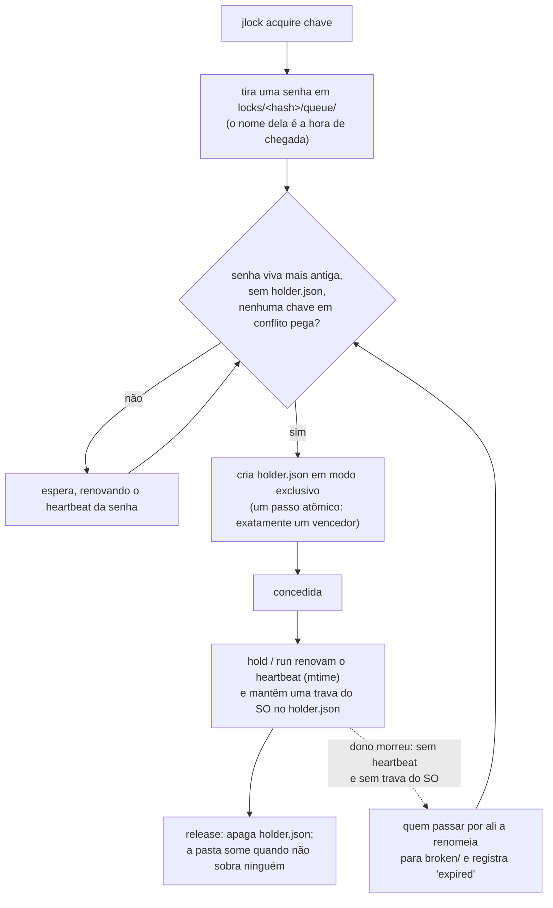

<!-- languages -->
[English](README.md) · [Português (Brasil)](README.pt-BR.md) · [Español](README.es.md) · [Français](README.fr.md) · [Deutsch](README.de.md) · [Italiano](README.it.md) · [简体中文](README.zh-CN.md) · [日本語](README.ja.md) · [Русский](README.ru.md) · [العربية](README.ar.md) · [हिन्दी](README.hi.md)

# jlock

**O jlock faz os programas, scripts, pessoas e agentes de IA de uma mesma máquina se revezarem no uso de
arquivos, pastas e qualquer outra coisa, sem servidor.**

## Por que o jlock existe

O jlock nasceu com os agentes de IA que escrevem código. Vários agentes trabalhando ao mesmo tempo no mesmo
repositório viviam pisando uns nos outros: dois editavam o mesmo arquivo, ou um reescrevia uma pasta enquanto
outro fazia o build dela. As ferramentas de edição que eles usam abrem o arquivo, gravam e fecham em
milissegundos, então nada no sistema operacional percebe o conflito. Mas a *posse* de que um agente precisa
dura a tarefa inteira: minutos, ao longo de dezenas de edições e de muitos processos de vida curta. Faltava um
jeito de dizer "este arquivo é meu até eu terminar", visível para todos os outros agentes, e que se desfizesse
sozinho se o agente quebrasse.

A mesma necessidade aparece em todo lugar: dois builds gravando na mesma pasta `dist`, dois deploys para o
mesmo servidor, dois servidores de desenvolvimento querendo a porta 3000, um script noturno que não pode rodar
duas vezes. O jlock é um único comando pequeno para todos esses casos.

## O problema, com precisão

Revezar parece simples. Fazer isso direito numa máquina só, sem servidor, exige resolver tudo isto:

- **Dois pedidos no mesmo instante.** Ler "está livre?" e depois gravar "é meu" são dois passos; dois
  processos podem ler "livre" ao mesmo tempo. O jlock decide com uma única operação atômica do sistema de
  arquivos.
- **O dono morre.** Um processo que quebrou não consegue liberar nada. O jlock recupera as travas dele
  sozinho, e anota que fez isso.
- **Ordem de chegada.** Quem pediu primeiro deve receber primeiro, e não quem por acaso tenta de novo no
  momento certo. O jlock mantém uma fila de verdade.
- **Deadlock.** A tem `x` e espera por `y`; B tem `y` e espera por `x`; os dois esperam para sempre. O jlock
  enxerga o ciclo e recusa o pedido que o fecharia.
- **Saber quem tem o quê.** Quando algo empaca, você precisa ver quem tem a trava, desde quando, e quem está
  esperando. O jlock lista tudo isso, e deixa você quebrar uma trava numa emergência.

## Por que não algo que já existe

| Opção | O que oferece | O que falta |
|---|---|---|
| Modos de compartilhamento do Windows (abrir um arquivo em modo exclusivo) | o SO recusa outras aberturas | dura só enquanto o arquivo está aberto (milissegundos, para um editor); bloqueia também o seu próprio editor; sem fila, sem "quem" |
| Mutex nomeado do Windows | uma trava que morre com o seu processo | exige um processo segurando-a o tempo todo; sem ordem justa; sem lista |
| `flock(1)` + `lslocks` (Linux) | segura uma trava enquanto um comando roda; lista por PID | não existe no Windows; sem ordem de chegada; nenhuma identidade além do PID (não diz qual agente ou tarefa está com o arquivo); sem detecção de deadlock; não segura entre comandos separados |
| `proper-lockfile` (npm) | trava pastas, detecta travas abandonadas pelo mtime | sem fila (tentativas aleatórias); sem CLI; sem lista global |

**Por que a identidade importa.** Um PID só diz qual processo está com o arquivo, e os processos de um agente nascem e morrem o tempo todo: cada edição, cada comando de shell é um processo novo. O que se precisa saber é *quem* está com o arquivo e *para quê*. O jlock guarda isso em cada trava: `--owner` diz qual agente ou sessão (`claude:a8ec2aca`), `--group` em qual tarefa ele está trabalhando (`tarefa-42`), `--intent` o que está fazendo ("T4: refatorar o parser") e `--meta` qualquer dado a mais (`--meta task=T04`). Com isso, quem coordena agentes em paralelo vê qual agente e qual tarefa estão com cada arquivo (`jlock list`), devolve de uma vez os arquivos de uma tarefa (`jlock release --group tarefa-42`) e distribui tarefas que não mexem nos mesmos arquivos. Scripts e pessoas também ganham com isso, mas são os agentes de IA trabalhando lado a lado que tornam isso necessário: editam em milissegundos, ficam com os arquivos por minutos, e nada mais na máquina sabe quem eles são.

## Instalação

Linux e macOS:

```
curl -fsSL https://raw.githubusercontent.com/rodrigojager/jlock/main/install.sh | sh
```

Windows (PowerShell):

```
irm https://raw.githubusercontent.com/rodrigojager/jlock/main/install.ps1 | iex
```

Com Rust: `cargo install jlock`, `cargo binstall jlock` (baixa o binário do release), ou a partir do código
fonte: `cargo install --path .`. Depois, num terminal novo, confira se está tudo no lugar:

```
jlock doctor
```

**Ensine o seu agente de IA a usar o jlock.** A pasta [`skills/`](skills/README.md) tem uma skill para
Claude Code, OpenCode e Codex. Ela diz ao agente quando pegar uma trava, quais comandos e opções usar e o
que fazer quando um arquivo está ocupado. Um comando instala a skill no seu agente; depois, abra uma sessão
nova do agente.

Linux e macOS:

```
# Claude Code
mkdir -p ~/.claude/skills/jlock && curl -fsSL https://raw.githubusercontent.com/rodrigojager/jlock/main/skills/claude-code/jlock/SKILL.md -o ~/.claude/skills/jlock/SKILL.md
# OpenCode
mkdir -p ~/.config/opencode/skills/jlock && curl -fsSL https://raw.githubusercontent.com/rodrigojager/jlock/main/skills/opencode/jlock/SKILL.md -o ~/.config/opencode/skills/jlock/SKILL.md
# Codex
mkdir -p ~/.agents/skills/jlock && curl -fsSL https://raw.githubusercontent.com/rodrigojager/jlock/main/skills/codex/jlock/SKILL.md -o ~/.agents/skills/jlock/SKILL.md
```

Windows (PowerShell):

```
# Claude Code
New-Item -ItemType Directory -Force "$HOME\.claude\skills\jlock" | Out-Null; irm https://raw.githubusercontent.com/rodrigojager/jlock/main/skills/claude-code/jlock/SKILL.md -OutFile "$HOME\.claude\skills\jlock\SKILL.md"
# OpenCode
New-Item -ItemType Directory -Force "$HOME\.config\opencode\skills\jlock" | Out-Null; irm https://raw.githubusercontent.com/rodrigojager/jlock/main/skills/opencode/jlock/SKILL.md -OutFile "$HOME\.config\opencode\skills\jlock\SKILL.md"
# Codex
New-Item -ItemType Directory -Force "$HOME\.agents\skills\jlock" | Out-Null; irm https://raw.githubusercontent.com/rodrigojager/jlock/main/skills/codex/jlock/SKILL.md -OutFile "$HOME\.agents\skills\jlock\SKILL.md"
```

Para instalar a skill só num projeto, e outros detalhes, veja [`skills/README.md`](skills/README.md).

## Cinco minutos

Alice pega a trava de um nome. Bob pede o mesmo nome sem esperar e fica sabendo quem está com ele. Depois
Alice o devolve:

<!-- jlock-example -->
```text
$ jlock acquire name:demo --owner alice
concedida name:demo
$ jlock acquire name:demo --owner bob --no-wait
ocupada name:demo, com alice (posição 1)
dica: jlock status name:demo mostra quem a tem e a fila; tire o --no-wait para esperar a sua vez
$ jlock release name:demo --owner alice
liberada name:demo
$ jlock status name:demo
livre name:demo
```

Sem `--no-wait`, Bob simplesmente esperaria na fila e receberia a trava no instante em que Alice a liberasse.
`jlock help acquire` explica cada opção.

## Usando a partir de um agente

Um agente (Claude Code, OpenCode, Codex ou qualquer outro) pega o que vai mudar, segura enquanto trabalha
e devolve no fim. São duas chamadas:

1. **Pegar:** `jlock hold src/parser.rs src/lexer.rs --owner agent-7 --group task-42 --intent "T4 parser" --detach`
   pega os dois arquivos ou nenhum, esperando a vez se outro estiver com eles, responde `concedida` e
   volta. Um pequeno processo do jlock fica em segundo plano mantendo a trava viva, então o agente não gasta
   chamadas, nem tokens, com isso. `--owner` é a identidade do agente entre um comando e outro; `--group`
   amarra tudo o que uma tarefa segura.
2. **Devolver:** `jlock release --group task-42 --owner agent-7` quando a tarefa acaba. O processo em
   segundo plano percebe e termina.

Opções que vale conhecer:

- `--no-wait`: não esperar na fila. Se um arquivo está ocupado, a resposta vem na hora (`ocupada`, código
  de saída 10) dizendo quem está com ele, e o agente pode pegar outro trabalho em vez de ficar parado.
- `--timeout 2m`: esperar no máximo esse tempo, depois desistir (código de saída 11).
- `--ttl 2h`: um limite de segurança. A trava some sozinha depois desse tempo, mesmo que o agente nunca a
  devolva.

Por que não o `jlock acquire` puro? Uma trava pega com `acquire` também sobrevive ao comando, mas precisa
ser renovada (`jlock heartbeat`) pelo menos a cada 30 segundos, senão é tida como morta e expira. Um agente
passa minutos entre dois comandos, então o `hold --detach` é a ferramenta dele; o `acquire` é para programas
que renovam sozinhos. Se alguém quebrar a trava (`jlock unlock --force`), o processo em segundo plano
termina e `jlock heartbeat <arquivo> --owner agent-7` responde `perdida` (código de saída 13): vale conferir
depois de uma pausa longa.

O ciclo inteiro, num nome:

<!-- jlock-example -->
```text
$ jlock hold name:port-3000 --owner agent-7 --group task-42 --ttl 2h --detach
concedida name:port-3000
$ jlock release --group task-42 --owner agent-7
liberada name:port-3000
```

Com `--json`, todo comando imprime um objeto JSON, igual em todos os idiomas:

<!-- jlock-example -->
```text
$ jlock acquire name:port-3000 --owner agent-7 --json
{"key":"name:port-3000","keys":["name:port-3000"],"owner":"agent-7","result":"granted","waited_ms":1}
```

## Usando a partir de um script

`jlock run` funciona como o `flock(1)`: pega as chaves, roda o comando, mantém a trava viva enquanto o comando
roda, libera no fim e sai com o código de saída do próprio comando.

```
jlock run D:\proj\dist -- cargo build --release      # um build por vez nesta máquina
jlock run name:deploy-prod --timeout 2m -- ./deploy.sh
```

Aqui o comando é o próprio jlock, então dá para ver a trava segura enquanto ele roda:

<!-- jlock-example -->
```text
$ jlock run name:nightly -- jlock list
CHAVE         DONO        GRUPO  INTENÇÃO  HÁ    HEARTBEAT  FILA
name:nightly  pid:181176  -      -         21ms  21ms       0

1 trava, 0 na fila
$ jlock list
nada travado
```

## Usando como pessoa

- `jlock list --watch` mostra tudo o que está travado na máquina, redesenhado a cada segundo.
- `jlock status <key>` mostra quem tem uma chave, a fila e o que a bloqueia.
- `jlock graph` mostra quem espera por quem.
- `jlock unlock <key> --force --reason "..."` quebra a trava de outra pessoa numa emergência; o log guarda quem
  fez e por quê, e o `hold`/`run` do dono para.

<!-- jlock-example -->
```text
$ jlock acquire name:printer --owner alice --intent "printing the report"
concedida name:printer
$ jlock unlock name:printer --force --reason "alice went home"
forçada name:printer (era de alice)
$ jlock graph
ninguém esperando
```

## Como funciona

O estado é uma pasta no disco (`%LOCALAPPDATA%\jlock` no Windows, `~/.local/state/jlock` no Linux,
`~/Library/Application Support/jlock` no macOS). Nada precisa ficar rodando, e nada se perde se um processo
quebrar.



- **Uma pasta por chave**, com o nome do SHA-1 da chave normalizada. O `holder.json` existe exatamente enquanto
  a chave está pega, e diz quem a tem.
- **Uma senha por esperador** em `queue/`, com o nome da sua hora de chegada: só a senha viva mais antiga pode
  pegar a trava, então a ordem é a ordem de chegada.
- **Heartbeat**: donos e esperadores tocam o seu arquivo a cada 5 s. Um arquivo que não é tocado há 30 s
  pertence a um processo morto e é removido por quem o encontrar. `hold` e `run` também mantêm uma trava do
  sistema operacional no `holder.json`, que o kernel solta no instante em que o processo morre; assim, um dono
  lento mas vivo nunca é tido como morto.
- **Deadlocks**: os próprios arquivos descrevem quem espera por quem; um pedido que fecharia um ciclo é
  recusado, com a cadeia.
- **Zero sobras**: sem nada travado, a pasta `locks` fica vazia.

## Garantias e limites

| O jlock garante | O jlock não faz (e por que tudo bem) |
|---|---|
| um dono por chave a cada instante | impedir programas que não usam o jlock: as travas são consultivas, como as do `flock` |
| ordem estrita de chegada entre os esperadores vivos | passagem instantânea: o próximo percebe em até um quarto de segundo |
| a trava de um dono morto é recuperada em até 30 s, e registrada no log | distinguir morto de congelado num `acquire` simples (um dono congelado encontra `lost` e para); com `hold`/`run`, a trava do SO distingue os dois |
| deadlocks detectados e resolvidos sempre do mesmo jeito | coordenação entre máquinas diferentes |
| a lista é sempre a verdade: ela é a própria pasta | — |
| nenhum processo precisa ficar rodando | limpeza sem nenhuma chamada: as sobras esperam o próximo comando ou o `jlock gc` |
| uma pasta `locks` vazia quando nada está travado | — |

## Chaves

| Chave | Significado | Conflita com |
|---|---|---|
| um caminho: `D:\proj\src\a.ts`, `src/a.ts`, `~/notes`, `.` | aquele arquivo ou pasta; caminhos relativos partem da pasta atual; o caminho não precisa existir | o mesmo caminho, tudo o que está dentro dele, toda pasta acima dele, e `*` |
| `name:<text>` | qualquer coisa que não seja um caminho: `name:port-3000`, `name:deploy-prod` | o mesmo nome, e `*` |
| `*` | tudo | todas as chaves |

No Windows e no macOS, maiúsculas e minúsculas são ignoradas (`D:\Proj\SRC` e `d:/proj/src` são a mesma
chave). Várias chaves num mesmo comando são pegas todas ou nenhuma, numa ordem fixa, então nunca causam
deadlock entre si.

## Códigos de saída

| Código | Significado |
|---|---|
| 0 | concedida / ok |
| 2 | uso incorreto |
| 10 | ocupada (com `--no-wait`) |
| 11 | tempo esgotado (com `--timeout`) |
| 12 | deadlock: o pedido fecharia um ciclo |
| 13 | não é o dono |
| 14 | trava perdida (`hold`/`run`) |
| 20 | erro de sistema de arquivos; a mensagem traz o erro do SO |
| 130 | interrompido (CTRL+C) durante a espera |

`jlock run` sai com o código do próprio comando depois que a trava é concedida.

## Configuração

| Variável | Padrão | Uso |
|---|---|---|
| `JLOCK_HOME` | depende do sistema (veja acima) | onde fica o registro |
| `JLOCK_LANG` | o idioma do sistema | idioma das saídas de texto: `en`, `pt-BR`, `es`, `fr`, `de`, `it`, `zh-CN`, `ja`, `ru`, `ar`, `hi` (também `--lang`) |
| `JLOCK_HINTS` | `1` | `0` desliga as dicas |
| `JLOCK_HEARTBEAT_MS` | 5000 | com que frequência donos e esperadores renovam |
| `JLOCK_STALE_MS` | 30000 | sem renovação por esse tempo = morto |
| `JLOCK_POLL_MS` | 250 | com que frequência quem espera olha de novo |
| `JLOCK_SWEEP_MS` | 60000 | tempo mínimo entre duas varreduras globais |
| `JLOCK_LOG_MAX_BYTES` | 5242880 | tamanho a partir do qual o `log.jsonl` é rotacionado |

Comandos, opções, `--json`, o log e os códigos de saída são iguais em todos os idiomas.

## Atualização

```
jlock update --check   # existe versão mais nova?
jlock update           # instala
```

O `update` baixa o release do seu sistema, confere com o `SHA256SUMS` do release, substitui o executável em
execução e o roda uma vez antes de declarar sucesso. Ele usa o `curl` do sistema. É o único comando que usa a
rede, e só quando você o roda.

## Como contribuir

Veja [`CONTRIBUTING.md`](CONTRIBUTING.md). O texto que o jlock imprime existe em onze idiomas, e **revisões do
texto são bem-vindas em qualquer idioma, inclusive o inglês**, sem precisar saber Rust. A referência completa
dos comandos é [`docs/USAGE.md`](docs/USAGE.md); o projeto completo está em [`docs/PLAN.md`](docs/PLAN.md),
as decisões tomadas durante a construção em [`docs/DEVIATIONS.md`](docs/DEVIATIONS.md), e o que vem a seguir
em [`ROADMAP.md`](ROADMAP.md).

## Autor

Rodrigo Jäger — GitHub <https://github.com/rodrigojager> · LinkedIn <https://www.linkedin.com/in/rodrigojager>

## Licença

MIT, veja [`LICENSE`](LICENSE).
