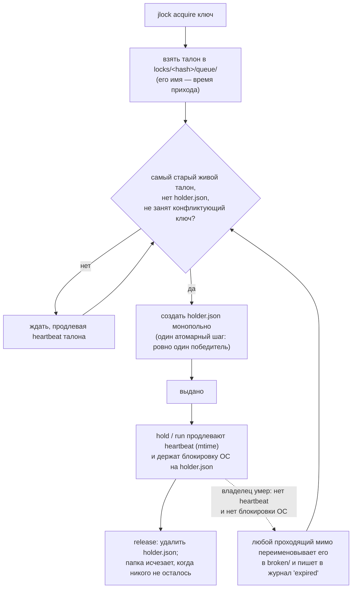

<!-- languages -->
[English](README.md) · [Português (Brasil)](README.pt-BR.md) · [Español](README.es.md) · [Français](README.fr.md) · [Deutsch](README.de.md) · [Italiano](README.it.md) · [简体中文](README.zh-CN.md) · [日本語](README.ja.md) · [Русский](README.ru.md) · [العربية](README.ar.md) · [हिन्दी](README.hi.md)

# jlock

**jlock позволяет программам, скриптам, людям и ИИ-агентам на одной машине по очереди работать с файлами,
папками и чем угодно ещё, без сервера.**

## Зачем нужен jlock

jlock начался с ИИ-агентов, которые пишут код. Несколько агентов, одновременно работающих в одном
репозитории, постоянно мешали друг другу: двое правили один и тот же файл, или один переписывал папку, пока
другой её собирал. Инструменты правки, которыми они пользуются, открывают файл, записывают его и закрывают за
миллисекунды, поэтому операционная система не замечает никакого конфликта. Но *владение*, нужное агенту,
длится всю задачу: минуты, десятки правок и множество короткоживущих процессов. Не хватало способа сказать
«этот файл мой, пока я не закончу» так, чтобы это видели все остальные агенты, и чтобы всё убиралось само,
если агент упадёт.

Та же потребность возникает и повсюду: две сборки пишут в одну и ту же папку `dist`, два деплоя на один и тот
же сервер, два dev-сервера хотят порт 3000, ночной скрипт не должен запуститься дважды. jlock — одна небольшая
команда для всех этих случаев.

## Задача, если точно

Действовать по очереди звучит просто. Сделать это правильно на одной машине и без сервера — значит решить всё
это:

- **Два запроса в одно и то же мгновение.** Прочитать «свободно?», а затем записать «моё» — это два шага; два
  процесса могут оба прочитать «свободно». jlock решает это одной атомарной операцией файловой системы.
- **Владелец умирает.** Упавший процесс ничего не может освободить. jlock сам восстанавливает его блокировки и
  записывает, что сделал это.
- **Порядок прихода.** Получить ресурс первым должен тот, кто первым попросил, а не тот, кому повезло повторить
  попытку в нужный момент. jlock ведёт настоящую очередь.
- **Взаимоблокировка.** A держит `x` и ждёт `y`; B держит `y` и ждёт `x`; оба ждут вечно. jlock видит цикл и
  отклоняет запрос, который замкнул бы его.
- **Знать, у кого что.** Когда что-то зависло, нужно видеть, кто это держит, с какого времени и кто ждёт. jlock
  показывает всё это и позволяет снять блокировку в экстренном случае.

## Почему не что-то уже существующее

| Вариант | Что даёт | Чего не хватает |
|---|---|---|
| Режимы совместного доступа Windows (открыть файл монопольно) | ОС отказывает другим открытиям | действует, только пока файл открыт (миллисекунды для редактора); блокирует и ваш собственный редактор; нет очереди, нет «кто» |
| Именованный мьютекс Windows | блокировка, которая умирает вместе со своим процессом | нужен процесс, держащий её всё время; нет честного порядка; нет списка |
| `flock(1)` + `lslocks` (Linux) | держать блокировку, пока выполняется команда; список по PID | нет в Windows; нет порядка прихода; нет идентичности, кроме PID (не скажет, какой агент или какая задача держит файл); нет обнаружения взаимоблокировок; нельзя держать между отдельными командами |
| `proper-lockfile` (npm) | блокировка папок, обнаружение устаревших по mtime | нет очереди (случайные повторы); нет CLI; нет общего списка |

**Почему важна идентичность.** PID говорит только о том, какой процесс держит файл, а процессы агента постоянно появляются и исчезают: каждая правка, каждая команда оболочки — новый процесс. Знать нужно, *кто* держит файл и *зачем*. jlock записывает это в каждую блокировку: `--owner` называет агента или сессию (`claude:a8ec2aca`), `--group` — задачу, над которой он работает (`task-42`), `--intent` — что именно он делает («T4: рефакторинг парсера»), а `--meta` — любые дополнительные данные (`--meta task=T04`). Благодаря этому тот, кто координирует параллельных агентов, видит, какой агент и какая задача держат каждый файл (`jlock list`), разом возвращает файлы задачи (`jlock release --group task-42`) и раздаёт задачи, которые не трогают одни и те же файлы. Скриптам и людям это тоже полезно, но необходимым это делают ИИ-агенты, работающие бок о бок: они правят файлы за миллисекунды, держат их минутами, и больше ничто на машине не знает, кто они.

## Установка

Linux и macOS:

```
curl -fsSL https://raw.githubusercontent.com/rodrigojager/jlock/main/install.sh | sh
```

Windows (PowerShell):

```
irm https://raw.githubusercontent.com/rodrigojager/jlock/main/install.ps1 | iex
```

С Rust: `cargo install jlock`, `cargo binstall jlock` (скачивает готовый бинарный файл релиза) или из
исходного кода: `cargo install --path .`. Затем в новом терминале проверьте, что всё на месте:

```
jlock doctor
```

**Научите своего ИИ-агента пользоваться jlock.** В папке [`skills/`](skills/README.md) есть навык (skill) для
Claude Code, OpenCode и Codex. Он подсказывает агенту, когда брать блокировку, какие команды и параметры
использовать и что делать, если файл занят. Одна команда устанавливает навык для вашего агента; после этого
начните новую сессию агента.

Linux и macOS:

```
# Claude Code
mkdir -p ~/.claude/skills/jlock && curl -fsSL https://raw.githubusercontent.com/rodrigojager/jlock/main/skills/claude-code/jlock/SKILL.md -o ~/.claude/skills/jlock/SKILL.md
# OpenCode
mkdir -p ~/.config/opencode/skills/jlock && curl -fsSL https://raw.githubusercontent.com/rodrigojager/jlock/main/skills/opencode/jlock/SKILL.md -o ~/.config/opencode/skills/jlock/SKILL.md
# Codex
mkdir -p ~/.agents/skills/jlock && curl -fsSL https://raw.githubusercontent.com/rodrigojager/jlock/main/skills/codex/jlock/SKILL.md -o ~/.agents/skills/jlock/SKILL.md
```

Windows (PowerShell):

```
# Claude Code
New-Item -ItemType Directory -Force "$HOME\.claude\skills\jlock" | Out-Null; irm https://raw.githubusercontent.com/rodrigojager/jlock/main/skills/claude-code/jlock/SKILL.md -OutFile "$HOME\.claude\skills\jlock\SKILL.md"
# OpenCode
New-Item -ItemType Directory -Force "$HOME\.config\opencode\skills\jlock" | Out-Null; irm https://raw.githubusercontent.com/rodrigojager/jlock/main/skills/opencode/jlock/SKILL.md -OutFile "$HOME\.config\opencode\skills\jlock\SKILL.md"
# Codex
New-Item -ItemType Directory -Force "$HOME\.agents\skills\jlock" | Out-Null; irm https://raw.githubusercontent.com/rodrigojager/jlock/main/skills/codex/jlock/SKILL.md -OutFile "$HOME\.agents\skills\jlock\SKILL.md"
```

Как установить навык только для одного проекта, а также другие подробности — см. [`skills/README.md`](skills/README.md).

## Пять минут

Алиса берёт блокировку на имя. Боб просит то же самое без ожидания и узнаёт, у кого оно. Затем Алиса
возвращает его:

<!-- jlock-example -->
```text
$ jlock acquire name:demo --owner alice
выдано name:demo
$ jlock acquire name:demo --owner bob --no-wait
занято name:demo, держатель: alice (позиция 1)
совет: jlock status name:demo показывает, кто его держит, и очередь; уберите --no-wait, чтобы дождаться своей очереди
$ jlock release name:demo --owner alice
освобождено name:demo
$ jlock status name:demo
свободно name:demo
```

Без `--no-wait` Боб просто встал бы в очередь и получил блокировку в тот момент, когда Алиса её освободит.
`jlock help acquire` объясняет каждый параметр.

## Использование из агента

Агент (Claude Code, OpenCode, Codex или любой другой) берёт то, что собирается изменить, держит это, пока
работает, и возвращает в конце. Для этого нужно два вызова:

1. **Взять:** `jlock hold src/parser.rs src/lexer.rs --owner agent-7 --group task-42 --intent "T4 parser" --detach`
   берёт оба файла или ни одного, дожидаясь своей очереди, если их держит кто-то другой, отвечает `granted`
   и возвращается. Небольшой процесс jlock остаётся в фоне и поддерживает блокировку живой, так что агент
   не тратит на это ни вызовов, ни токенов. `--owner` — это идентичность агента во всех командах; `--group`
   связывает воедино всё, что держит одна задача.
2. **Вернуть:** `jlock release --group task-42 --owner agent-7`, когда задача готова. Фоновый процесс
   замечает это и завершается.

Полезные параметры:

- `--no-wait`: не ждать в очереди. Если файл занят, ответ приходит сразу (`busy`, код выхода 10) вместе с
  тем, кто его держит, и агент может взяться за другую работу, а не стоять на месте.
- `--timeout 2m`: ждать не дольше этого времени, затем сдаться (код выхода 11).
- `--release-on-eof`: для программы, которая остаётся открытой и выполняет `hold` на переднем плане (без
  `--detach`), держа его стандартный ввод: если программа умирает, канал закрывается и блокировка сразу
  снимается. Короткие вызовы используют `--detach`; программа, которая остаётся открытой, — `--release-on-eof`.
- `--ttl 2h`: предел безопасности. Блокировка исчезает сама через это время, даже если агент её так и не
  освободил.

Почему не просто `jlock acquire`? Блокировка, взятая через `acquire`, тоже переживает команду, но её нужно
продлевать (`jlock heartbeat`) хотя бы раз в 30 секунд, иначе она считается мёртвой и истекает. Между двумя
командами агента проходят минуты, поэтому для него инструмент — `hold --detach`; `acquire` — для программ,
которые продлевают блокировку сами. Если кто-то снимет блокировку (`jlock unlock --force`), фоновый процесс
завершится, а `jlock heartbeat <file> --owner agent-7` ответит `lost` (код выхода 13): это стоит проверить
после долгой паузы.

Весь цикл на примере имени:

<!-- jlock-example -->
```text
$ jlock hold name:port-3000 --owner agent-7 --group task-42 --ttl 2h --detach
выдано name:port-3000
$ jlock release --group task-42 --owner agent-7
освобождено name:port-3000
```

С `--json` каждая команда печатает один объект JSON, одинаковый на всех языках:

<!-- jlock-example -->
```text
$ jlock acquire name:port-3000 --owner agent-7 --json
{"key":"name:port-3000","keys":["name:port-3000"],"owner":"agent-7","result":"granted","waited_ms":0}
```

## Использование из скрипта

`jlock run` работает как `flock(1)`: берёт ключи, запускает команду, поддерживает блокировку живой, пока
команда выполняется, освобождает её в конце и завершается с кодом выхода самой команды.

```
jlock run D:\proj\dist -- cargo build --release      # одна сборка за раз на этой машине
jlock run name:deploy-prod --timeout 2m -- ./deploy.sh
```

Здесь командой служит сам jlock, поэтому видно, что блокировка удерживается, пока команда выполняется:

<!-- jlock-example -->
```text
$ jlock run name:nightly -- jlock list
КЛЮЧ          ВЛАДЕЛЕЦ    ГРУППА  ЦЕЛЬ  ВРЕМЯ  HEARTBEAT  ОЧЕРЕДЬ
name:nightly  pid:186072  -       -     33ms   32ms       0

1 блокировка, ждут: 0
$ jlock list
ничего не заблокировано
```

## Использование человеком

- `jlock list --watch` показывает всё, что заблокировано на машине, и перерисовывается каждую секунду.
- `jlock status <key>` показывает, кто держит один ключ, очередь и что его блокирует.
- `jlock graph` показывает, кто кого ждёт.
- `jlock unlock <key> --force --reason "..."` снимает чужую блокировку в экстренном случае; журнал сохраняет,
  кто это сделал и почему, а `hold`/`run` владельца останавливается.

<!-- jlock-example -->
```text
$ jlock acquire name:printer --owner alice --intent "printing the report"
выдано name:printer
$ jlock unlock name:printer --force --reason "alice went home"
снято принудительно name:printer (держал alice)
$ jlock graph
никто не ждёт
```

## Как это работает

Состояние — это папка на диске (`%LOCALAPPDATA%\jlock` в Windows, `~/.local/state/jlock` в Linux,
`~/Library/Application Support/jlock` в macOS). Ничему не нужно оставаться запущенным, и ничего не теряется,
если какой-либо процесс упадёт.



- **Одна папка на ключ**, названная по SHA-1 нормализованного ключа. `holder.json` существует ровно то время,
  пока ключ занят, и сообщает, у кого он.
- **Талон на каждого ожидающего** в `queue/`, названный по времени его прихода: взять блокировку может только
  самый старый живой талон, поэтому порядок — это порядок прихода.
- **Heartbeat (сигнал жизни)**: владельцы и ожидающие обновляют свой файл каждые 5 s. Файл, не обновлявшийся
  30 s, принадлежит мёртвому процессу и удаляется тем, кто его заметит. `hold` и `run` также держат блокировку
  операционной системы на `holder.json`, которую ядро снимает в то же мгновение, когда процесс умирает, поэтому
  медленного, но живого владельца никогда не примут за мёртвого.
- **Взаимоблокировки**: сами файлы описывают, кто кого ждёт; запрос, который замкнул бы цикл, отклоняется, и
  печатается цепочка.
- **Никаких остатков**: когда ничего не заблокировано, папка `locks` пуста.

## Гарантии и ограничения

| jlock гарантирует | jlock не делает (и почему это нормально) |
|---|---|
| один владелец на ключ в любой момент | не останавливает программы, которые не используют jlock: блокировки рекомендательные, как `flock` |
| строгий порядок прихода среди живых ожидающих | мгновенную передачу: следующий замечает освобождение в течение четверти секунды |
| блокировка умершего владельца восстанавливается в течение 30 s, и это записывается в журнал | не отличает умершего от зависшего при простом `acquire` (зависший владелец обнаружит `lost` и остановится); с `hold`/`run` их различает блокировка ОС |
| взаимоблокировки обнаруживаются и разрешаются каждый раз одинаково | координацию между разными машинами |
| список всегда правдив: это сама папка | — |
| ни одному процессу не нужно оставаться запущенным | очистку без единого вызова: остатки ждут следующей команды или `jlock gc` |
| пустая папка `locks`, когда ничего не заблокировано | — |

## Ключи

| Ключ | Значение | Конфликтует с |
|---|---|---|
| путь: `D:\proj\src\a.ts`, `src/a.ts`, `~/notes`, `.` | этот файл или папка; относительные пути отсчитываются от текущей папки; путь не обязан существовать | тем же путём, всем, что внутри него, каждой папкой выше него и `*` |
| `name:<text>` | всё, что не является путём: `name:port-3000`, `name:deploy-prod` | тем же именем и `*` |
| `*` | всё | любым ключом |

В Windows и macOS регистр букв не учитывается (`D:\Proj\SRC` и `d:/proj/src` — один и тот же ключ). Несколько
ключей в одной команде берутся все или ни одного, в фиксированном порядке, поэтому они никогда не блокируют
друг друга.

## Коды выхода

| Код | Значение |
|---|---|
| 0 | выдано / ok |
| 2 | неверное использование |
| 10 | занято (с `--no-wait`) |
| 11 | тайм-аут (с `--timeout`) |
| 12 | взаимоблокировка: запрос замкнул бы цикл |
| 13 | не владелец |
| 14 | блокировка потеряна (`hold`/`run`) |
| 20 | ошибка файловой системы; сообщение содержит ошибку ОС |
| 130 | прервано (CTRL+C) во время ожидания |

`jlock run` завершается с кодом самой команды, как только блокировка выдана.

## Настройка

| Переменная | По умолчанию | Назначение |
|---|---|---|
| `JLOCK_HOME` | зависит от системы (см. выше) | где находится реестр |
| `JLOCK_LANG` | язык системы | язык текстового вывода: `en`, `pt-BR`, `es`, `fr`, `de`, `it`, `zh-CN`, `ja`, `ru`, `ar`, `hi` (также `--lang`) |
| `JLOCK_HINTS` | `1` | `0` отключает советы |
| `JLOCK_HEARTBEAT_MS` | 5000 | как часто владельцы и ожидающие продлевают heartbeat |
| `JLOCK_STALE_MS` | 30000 | нет продления столько времени = мёртв |
| `JLOCK_POLL_MS` | 250 | как часто ожидающий проверяет |
| `JLOCK_SWEEP_MS` | 60000 | минимальное время между глобальными очистками |
| `JLOCK_LOG_MAX_BYTES` | 5242880 | размер, при котором `log.jsonl` ротируется |

Команды, параметры, `--json`, журнал и коды выхода одинаковы на всех языках.

## Обновление

```
jlock update --check   # есть ли новая версия?
jlock update           # установить её
```

`update` скачивает релиз для вашей системы, сверяет его с `SHA256SUMS` релиза, заменяет запущенный исполняемый
файл и один раз запускает его, прежде чем объявить успех. Он использует системный `curl`. Это единственная
команда, которая обращается к сети, и только когда вы её запускаете.

## Участие в разработке

См. [`CONTRIBUTING.md`](CONTRIBUTING.md). Текст, который печатает jlock, существует на одиннадцати языках, и
**правки формулировок приветствуются на любом языке, включая английский**, без знания Rust. Полный справочник
по командам — [`docs/USAGE.md`](docs/USAGE.md); устройство описано в [`docs/PLAN.md`](docs/PLAN.md) (на
португальском), решения, принятые по ходу разработки, — в [`docs/DEVIATIONS.md`](docs/DEVIATIONS.md), а что
будет дальше — в [`ROADMAP.md`](ROADMAP.md).

## Автор

Rodrigo Jäger — GitHub <https://github.com/rodrigojager> · LinkedIn <https://www.linkedin.com/in/rodrigojager>

## Лицензия

MIT, см. [`LICENSE`](LICENSE).

<sub>Этот перевод ждёт проверки носителем языка; исправления приветствуются — см. [`CONTRIBUTING.md`](CONTRIBUTING.md).</sub>
