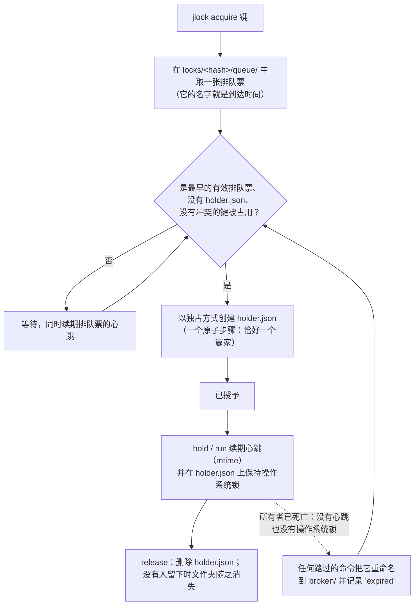

<!-- languages -->
[English](README.md) · [Português (Brasil)](README.pt-BR.md) · [Español](README.es.md) · [Français](README.fr.md) · [Deutsch](README.de.md) · [Italiano](README.it.md) · [简体中文](README.zh-CN.md) · [日本語](README.ja.md) · [Русский](README.ru.md) · [العربية](README.ar.md) · [हिन्दी](README.hi.md)

# jlock

**jlock 让同一台机器上的程序、脚本、人和 AI 智能体轮流使用文件、文件夹以及其他任何资源，无需服务器。**

## 为什么会有 jlock

jlock 起源于 AI 编程智能体。多个智能体同时在同一个仓库里工作时，总是互相干扰：两个智能体会同时编辑同一个文件，或者一个在重写某个文件夹，另一个却正在构建它。它们使用的编辑工具打开文件、写入、关闭，只需几毫秒，因此操作系统根本察觉不到冲突。但智能体需要的*所有权*要持续整个任务：几分钟，跨越几十次编辑和许多短命的进程。缺少的是一种方式，能够声明“这个文件归我，直到我做完”，并且让其他所有智能体都看得到；如果智能体崩溃，它还能自动清理。

同样的需求在别处也随处可见：两个构建写入同一个 `dist` 文件夹，两次部署指向同一台服务器，两个开发服务器都想用 3000 端口，一个每晚运行的脚本绝不能同时跑两次。jlock 是用来应对所有这些情况的一个小命令。

## 问题的准确描述

轮流听起来很简单。但要在一台机器上、没有服务器的情况下把它做对，就必须解决以下所有问题：

- **同一时刻的两个请求。** 先读“它空闲吗？”，再写“它归我了”，这是两步；两个进程可能都读到“空闲”。jlock 用文件系统的一个原子操作来裁决。
- **所有者死亡。** 已崩溃的进程无法释放任何东西。jlock 会自行回收它的锁，并记录下这件事。
- **到达顺序。** 应该是先请求的人先得到，而不是碰巧在合适时刻重试的人。jlock 维护一个真正的队列。
- **死锁。** A 持有 `x` 并等待 `y`；B 持有 `y` 并等待 `x`；两者永远等下去。jlock 能看出这个环，并拒绝会使环闭合的那个请求。
- **知道谁持有什么。** 当某样东西卡住时，你需要看到谁持有它、从何时起、谁在等待。jlock 会把这些全部列出来，并允许你在紧急情况下解除一个锁。

## 为什么不用现成的方案

| 方案 | 它提供什么 | 它缺少什么 |
|---|---|---|
| Windows 共享模式（以独占方式打开文件） | 操作系统拒绝其他打开请求 | 只在文件打开期间有效（对编辑器来说只有几毫秒）；也会挡住你自己的编辑器；没有队列，不知道“是谁” |
| Windows 命名互斥体 | 随进程一起消失的锁 | 需要一个进程全程持有它；没有公平的顺序；没有列表 |
| `flock(1)` + `lslocks`（Linux） | 在命令运行期间持有锁；按 PID 列出 | Windows 上没有；没有到达顺序；除了 PID 之外没有身份（无法知道是哪个智能体或哪个任务持有该文件）；没有死锁检测；无法跨多个独立命令持有 |
| `proper-lockfile`（npm） | 锁住文件夹，按 mtime 检测失效 | 没有队列（随机重试）；没有 CLI；没有全局列表 |

**为什么身份很重要。** PID 只能说明是哪个进程持有文件，而智能体的进程不断产生又消失：每次编辑、每条 shell 命令都是一个新进程。真正需要知道的是*谁*持有文件、*为了什么*。jlock 在每把锁里都记录这些：`--owner` 写明是哪个智能体或会话（`claude:a8ec2aca`），`--group` 写明它正在做的任务（`task-42`），`--intent` 写明它在做什么（"T4: 重构解析器"），`--meta` 记录任何额外数据（`--meta task=T04`）。这样，协调多个并行智能体的一方就能看到每个文件由哪个智能体、哪个任务持有（`jlock list`），一次性归还某个任务的所有文件（`jlock release --group task-42`），并分配不会碰到同一批文件的任务。脚本和人也会受益，但真正让这件事变得必要的，是并肩工作的 AI 智能体：它们几毫秒就完成编辑，却要占用文件好几分钟，而机器上没有别的东西知道它们是谁。

## 安装

Linux 和 macOS：

```
curl -fsSL https://raw.githubusercontent.com/rodrigojager/jlock/main/install.sh | sh
```

Windows（PowerShell）：

```
irm https://raw.githubusercontent.com/rodrigojager/jlock/main/install.ps1 | iex
```

使用 Rust：`cargo install jlock`、`cargo binstall jlock`（下载发布版的二进制文件），或者从源代码安装：`cargo install --path .`。然后在一个新的终端中检查一切是否就绪：

```
jlock doctor
```

**教你的 AI 智能体使用它。** [`skills/`](skills/README.md) 文件夹里有一个适用于 Claude Code、OpenCode 和 Codex 的技能（skill）。它告诉智能体何时获取锁、该用哪些命令和选项，以及文件被占用时该怎么做。一条命令就能为你的智能体安装它；安装后请重新开启一个智能体会话。

Linux 和 macOS：

```
# Claude Code
mkdir -p ~/.claude/skills/jlock && curl -fsSL https://raw.githubusercontent.com/rodrigojager/jlock/main/skills/claude-code/jlock/SKILL.md -o ~/.claude/skills/jlock/SKILL.md
# OpenCode
mkdir -p ~/.config/opencode/skills/jlock && curl -fsSL https://raw.githubusercontent.com/rodrigojager/jlock/main/skills/opencode/jlock/SKILL.md -o ~/.config/opencode/skills/jlock/SKILL.md
# Codex
mkdir -p ~/.agents/skills/jlock && curl -fsSL https://raw.githubusercontent.com/rodrigojager/jlock/main/skills/codex/jlock/SKILL.md -o ~/.agents/skills/jlock/SKILL.md
```

Windows（PowerShell）：

```
# Claude Code
New-Item -ItemType Directory -Force "$HOME\.claude\skills\jlock" | Out-Null; irm https://raw.githubusercontent.com/rodrigojager/jlock/main/skills/claude-code/jlock/SKILL.md -OutFile "$HOME\.claude\skills\jlock\SKILL.md"
# OpenCode
New-Item -ItemType Directory -Force "$HOME\.config\opencode\skills\jlock" | Out-Null; irm https://raw.githubusercontent.com/rodrigojager/jlock/main/skills/opencode/jlock/SKILL.md -OutFile "$HOME\.config\opencode\skills\jlock\SKILL.md"
# Codex
New-Item -ItemType Directory -Force "$HOME\.agents\skills\jlock" | Out-Null; irm https://raw.githubusercontent.com/rodrigojager/jlock/main/skills/codex/jlock/SKILL.md -OutFile "$HOME\.agents\skills\jlock\SKILL.md"
```

如果只想为单个项目安装技能，以及其他细节，请参阅 [`skills/README.md`](skills/README.md)。

## 五分钟上手

Alice 获取一个名称的锁。Bob 不等待地请求同一个名称，得到的回答是谁持有它。然后 Alice 把它归还：

<!-- jlock-example -->
```text
$ jlock acquire name:demo --owner alice
已授予 name:demo
$ jlock acquire name:demo --owner bob --no-wait
忙 name:demo：持有者 alice（位次 1）
提示：jlock status name:demo 显示谁持有它以及队列；去掉 --no-wait 即可排队等候
$ jlock release name:demo --owner alice
已释放 name:demo
$ jlock status name:demo
空闲 name:demo
```

如果不加 `--no-wait`，Bob 只会在队列中等待，并在 Alice 释放的那一刻得到锁。
`jlock help acquire` 会说明每一个选项。

## 在智能体中使用

智能体（Claude Code、OpenCode、Codex 或其他任何智能体）先获取它要修改的东西，在工作期间一直持有，结束时归还。这只需要两次调用：

1. **获取：** `jlock hold src/parser.rs src/lexer.rs --owner agent-7 --group task-42 --intent "T4 parser" --detach`
   要么获取两个文件，要么一个都不获取；如果别人正持有它们，就排队等候，然后回答 `granted` 并返回。一个小小的 jlock 进程留在后台让锁保持有效，因此智能体无需为此花费任何调用，也不花费 token。`--owner` 是智能体跨命令使用的身份；`--group` 把一个任务持有的所有锁归在一起。
2. **归还：** 任务完成后运行 `jlock release --group task-42 --owner agent-7`。后台进程会察觉并结束。

值得了解的选项：

- `--no-wait`：不排队等候。如果某个文件已被占用，会立即得到回答（`busy`，退出码 10）以及谁持有它，这样智能体可以去做别的工作，而不是原地等待。
- `--timeout 2m`：最多等待这么久，然后放弃（退出码 11）。
- `--release-on-eof`：用于保持运行、在前台执行 `hold`（不带 `--detach`）并握住其标准输入的程序：程序一旦死亡，
  管道关闭，锁立刻释放。短调用用 `--detach`；保持运行的宿主用 `--release-on-eof`。
- `--ttl 2h`：安全上限。经过这段时间后锁会自行消失，即使智能体从未释放它。

为什么不直接用 `jlock acquire`？用 `acquire` 获取的锁同样会在命令结束后保留，但必须至少每 30 秒续期一次（`jlock heartbeat`），否则会被视为失效并过期。智能体在两条命令之间往往要花上几分钟，所以 `hold --detach` 才是适合它的工具；`acquire` 适用于能自行续期的程序。如果有人解除了锁（`jlock unlock --force`），后台进程会结束，`jlock heartbeat <file> --owner agent-7` 会回答 `lost`（退出码 13）：长时间停顿后值得检查一下。

在一个名称上完整走一遍：

<!-- jlock-example -->
```text
$ jlock hold name:port-3000 --owner agent-7 --group task-42 --ttl 2h --detach
已授予 name:port-3000
$ jlock release --group task-42 --owner agent-7
已释放 name:port-3000
```

使用 `--json` 时，每个命令都输出一个 JSON 对象，在所有语言下都相同：

<!-- jlock-example -->
```text
$ jlock acquire name:port-3000 --owner agent-7 --json
{"key":"name:port-3000","keys":["name:port-3000"],"owner":"agent-7","result":"granted","waited_ms":1}
```

## 在脚本中使用

`jlock run` 的用法类似 `flock(1)`：它获取键，运行命令，在命令运行期间让锁保持有效，结束时释放，并以该命令自身的退出码退出。

```
jlock run D:\proj\dist -- cargo build --release      # 本机同一时间只运行一个构建
jlock run name:deploy-prod --timeout 2m -- ./deploy.sh
```

这里的命令就是 jlock 本身，所以你可以看到它运行期间锁处于持有状态：

<!-- jlock-example -->
```text
$ jlock run name:nightly -- jlock list
键            所有者      组  用途  时长  心跳  队列
name:nightly  pid:188636  -   -     25ms  24ms  0

1 个锁, 0 个在等待
$ jlock list
没有任何锁
```

## 由人来使用

- `jlock list --watch` 显示本机上被锁住的所有内容，每秒重绘一次。
- `jlock status <key>` 显示某个键由谁持有、队列，以及是什么阻塞了它。
- `jlock graph` 显示谁在等待谁。
- `jlock unlock <key> --force --reason "..."` 在紧急情况下解除别人的锁；日志会记录是谁做的以及原因，所有者的 `hold`/`run` 会停止。

<!-- jlock-example -->
```text
$ jlock acquire name:printer --owner alice --intent "printing the report"
已授予 name:printer
$ jlock unlock name:printer --force --reason "alice went home"
已强制解除 name:printer（原所有者 alice）
$ jlock graph
没有等待者
```

## 工作原理

状态就是磁盘上的一个文件夹（Windows 上是 `%LOCALAPPDATA%\jlock`，Linux 上是 `~/.local/state/jlock`，macOS 上是 `~/Library/Application Support/jlock`）。不需要任何常驻进程，任何进程崩溃也不会丢失任何东西。



- **每个键一个文件夹**，以规范化后的键的 SHA-1 命名。`holder.json` 恰好在键被占用期间存在，并写明由谁持有。
- **每个等待者一张排队票**，放在 `queue/` 中，以其到达时间命名：只有最早的有效排队票才能获取锁，所以顺序就是到达顺序。
- **心跳**：所有者和等待者每 5 s 触碰一次自己的文件。超过 30 s 未被触碰的文件属于已死亡的进程，会被看到它的任何人删除。`hold` 和 `run` 还会在 `holder.json` 上保持一个操作系统锁，进程一死，内核会立即解除它，因此一个缓慢但仍存活的所有者永远不会被误认为已死亡。
- **死锁**：文件本身就描述了谁在等待谁；会使环闭合的请求会被拒绝，并附上那条链。
- **零残留**：没有任何锁时，`locks` 文件夹是空的。

## 保证与限制

| jlock 保证 | jlock 不做的事（以及为什么这没问题） |
|---|---|
| 任一时刻每个键只有一个所有者 | 阻止不使用 jlock 的程序：这些锁是建议性的，就像 `flock` 一样 |
| 在存活的等待者之间严格按到达顺序 | 瞬间交接：下一个会在四分之一秒内察觉 |
| 已死亡所有者的锁会在 30 s 内被回收，并记入日志 | 对普通的 `acquire` 区分已死亡和卡住（卡住的所有者会发现 `lost` 并停止）；使用 `hold`/`run` 时，操作系统锁能区分二者 |
| 每次都以相同方式检测并解决死锁 | 不同机器之间的协调 |
| 列表永远是真实状态：它就是文件夹本身 | — |
| 不需要任何常驻进程 | 不经任何调用的清理：残留会等到下一个命令或 `jlock gc` |
| 没有任何锁时 `locks` 文件夹为空 | — |

## 键

| 键 | 含义 | 与谁冲突 |
|---|---|---|
| 一个路径：`D:\proj\src\a.ts`、`src/a.ts`、`~/notes`、`.` | 那个文件或文件夹；相对路径从当前文件夹开始；路径不必存在 | 相同的路径、其中的所有内容、其上层的每个文件夹，以及 `*` |
| `name:<text>` | 任何不是路径的东西：`name:port-3000`、`name:deploy-prod` | 相同的名称，以及 `*` |
| `*` | 全部 | 所有键 |

在 Windows 和 macOS 上忽略字母大小写（`D:\Proj\SRC` 和 `d:/proj/src` 是同一个键）。一个命令中的多个键要么全部获取、要么一个都不获取，并按固定顺序进行，因此它们之间永远不会互相死锁。

## 退出码

| 退出码 | 含义 |
|---|---|
| 0 | 已授予 / 成功 |
| 2 | 用法错误 |
| 10 | 忙（使用 `--no-wait` 时） |
| 11 | 超时（使用 `--timeout` 时） |
| 12 | 死锁：该请求会使环闭合 |
| 13 | 不是所有者 |
| 14 | 锁已丢失（`hold`/`run`） |
| 20 | 文件系统错误；消息中带有操作系统的错误 |
| 130 | 等待期间被中断（CTRL+C） |

一旦锁被授予，`jlock run` 就以该命令自身的退出码退出。

## 配置

| 变量 | 默认值 | 用途 |
|---|---|---|
| `JLOCK_HOME` | 因系统而异（见上文） | 注册表所在的位置 |
| `JLOCK_LANG` | 系统语言 | 文本输出的语言：`en`、`pt-BR`、`es`、`fr`、`de`、`it`、`zh-CN`、`ja`、`ru`、`ar`、`hi`（也可用 `--lang`） |
| `JLOCK_HINTS` | `1` | `0` 关闭提示 |
| `JLOCK_HEARTBEAT_MS` | 5000 | 所有者和等待者续期的频率 |
| `JLOCK_STALE_MS` | 30000 | 超过这么久没有续期 = 已死亡 |
| `JLOCK_POLL_MS` | 250 | 等待者查看的频率 |
| `JLOCK_SWEEP_MS` | 60000 | 两次全局清扫之间的最短间隔 |
| `JLOCK_LOG_MAX_BYTES` | 5242880 | `log.jsonl` 达到此大小时轮转 |

命令、选项、`--json`、日志和退出码在所有语言下都相同。

## 更新

```
jlock update --check   # 有新版本吗？
jlock update           # 安装它
```

`update` 会下载适用于你系统的发布版，用该发布版的 `SHA256SUMS` 校验它，替换正在运行的可执行文件，并在宣告成功之前运行一次新版本。它使用系统的 `curl`。这是唯一使用网络的命令，并且只在你运行它时才会联网。

## 参与贡献

参见 [`CONTRIBUTING.md`](CONTRIBUTING.md)。jlock 输出的文本有十一种语言版本，**欢迎对任何语言（包括英语）的措辞提出审校意见**，无需懂 Rust。完整的命令参考见 [`docs/USAGE.md`](docs/USAGE.md)；设计见 [`docs/PLAN.md`](docs/PLAN.md)（葡萄牙语），构建过程中做出的决定见 [`docs/DEVIATIONS.md`](docs/DEVIATIONS.md)，接下来的计划见 [`ROADMAP.md`](ROADMAP.md)。

## 作者

Rodrigo Jäger — GitHub <https://github.com/rodrigojager> · LinkedIn <https://www.linkedin.com/in/rodrigojager>

## 许可证

MIT，见 [`LICENSE`](LICENSE)。

<sub>本译文尚待母语者审校，欢迎指正：见 [CONTRIBUTING.md](CONTRIBUTING.md)。</sub>
